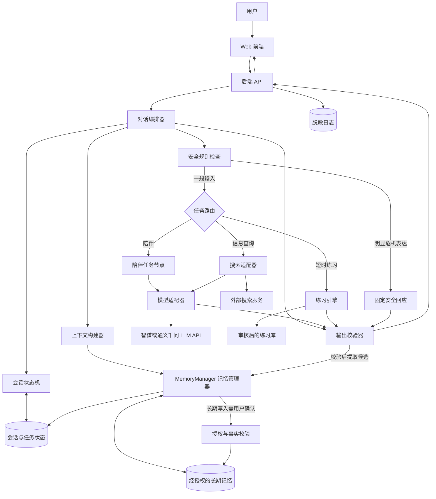
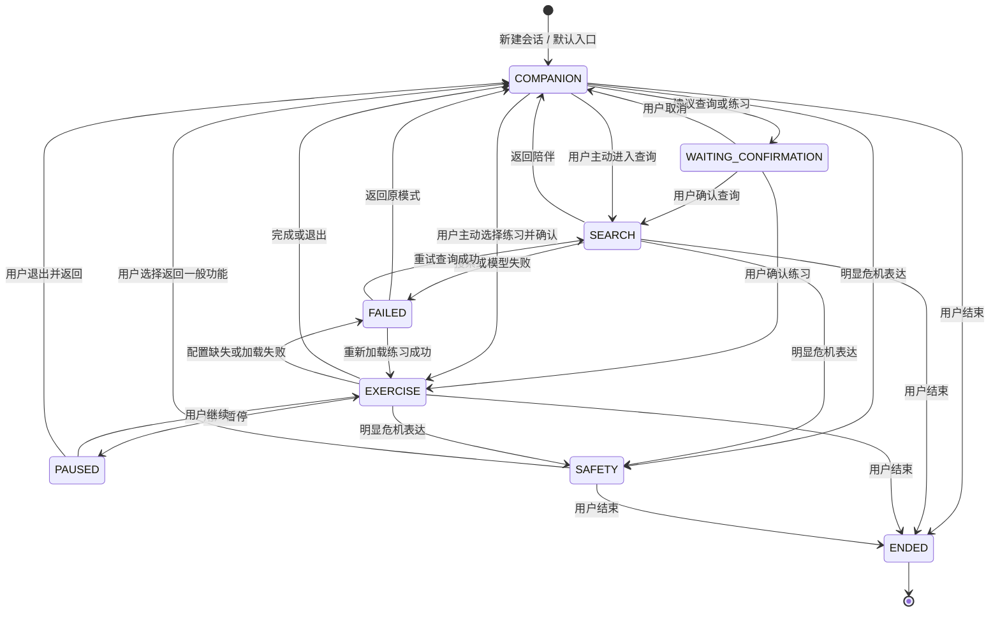
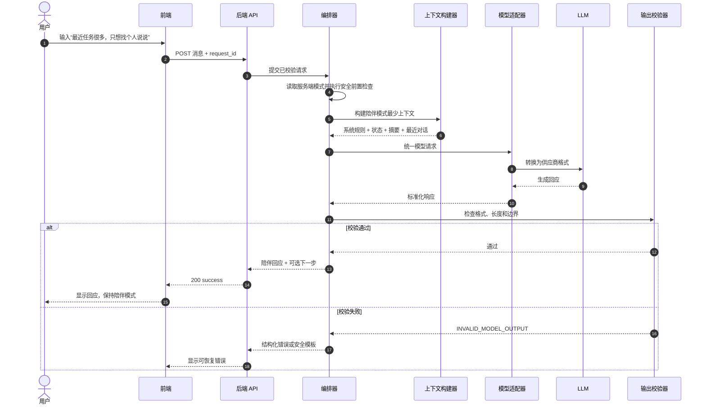
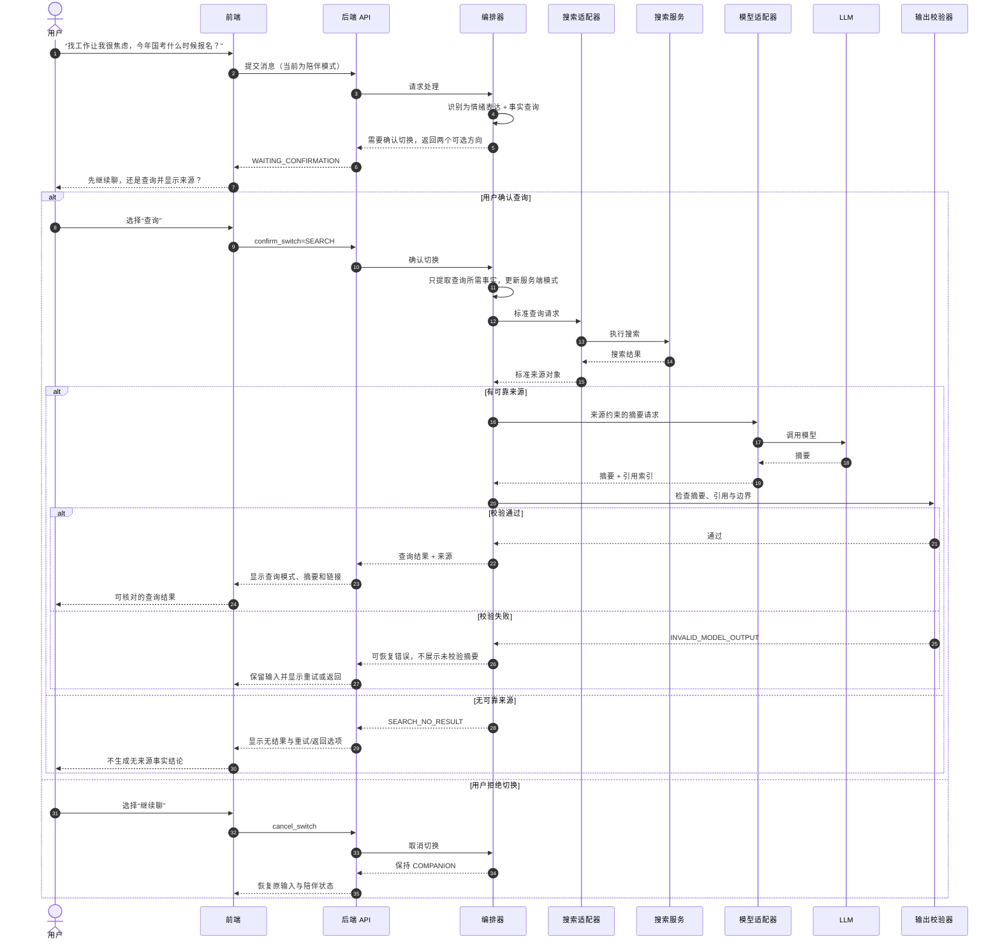
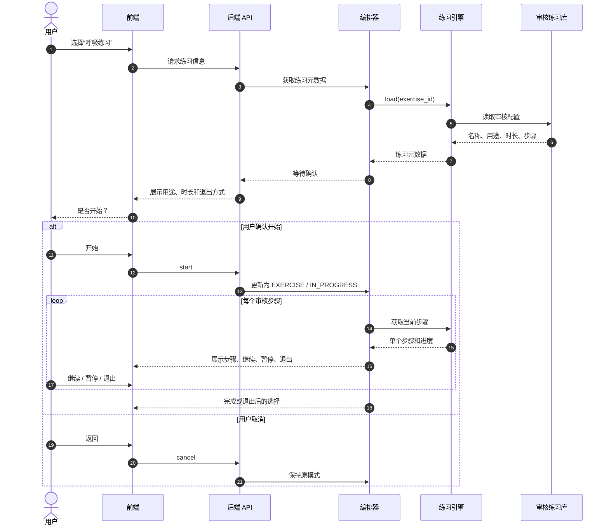
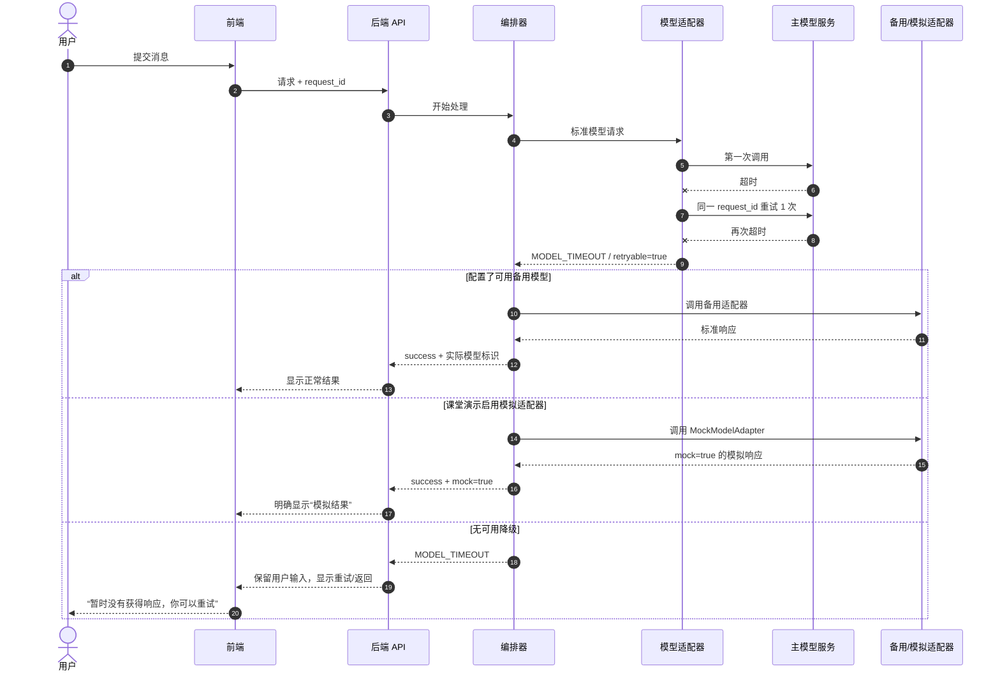
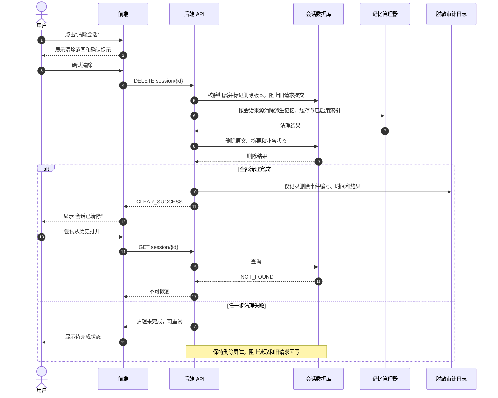
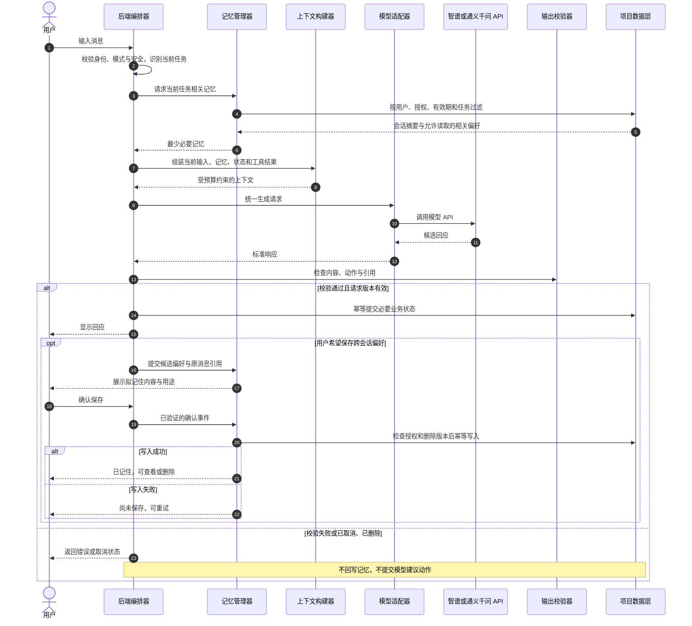

# 404NOTFOUND 智能体编排与时序图

本文为应用层 Agent 的设计图。LLM 通过智谱或通义千问 API 接入；编排器、记忆、业务状态和工具权限由项目实现。任务节点可复用同一个模型，不代表多个独立训练的模型。

## 1. 总体编排架构

### 图示说明

- 前端负责展示，不是业务状态的唯一来源。
- 编排器先执行安全检查，再按当前状态和用户意图路由。
- 陪伴和查询摘要可以调用模型；练习步骤从审核配置中读取。
- 搜索结果先标准化为来源对象，再交给模型生成摘要。
- 所有输出在返回前都经过结构和边界检查。
- 总图表示模块依赖；执行顺序以各时序图为准。读取记忆先检查归属与授权，模型仅接收筛选后的内容，不能直接访问数据库。
- 练习推进、清除和记忆确认由程序处理；不是每个节点都需要调用 LLM。

## 2. 模式状态机

### 状态机约束

1. 系统建议切换时必须经过 `WAITING_CONFIRMATION`。
2. 用户通过明确入口主动进入查询时可直接切换；进入练习仍需展示用途、时长和退出方式并确认开始。
3. `SAFETY` 的优先级高于普通模式，但不显示诊断式风险等级。
4. 所有外部服务错误进入可见的失败状态，禁止无限加载。

## 3. 陪伴交流正常时序

## 4. 混合意图与查询切换时序

## 5. 短时练习时序

## 6. 模型异常与降级时序

## 7. 会话清除时序

## 8. 图与需求的对应关系

| 图 | 主要对应需求 |
|---|---|
| 总体编排架构 | FR-C01～FR-C05、FR-E01～FR-E05、FR-M01～FR-M05 |
| 模式状态机 | FR-E01～FR-E04、FR-M01～FR-M05 |
| 陪伴正常时序 | FR-C01、FR-C02、FR-C03 |
| 混合意图与查询切换 | FR-M02、FR-M03、FR-M04、FR-M05 |
| 短时练习时序 | FR-E01～FR-E05 |
| 模型异常与降级 | FR-M05 |
| 会话清除 | FR-C05 |

原需求文件未包含在本目录，以上编号沿用初稿，待与需求原文核对。以下记忆设计是本次新增细化，不编造既有需求编号。

## 9. 记忆读取与确认写入时序

该流程的持久化数据在项目侧；替换 LLM 供应商时，状态和已授权记忆无需依赖原供应商的聊天记录迁移。
