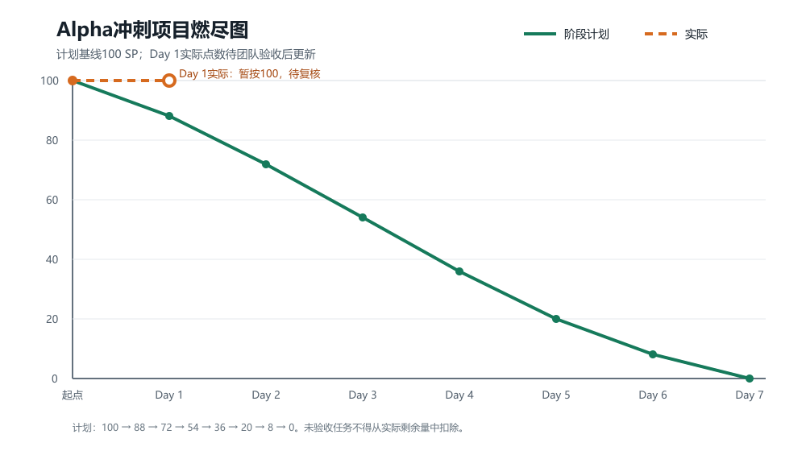
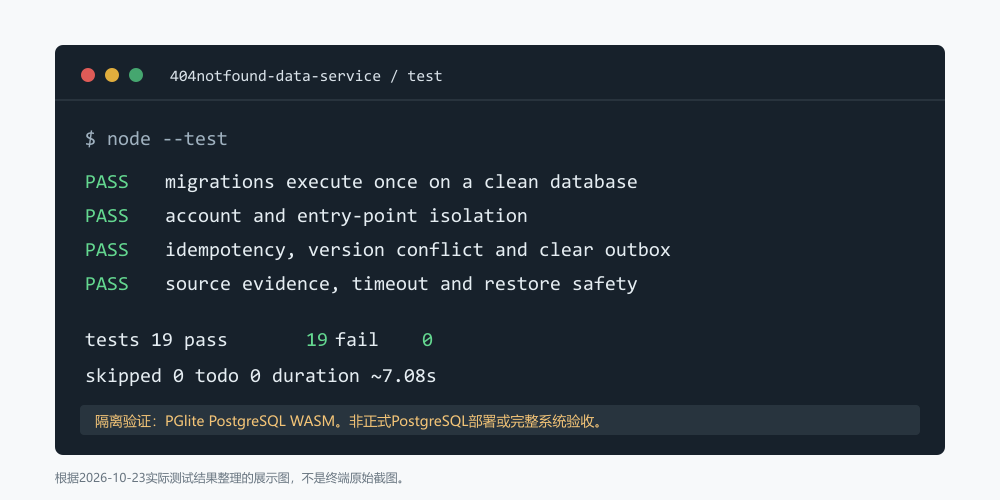

# 404烦恼未找到｜Alpha冲刺Day 1

| 这个作业属于哪个课程 | [2601_FZU_SE](https://bbs.csdn.net/forums/2601_CS_SE_FZU) |
|---|---|
| 这个作业要求在哪里 | [团队第四次作业-站立式会议+α冲刺](https://bbs.csdn.net/topics/620563653) |
| 这个作业的目标 | 记录Alpha冲刺第一天的真实站会、成员进展、困难、明日安排、燃尽情况、运行结果和AI技术员工作 |
| 其他参考文献 | 《构建之法》、PostgreSQL 16、React、Vite、Express、Zod、node-postgres、LangChain JS |

> 团队：404烦恼未找到  
> 日期：2026年10月23日，北京时间  
> 冲刺阶段：Day 1 / 7  
> 作业截止：2026年10月29日23:59  
> 发布提醒：博客发布后需要审核，应提前发布并在作业页面提交链接。

## 一、今日站立式会议

| 项目 | 内容 |
|---|---|
| 会议时间 | 【填写真实开始和结束时间】 |
| 会议地点/方式 | 【填写真实地点或线上方式】 |
| 参与成员 | 【按实际到会情况填写】 |
| 缺席成员及原因 | 【无则填写“无”】 |
| 会议记录人 | 【填写】 |
| 照片拍摄与核对 | 曾俊涛拍摄，张王昊核对；按实际情况修改 |

### 当天真实会议照片

> 【必须上传10月23日当天的真实非摆拍会议照片。不得复用其他日期照片，可以遮挡面部保护隐私。】


## 二、项目燃尽图

当前计划基线为100 SP，Day 1阶段计划剩余88 SP。实际剩余量只能按非作者复核通过的任务扣减。



| 节点 | 阶段计划剩余 | 实际剩余 | 说明 |
|---|---:|---:|---|
| 冲刺起点 | 100 | 100 | 初始基线 |
| Day 1结束 | 88 | 【填写】 | 未复核任务不能扣点；当前庄剀涵1.5 SP仍待非作者复核 |

> 发布到CSDN时应上传 `assets/day1-burndown.png` 并替换为平台图片链接。若团队完成了当日验收，应根据任务板更新实际点数和图，不得直接复制计划值。

## 三、最新程序/模块运行展示

### 数据服务自动化测试



2026年10月23日实际运行结果：

```text
tests 19
pass 19
fail 0
cancelled 0
skipped 0
todo 0
duration 约7.08秒
```

该测试在PGlite隔离PostgreSQL引擎中执行，不代表正式PostgreSQL服务器、完整前后端或生产部署已经通过。发布博客时建议同时上传真实终端运行截图；上图是根据实际结果整理的展示图，不是终端原始截图。

### 其他模块运行图片/GIF/视频

> 【程杰、郭昱祺、李泉毅、程群等模块负责人提交当日真实版本的运行图片/GIF/视频。没有真实运行结果时写明失败或阻塞，不能使用设计稿冒充运行截图。】

## 四、成员进展、问题、明日安排和心得

| 成员 | 从冲刺开始到现在的真实进展 | 问题/困难 | 到明日站会前的安排 | 心得体会 | 证据 |
|---|---|---|---|---|---|
| 张王昊 | 【本人填写；计划包括现状核对、范围、任务板、计划博客】 | 【本人填写】 | 【本人填写】 | 【本人填写】 | 【Issue/文档/截图】 |
| 郭昱祺 | 【本人填写；计划包括登录、主页、聊天、来源展示状态梳理】 | 【本人填写】 | 【本人填写】 | 【本人填写】 | 【设计提交/截图】 |
| 程杰 | 【本人填写；计划包括启动React原型、API适配层、模拟项和REQ14独立状态】 | 【本人填写】 | 【本人填写】 | 【本人填写】 | 【代码签入+Issue】 |
| 李泉毅 | 【本人填写；计划包括Express骨架、统一错误、Zod契约和认证资料API核对】 | 【本人填写】 | 【本人填写】 | 【本人填写】 | 【代码签入+Issue】 |
| 程群 | 【本人填写；计划包括模型配置、LangChain适配、合成输入和失败替身】 | 【本人填写】 | 【本人填写】 | 【本人填写】 | 【代码签入/调用记录】 |
| 庄剀涵 | 核对仓库实际状态；在隔离PostgreSQL引擎执行DDL并修正不必要的pgcrypto依赖；建立001/002迁移、迁移校验和、数据服务基础和检索契约；完整自动化测试19项通过；两次真实Wikipedia请求分别超时和服务不可用 | 本机没有PostgreSQL服务、psql或Docker；真实Wikipedia网络不可用；认证、密钥和正式环境未接入 | 复跑账号、会话、资料和主动保存仓储；检查事务、唯一性、幂等及账号/入口隔离；邀请非作者复核 | 静态设计不能代替实际执行；每个“通过”都必须绑定环境、命令和结果 | `backend/`、测试报告；代码签入和Issue链接待填写 |
| 关欣 | 【本人填写；计划包括密钥、日志、Cookie/CSRF、正文外发和越权检查项】 | 【本人填写】 | 【本人填写】 | 【本人填写】 | 【审查记录/截图】 |
| 曾俊涛 | 【本人填写；计划包括构建测试流程、干净环境启动和测试计划】 | 【本人填写】 | 【本人填写】 | 【本人填写】 | 【测试报告/截图】 |

> 表格中的“计划包括”仅用于提醒成员，不代表成员已经完成。发布前必须由每名成员替换为当天真实结果。

## 五、代码签入、Issue和非开发证据

作业要求开发工作必须有代码签入，并提供对应Issue内容和链接或图片；测试、设计和安全工作必须提供具体结果。

| 成员/任务 | 证据类型 | 提交号/Issue/链接 | 状态 |
|---|---|---|---|
| 庄剀涵：迁移、仓储和检索基础 | 代码签入+Issue | 【当前尚未提供，发布前填写；没有签入时必须如实写“未提交”】 | 待补 |
| 程杰：前端原型与API适配 | 代码签入+Issue | 【填写】 | 待补 |
| 李泉毅：后端骨架与契约 | 代码签入+Issue | 【填写】 | 待补 |
| 程群：AI适配 | 代码签入/调用记录 | 【填写】 | 待补 |
| 郭昱祺：设计与页面状态 | 设计提交/截图 | 【填写】 | 待补 |
| 关欣：安全审查 | 检查清单/问题单 | 【填写】 | 待补 |
| 曾俊涛：测试与构建 | 测试报告/运行截图 | 【填写】 | 待补 |
| 张王昊：范围与任务板 | 任务板/计划博客 | 【填写】 | 待补 |

## 六、AI技术员工作情况

| 项目 | 今日实际情况 |
|---|---|
| AI角色 | 辅助程序员、测试员和文档整理员；不替代8名成员责任 |
| 输入约束 | 以需求v0.3、接口规范、数据库设计和“不把原型描述为生产系统”为边界 |
| 实际用途 | 辅助生成迁移执行器、Repository草稿、测试用例、每日材料和交接文档 |
| 人工修正 | 根据真实SQL错误移除不必要扩展依赖；检查账号/入口条件、事务、幂等和版本锁 |
| 验证方式 | 使用隔离PostgreSQL引擎和Node自动化测试验证，19项通过 |
| 失败/局限 | 不能提供正式数据库、真实网络成功、站会照片、代码签入、非作者评审或跨成员联调证据 |
| 成效 | 提高了数据层实现和测试准备效率；最终结论仍由成员根据运行证据确认 |

其他成员使用AI的原始记录：【由各成员填写提示约束、输出用途、人工修改、采用/未采用及失败情况】。

## 七、今日问题与风险

| 问题/风险 | 影响 | 处理情况 | 负责人/协作人 |
|---|---|---|---|
| 正式PostgreSQL环境不可用 | 无法形成正式服务器迁移和备份证据 | 使用PGlite隔离验证，正式环境继续列阻塞 | 庄剀涵、曾俊涛 |
| Wikipedia真实调用失败 | 真实检索尚未验收 | 保留TIMEOUT和SERVICE_UNAVAILABLE结果，Day 3复查 | 庄剀涵、程群 |
| 认证、CSRF和许可未接入 | 不能开放记录HTTP端点 | 仓储不接受客户端自报身份，等待应用服务联调 | 李泉毅、庄剀涵、关欣 |
| 真实站会照片和成员证据尚未汇总 | 当日博客可能扣分 | 21:00前收齐，张王昊发布前核对 | 全体成员 |

## 八、明日重点

1. 注册、会话、资料和保存仓储复跑与联调。
2. 重复账号、无效会话、事务回滚和资料版本冲突测试。
3. 主动保存幂等及账号A/B、不同入口隔离测试。
4. 登录/注册和个人主页页面与后端契约对齐。
5. 更新实际燃尽点数和缺陷状态。

## 九、Day 1验收结论

| 检查项 | 当前结论 |
|---|---|
| 冲刺前代码规范、任务和计划博客 | 【张王昊填写链接和发布时间，必须早于开发启动】 |
| 环境能启动 | 数据服务测试环境可运行；正式PostgreSQL未启动 |
| 真实/模拟/未实现状态标识 | 数据材料已区分；其他模块待负责人核对 |
| 接口和迁移执行记录 | 庄剀涵部分已有隔离执行记录 |
| 当天真实站会照片 | 【待上传】 |
| 项目燃尽图 | 模板已生成；实际剩余点数待团队验收后填写 |
| 最新运行图片/GIF/视频 | 数据服务摘要图已生成；其他模块待上传 |
| 8名成员进展/问题/安排/心得 | 庄剀涵已填写；其他7名成员待本人填写 |
| 开发签入与Issue | 【待全员补齐】 |
| AI技术员工作 | 已单列庄剀涵相关记录；其他成员AI记录待补 |

## 十、发布前检查

- [ ] 已上传当天真实站会照片，且未与其他日期复用。
- [ ] 已上传燃尽图，并填写实际剩余点数和偏差说明。
- [ ] 已上传当天真实运行图片/GIF/视频。
- [ ] 8名成员均填写进展、困难、明日安排和心得。
- [ ] 每项开发工作都有代码签入、对应Issue和链接/图片。
- [ ] 测试、设计、安全工作都有结果或报告证据。
- [ ] AI技术员工作已单列，包含输入约束、用途、人工修改、成效与失败。
- [ ] 博客开头四项格式和链接正确。
- [ ] 置顶集合随笔已加入本篇链接。
- [ ] 博客发布后已在班级作业页面提交链接；若审核显示404，仍在deadline前先提交链接。
- [ ] 未填写的模板文字已经删除，没有把计划、原型或隔离验证写成完整系统成果。

> 当前模板仍缺少真实会议照片、7名成员当日材料、团队实际燃尽点数、运行展示和代码签入链接。在这些必填项补齐前，不应作为“已完成博客”提交占位，否则可能被认定为伪造提交。
