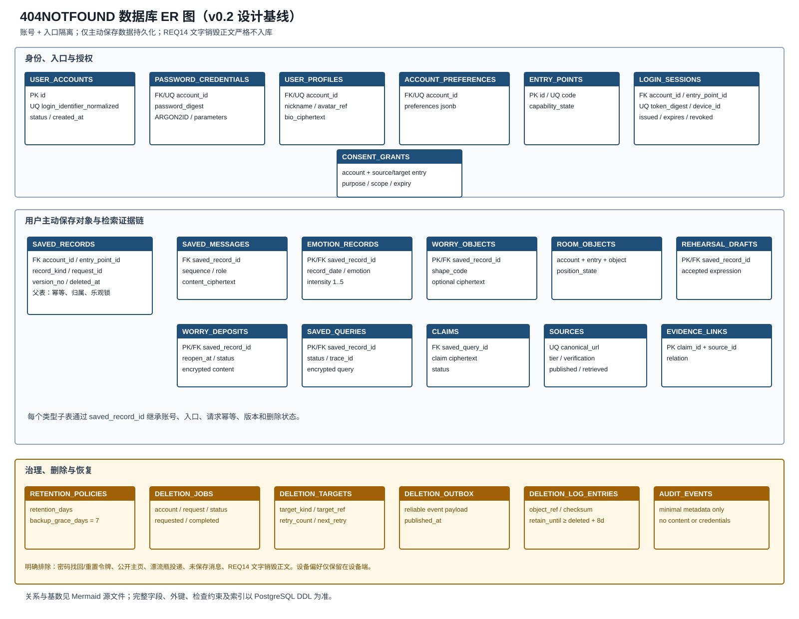

# 404烦恼未找到——数据库设计说明书（庄剀涵修订稿）

**版本**：v0.2（2026-10-20）
**主责**：庄剀涵（102400435，搜索 / 数据工程）
**文档状态**：已完成跨文档交叉评审的设计修订稿，未宣称已部署或已执行运行测试
**关联课程要求**：[团队第三次作业——概要设计与数据库设计](https://bbs.csdn.net/topics/620554714)

## 0. 阅读说明与范围冻结

### 0.1 本文回答的问题

本文为数据库设计说明书源稿，覆盖概念模型、逻辑模型、物理设计、访问规则、数据生命周期、备份恢复、信息检索契约和验收准备。它服务于课程要求中的“ER 分析 + 表结构设计、接口设计”，不等同于已经开发完成的数据库。

### 0.2 指令与历史材料的冲突处理

本次八人分工、`docs/需求范围_v0.3.md`、张王昊 2026-10-19 技术决策和李泉毅设计类图/接口目录共同构成本版基线。历史材料与当前基线的差异如下：

| 事项 | 本次分工文档的约束 | v0.3 历史材料 | 本文处理 |
|---|---|---|---|
| 需求编号 | REQ01～REQ17 | 曾写成 REQ01～REQ18 或使用旧编号 | 统一为 REQ13 屏幕发泄、REQ14 文字销毁、REQ15 弹珠机、REQ16 注册登录、REQ17 私密个人主页 |
| 模块数量 | 六个模块 | 曾写成七个模块 | 以六模块为验收口径；账号与资料合并到“账号与个人中心” |
| 密码找回/重置 | 不重新加入 | v0.3 曾列入登录子功能 | 不建找回凭据、重置令牌或恢复渠道表 |
| 烦恼漂流瓶 | 不重新加入 | 旧稿曾列为独立需求 | 不建投递/公开内容表；REQ13 已统一为屏幕无损发泄 |
| 公开主页/账号注销 | 不重新加入 | v0.3 曾列入目标 | 仅保留私密资料；不建公开视图和注销流程 |
| 自动跨端同步 | 禁止 | 历史稿仅允许明确授权 | 默认隔离，跨端仅由 `consent_grants` 显式授权 |

当前范围已经冻结为 17 项需求、六个模块。后续若变更范围，必须新增版本记录和迁移评估，不直接修改已冻结编号。

### 0.3 已确定技术基线

| 决策项 | 已确定方案 | 依据 | 影响 |
|---|---|---|---|
| 关系数据库 | 服务端 PostgreSQL；DDL 使用 PostgreSQL 16 兼容语法 | 技术决策 D06 | 使用 `uuid`、`timestamptz`、`jsonb`、事务和约束 |
| 数据访问 | Node.js 应用服务通过 `pg`、Repository 和 SQL 迁移访问 | 技术决策 D05/D13 | 客户端不得直连数据库；事务使用同一连接 |
| 部署边界 | 本机开发；交付目标为同源 Web/API + 私网 PostgreSQL | 技术决策 D07 | 数据库只对应用服务开放；云资源未配置前不称已部署 |
| 认证 | Argon2id 密码摘要；随机会话凭据仅安全传输，数据库只存 SHA-256 摘要 | 技术决策 D09/D13 | 登录会话可撤销；Web 使用安全 Cookie、CSRF 和 Origin 校验 |
| 敏感正文 | 应用层加密后以 `bytea` 保存；密钥/轮换配置置于受控服务环境，不入仓库和数据库 | 安全与数据最小化基线 | 支持正文最小暴露、轮换和删除传播 |
| 检索索引 | 首版仅保存用户主动保存的查询、主张和来源；全文/向量索引不在本次基线 | 默认临时、主动保存原则 | 文字销毁和临时查询不进入索引 |
| 时间与备份 | 时间点按 UTC 保存；日历日期按用户时区解释；加密备份保留 7 天，独立清除日志至少保留 8 天 | 技术决策 D08、接口规范 §20 | 恢复前必须重放清除日志并撤销旧登录会话 |

本文其余章节按上述基线展开，所有“已设计”均表示可审查的设计结论，不表示运行环境已存在。

## 1. 设计目标与原则

1. **默认临时**：陪伴、训练、排练、互动和文字销毁的运行态只在端侧或服务内存中存在，未主动保存不写业务持久表。
2. **主动保存分域**：会话、情绪记录、物件、认可表达、寄存和已保存查询分别保存，授权一类不推导另一类。
3. **账号 + 入口隔离**：所有可回看的业务对象通过 `saved_records.account_id` 和 `entry_point_id` 确定归属；跨端访问必须有用途明确、可撤回的授权。
4. **最小化检索**：检索适配器只接收规范化问题及必要约束；原始会话正文不自动进入搜索、模型、日志或分析。
5. **可追踪删除**：清除不仅删除主行，还跟踪缓存、搜索索引、派生摘要和备份延迟；部分失败可重试。
6. **不可伪造状态**：保存、删除、查询空结果/超时/冲突和寄存到期均有独立状态，不以空列表或成功提示掩盖失败。
7. **文字销毁零持久化**：REQ14 的正文不建表、不建接口存储字段、不进入数据库备份、检索索引、日志和遥测。

## 2. 范围、数据分类与模块映射

### 2.1 六模块与数据库对象

| 模块 | 需求 | 主要数据对象 | 持久化边界 |
|---|---|---|---|
| 账号与个人中心 | REQ16、REQ17 | `user_accounts`、`password_credentials`、`login_sessions`、`user_profiles`、`account_preferences`、`entry_points` | 凭据只存摘要；资料仅本人可见；不含找回/公开主页 |
| 陪伴与沟通 | REQ01、REQ09、REQ11 | `saved_records`、`saved_messages`、`rehearsal_drafts` | 普通聊天/排练默认临时；只保存选定消息或认可表达 |
| 记录与整理 | REQ08、REQ10、REQ12 | `emotion_records`、`worry_objects`、`rooms`、`room_objects`、`worry_deposits` | 分别授权；房间按账号+入口聚合物件外观；寄存到期只变状态 |
| 压力缓解 | REQ02、REQ13～REQ15 | 无持久业务正文；仅允许不含正文的最小 `audit_events` | 运行态端侧；REQ14 正文禁止任何持久化 |
| 信息支持 | REQ03 | `saved_queries`、`sources`、`claims`、`evidence_links` | 查询结果/来源仅在用户主动保存时持久化；临时结果不落库 |
| 基础与多端 | REQ04～REQ07 | `consent_grants`、`retention_policies`、`deletion_jobs`、`deletion_targets`、`deletion_outbox`、`audit_events` | 模式状态临时；授权、留存和删除元数据持久化 |

### 2.2 数据分类

| 分类 | 示例 | 默认状态 | 允许存储位置 | 敏感级别 |
|---|---|---|---|---|
| D0 临时端侧 | 文字销毁正文、浮层输入、弹珠运行态 | 关闭/退出即清理 | 端侧内存 | 高 |
| D1 临时服务态 | 陪伴/训练/排练未保存上下文、检索中间结果 | 请求结束或超时清理 | 服务内存 | 高 |
| D2 主动保存正文 | 用户保存的会话、寄存正文、认可表达 | 用户选择后保存 | 加密业务表 | 高 |
| D3 结构化记录 | 情绪词、强度、物件外观、状态、日期 | 用户点击保存后保存 | 业务表 | 中高 |
| D4 检索证据 | 来源元数据、主张、证据关系 | 仅随保存查询保存 | 证据表 | 中 |
| D5 安全元数据 | 会话撤销、授权、删除作业、最小审计 | 按策略保留 | 安全/治理表 | 中高 |

## 3. 概念模型（ER 分析）

### 3.1 实体与关系

- `UserAccount` 1:1 `PasswordCredential`、1:1 `UserProfile`、1:1 `AccountPreferences`，并拥有多个 `LoginSession`。
- `EntryPoint` 1:N `LoginSession` 和 `SavedRecord`。`SavedRecord` 的 `(account_id, entry_point_id)` 是所有持久业务对象的隔离边界。
- `SavedRecord` 是主动保存快照的父实体；`SavedMessage`、`EmotionRecord`、`WorryObject`、`RehearsalDraft`、`WorryDeposit`、`SavedQuery` 按记录类型扩展，避免各表重复定义所有权和版本语义。
- `UserAccount` 和 `EntryPoint` 共同限定 `PetRoom`（`rooms`）的唯一归属；`PetRoom` 通过 `RoomObject` 聚合 `WorryObject` 外观。房间、关联和物件必须属于同一账号与入口，移除 `RoomObject` 只解除外观关联，不等于删除 `WorryObject` 正文。
- `SavedQuery` 1:N `Claim`；`Claim` N:M `Source` 通过 `EvidenceLink` 关联。一个来源可支撑多个主张，也可被多个保存查询引用。
- `UserAccount` 1:N `DeletionJob`；`DeletionJob` 1:N `DeletionTarget`，删除事务同时写入 `DeletionOutbox`，再复制到独立清除日志。
- `ConsentGrant` 统一记录 SAVE、AI_PROCESS、SEARCH_PROCESS、ANALYZE 或 CROSS_ENTRY 用途；用户显式确认保存后生成 SAVE 授权，不能由登录或其他用途授权推导。

### 3.2 ER 图

可编辑源文件：[`diagrams/404NOTFOUND_database_er.mmd`](diagrams/404NOTFOUND_database_er.mmd)。图中只展示持久化实体；`TemporaryDestructionState`、普通聊天消息和检索中间结果明确不入图。



## 4. 逻辑模型与数据字典

### 4.1 命名约定

- 表名统一使用复数 `snake_case`，与系统设计中的逻辑表命名一致；主键统一 `id uuid`，外键以 `_id` 结尾。
- 所有时间字段使用 `timestamptz` 保存 UTC；业务日期（如情绪日历）使用 `date`，由用户时区解释。
- 正文不使用明文 `text` 字段；需保存的正文使用应用层加密后的 `bytea`，并记录 `cipher_key_version`。
- 软删除只用于需要恢复/传播清除的业务对象；对外读取必须过滤 `deleted_at is null`。安全删除完成后再按保留策略物理清除。

### 4.2 核心表数据字典

字段完整约束以 [`sql/404notfound_postgresql.sql`](sql/404notfound_postgresql.sql) 为准。下表是答辩可读版，`PK`/`FK`/`UQ` 分别表示主键/外键/唯一约束。

#### 身份、入口与授权

| 表 | 字段（类型） | 可空/默认 | 约束与索引 | 用途/敏感等级 |
|---|---|---|---|---|
| `user_accounts` | `id uuid`、`login_identifier/login_identifier_normalized varchar(64)` | 否 | PK、UQ(normalized)；normalized 匹配 `[a-z0-9_]{3,64}` | 账号主体和登录标识；高 |
|  | `status account_status`、`created_at/updated_at` | 否/ACTIVE、now() | ACTIVE/LOCKED；锁定是认证保护状态 | 账号生命周期；中 |
| `password_credentials` | `id uuid`、`account_id uuid` | 否 | PK、FK、UQ(account_id) | 与账号一对一；高 |
|  | `password_digest varchar(255)`、`algorithm varchar(16)`、`parameters jsonb` | 否 | algorithm=ARGON2ID；禁止明文 | 密码摘要和成本参数；高 |
| `user_profiles` | `id uuid`、`account_id uuid`、`nickname varchar(32)`、`avatar_key varchar(64)` | 否 | PK、FK、UQ(account_id)；nickname 1～32 | 私密个人资料；中高 |
|  | `bio_ciphertext bytea`、`cipher_key_version int`、`timezone_name varchar(64)`、`version_no int` | 正文可空；version=1 | 正文存在时要求密钥版本；version>0 | 私密资料正文和乐观锁；高 |
| `account_preferences` | `id uuid`、`account_id uuid`、`preferences jsonb`、`version_no int` | 否/'{}'/1 | PK、FK、UQ(account_id)；version>0 | 账号级偏好与乐观锁；中 |
| `entry_points` | `id uuid`、`code varchar(32)`、`capability_state jsonb` | 否 | PK、UQ(code) | WEB/DESKTOP/WECHAT_SIMULATED；低 |
| `login_sessions` | `id`、`account_id`、`entry_point_id`、`device_id` | 否；device 可空 | PK、FK；账号+入口索引 | 可撤销登录会话；高 |
|  | `token_digest bytea`、`issued_at`、`last_seen_at`、`expires_at`、`revoked_at` | 否；revoked 可空 | UQ(token_digest)；过期/撤销 CHECK | 会话凭据摘要；高 |
| `consent_grants` | `id`、`account_id`、`entry_point_id`、`target_entry_point_id` | target 可空 | PK、FK；仅 CROSS_ENTRY 要求不同目标入口 | 保存、外发、分析或跨入口授权；高 |
|  | `purpose consent_purpose`、`resource_kind/id/version`、`scope jsonb`、`granted_at`、`expires_at`、`revoked_at` | 资源与后两项可空 | purpose 为 SAVE/AI_PROCESS/SEARCH_PROCESS/ANALYZE/CROSS_ENTRY；有效期 CHECK | 用途、对象版本、范围和撤回；高 |

#### 用户主动保存的业务对象

| 表 | 字段（类型） | 可空/默认 | 约束与索引 | 用途/敏感等级 |
|---|---|---|---|---|
| `saved_records` | `id`、`account_id`、`entry_point_id`、`record_kind` | 否 | PK、FK；类型统一为 CONVERSATION/EMOTION/WORRY_OBJECT/REHEARSAL_DRAFT/DEPOSIT/QUERY | 主动保存快照父表；中高 |
|  | `title_ciphertext bytea`、`title_key_version int`、`request_id varchar(128)`、`version_no int`、`deleted_at` | title/deleted 可空 | UQ(account,entry,request)；乐观锁；标题存在时要求密钥版本 | 通用加密标题、幂等、并发和删除传播；高 |
| `saved_messages` | `id`、`saved_record_id`、`sequence_no`、`role` | 否 | FK；UQ(record,sequence) | 用户选定的会话消息；高 |
|  | `content_ciphertext bytea`、`cipher_key_version int` | 否 | 应用层加密 | 不保存未选上下文；高 |
| `emotion_records` | `saved_record_id`、`record_date`、`emotion_codes varchar(20)[]`、`intensity`、`timezone_name` | 否 | PK/FK；情绪词 1～5 个且无 NULL；intensity 1..5 | 日历只记录不分析；中高 |
|  | `event_ciphertext bytea`、`cipher_key_version int` | 可空 | 正文存在时要求密钥版本 | 可选事件正文；高 |
| `worry_objects` | `saved_record_id`、`shape_code`、`body_ciphertext` | shape 否；正文可空 | PK/FK；shape 为 TANGLE/STONE/NOTE；正文密钥 CHECK | 标题继承父表，可只保存外观；高 |
| `rooms` | `id`、`account_id`、`entry_point_id`、`version_no` | 否/1 | PK、FK、UQ(account,entry)、UQ(id,account,entry) | 本人当前入口唯一房间聚合与乐观锁；中 |
| `room_objects` | `id`、`room_id`、`account_id`、`entry_point_id`、`worry_object_id`、`position_x/y` | 否 | 复合 FK 强制房间与物件同账号同入口；UQ(room,object)；坐标 0..1 | 房间外观关联；中 |
| `rehearsal_drafts` | `saved_record_id`、`scene_ciphertext`、`expressions_ciphertext`、`expression_count`、`cipher_key_version` | 否 | PK/FK；表达数量 1～20 | 保存必要场景和用户认可表达列表；高 |
| `worry_deposits` | `saved_record_id`、`body_ciphertext`、`reopen_at`、`status` | 否 | PK/FK；标题继承父表；状态为 STORED/AVAILABLE/RETRIEVED；到期索引 | 到期只变 AVAILABLE，主动取回后变 RETRIEVED；高 |
| `saved_queries` | `saved_record_id`、`raw/normalized_query_ciphertext`、`status` | 否 | PK/FK；持久状态 SUCCESS/PARTIAL_SUCCESS/CONFLICTED/STALE_SOURCE | 主动保存的查询快照；高 |
|  | `uncertainty_note varchar(1000)`、`trace_id varchar(128)` | 可空/否 | trace 索引 | 不确定性与追踪；中 |
| `sources` | `id uuid`、`canonical_url varchar(2048)`、`quality source_quality` | 否 | PK、UQ(canonical_url)；quality 为 CURRENT/STALE/UNKNOWN | 去重来源元数据与新鲜度；中 |
| `claims` | `id`、`saved_query_id`、`claim_text_ciphertext`、`status` | 否 | FK；状态 CHECK | 主张及支持状态；中高 |
| `evidence_links` | `claim_id`、`source_id`、`relation` | 否 | PK(claim,source) | 主张—来源关系；中 |

#### 治理、删除与审计

| 表 | 字段（类型） | 可空/默认 | 约束与索引 | 用途/敏感等级 |
|---|---|---|---|---|
| `retention_policies` | `id`、`data_class`、`retention_days`、`backup_grace_days` | 否 | UQ(data_class)；备份窗口固定 7 天 | 备份基线 7 天；中 |
| `deletion_jobs` | `id`、`account_id`、`entry_point_id`、`request_id`、`requested_at`、`status` | 否 | PK；UQ(account,entry,request)；状态索引 | 入口作用域内的删除传播总任务；高 |
| `deletion_targets` | `id`、`deletion_job_id`、`target_kind/ref`、`status` | 否 | 状态/重试索引 | 主库、缓存、索引和派生物；高 |
| `deletion_outbox` | `id`、`deletion_job_id`、`payload`、`published_at` | 否；published 可空 | UQ(deletion_job_id) | 事务内可靠产生清除事件；高 |
| `deletion_log_entries` | `id`、`deletion_job_id`、`account_id`、`object_kind/ref`、`deleted_at`、`retain_until`、`checksum` | 否 | retain_until 至少晚于删除 8 天 | 独立于业务备份的恢复重放依据；高 |
| `audit_events` | `id`、`actor_account_id`、`entry_point_id`、`event_code`、`occurred_at` | actor/entry 可空 | 时间和主体索引 | 仅最小元数据；禁止正文、密码和销毁内容 |

### 4.3 不建表的对象

| 对象 | 原因 | 验证方式 |
|---|---|---|
| `TemporaryDestructionState`（REQ14） | 文字焚化/黑洞正文只能在当前页面内存，不能持久化 | 网络、数据库、浏览器持久缓存、日志、崩溃上报和重开检查均无唯一标记 |
| 普通 `Message` | 会话默认临时；只有用户明确选择消息后才写入 `saved_records`/`saved_messages` | 未点击保存后检查历史为空 |
| 检索中间结果 | 只为完成当前查询服务；避免默认保存用户问题和来源 | 断开数据库后仍能显示“未保存”状态，不伪造历史 |
| 日历分析结果 | REQ08 只记录不分析，分析需另行需求和授权 | 保存日历记录时无模型/分析调用 |
| 公开主页/漂流瓶/找回令牌 | 被本次分工文档明确排除 | 范围审查表中列为 out-of-scope |

## 5. 物理设计与约束

### 5.1 事务边界

| 事务 | 原子操作 | 失败处理 |
|---|---|---|
| 登录 | 校验 `password_credentials` 摘要、创建 `login_sessions`、更新 `last_seen_at` | 回滚；统一返回认证失败，不泄露账号存在性 |
| 主动保存 | 校验登录/授权，写 `saved_records` 父行和对应类型子表 | 任一失败整体回滚；前端保留未提交输入，不显示成功 |
| 查询保存 | 从有效 `searchRequestId` 写 `saved_records`、`saved_queries`、`claims`、`sources`、`evidence_links` | 证据不完整则状态为 PARTIAL_SUCCESS；EMPTY/failed 不允许保存 |
| 删除请求 | 目标记录立即不可见，同时写 `deletion_jobs`、targets 和 `deletion_outbox` | 同一事务提交；后台传播与清除日志复制可重试 |
| 跨端读取 | 校验当前入口、对象归属和有效 `consent_grants` | 外部调用前拒绝；不得先读取全文再隐藏 |
| 寄存延期 | 锁定 `saved_records.version_no`，更新 `worry_deposits.reopen_at` | 版本冲突返回 CONFLICT，不覆盖他方更新 |

### 5.2 并发、幂等与版本

- 写接口携带 `request_id`；保存、删除、投递（本版不实现真实投递）按请求号幂等。
- 业务对象使用 `version_no` 乐观锁；`UPDATE ... WHERE id = ? AND version_no = ?`，影响行数为 0 即并发冲突。
- 查询结果的迟到回复必须比对 `request_id`、当前 `login_sessions.id` 和任务代次，不能回填已退出或已切换账号的页面。
- 读操作通过 `saved_records` 按 `account_id`、`entry_point_id`、`deleted_at is null` 三个条件过滤；跨端读取额外要求有效授权。

### 5.3 索引依据

| 索引 | 依据 | 不做的索引 |
|---|---|---|
| `login_sessions(account_id, entry_point_id, expires_at)` | 退出、空闲/绝对过期和入口隔离查询 | 不索引会话凭据明文 |
| `saved_records(account_id, entry_point_id, record_kind, created_at)` | 各类记录列表和入口隔离 | 不保存未授权临时任务 |
| `emotion_records(record_date)` 联合父表索引 | 按账号、入口、日期回看 | 不对事件正文做全文索引 |
| `worry_deposits(status, reopen_at)` | 到期状态扫描 | 不自动展开正文 |
| `sources(canonical_url)` | URL 去重 | 不把转载默认当独立证据 |
| `deletion_targets(status, next_retry_at)` | 删除传播重试 | 不把正文写入错误字段 |
| `deletion_outbox(published_at)` | 可靠复制未发布的清除事件 | payload 只含对象标识和时间 |

## 6. 访问规则、隐私与生命周期

### 6.1 权限规则

| 主体 | 允许 | 禁止 |
|---|---|---|
| 游客 | 端侧互动、临时陪伴/查询/训练 | 读取或创建持久业务对象；跨端授权 |
| 本人+当前入口有效会话 | 读写本人且同入口的已保存对象；主动保存/清除 | 读取其他账号、其他入口对象；默认跨端读取 |
| 本人+明确跨端授权 | 仅在授权 scope、purpose、有效期内读取指定对象 | 超出 scope、撤销后读取、自动复制历史 |
| 其他账号 | 无 | 所有私密对象 |
| 失效会话 | 无 | 任何私密读取/写入 |
| 运维/审计服务 | 只读最小状态和错误码 | 读取正文、密码、销毁内容；不得绕过应用授权 |

### 6.2 生命周期表

| 数据对象 | 创建 | 使用 | 主动保存/外发 | 清除 | 备份与到期 |
|---|---|---|---|---|---|
| 陪伴/训练/排练临时态 | 用户开始任务 | 当前任务 | 仅确认保存时转为持久对象 | 结束/退出立即清理 | 不进入备份 |
| 情绪记录 | 用户填写 | 日历回看 | 点击保存；分析另行授权 | 用户删除；传播到索引/缓存 | 按策略保留，备份到期后物理清除 |
| 物件 | 选择外观 | 房间展示 | 可只保存外观或另存正文 | 分别删除外观/正文 | 不因登录自动迁移游客输入 |
| 认可表达 | 排练中选择 | 整理稿查看 | 用户主动保存 | 删除整理稿 | 不保存未认可 AI 回复 |
| 寄存 | 填写标题/正文 | 到期前只显示状态 | 点击寄存并选时间 | 用户删除 | 到期只改 `AVAILABLE`；主动取回后改 `RETRIEVED`，不自动打开/外发 |
| 已保存查询 | 用户确认保存 | 查看摘要、主张和来源 | 仅主动保存；来源随证据链保存 | 删除查询并启动传播 | 不以备份恢复到在线系统 |
| 文字销毁正文 | 当前页面输入 | 动画期间 | 禁止 | 动画/关闭/跳过后清理 | 无备份、无日志、无索引 |

### 6.3 备份恢复设计

1. 生产数据库只允许服务端私网访问；应用密钥和数据库凭据进入密钥管理服务，SQL 仓库只保留占位配置。
2. 已确定仅备份主动持久化数据，备份加密并保留 7 天；RPO/RTO 数值仍需在部署阶段实测，不在设计稿伪造。
3. 备份包含加密正文和治理元数据，访问与恢复均需双人审批/审计；恢复到隔离环境后再验证，不直接覆盖生产。
4. 用户删除后，在线主库立即不可见；删除事务写 `deletion_outbox`，后台复制到独立 `deletion_log_entries`，后者至少保留 8 天且不早于全部相关备份退出恢复窗口。
5. 全库恢复前先重放独立清除日志、校验连续性并撤销旧 `login_sessions`；日志缺失或校验失败时暂停恢复发布。
6. 备份失败告警只含任务 ID、目标和错误码，不含正文、密码、查询原文或文字销毁内容。

## 7. 信息检索设计与服务契约

### 7.1 检索流程

`明确问题 → 保留限制词的规范化 → 入口/授权校验 → SearchAdapter 检索 → URL/标题/内容指纹去重 → Claim/Evidence/Source 绑定 → 展示状态与不确定性 → 用户选择是否保存`

### 7.2 `/api/search/tasks` 请求与完成结果契约

检索任务通过 `POST /api/search/tasks` 受理，客户端提交业务会话、活动代次、问题和用途授权引用；账号和当前入口必须由服务端从有效会话推导，不能信任客户端自报字段。请求只在任务生命周期内存在，`SavedQuery` 仅在用户主动保存有效结果后落库。

```json
{
  "requestId": "uuid",
  "sessionId": "uuid",
  "activityId": "uuid",
  "sessionGeneration": 1,
  "activityGeneration": 1,
  "question": "用户问题",
  "selectedContextIds": [],
  "consentId": "uuid",
  "aiConsentId": null
}
```

```json
{
  "searchState": "SUCCESS|EMPTY",
  "partial": false,
  "hasConflict": false,
  "claims": [{"id": "uuid", "summary": "事实主张", "sourceIds": ["uuid"]}],
  "sources": [{"id": "uuid", "title": "标题", "url": "https://example.org", "publishedAt": null, "retrievedAt": "2026-10-20T00:00:00Z", "quality": "CURRENT|STALE|UNKNOWN"}]
}
```

服务端在保存时从本人当前入口的已完成任务复制问题、主张、来源和不确定性，并写入规范化查询、持久状态和追踪标识；客户端只提交有效 `searchRequestId`，不得提交自造证据链。使用模型整理时 `aiConsentId` 必填，否则为 `null`。

### 7.3 状态与异常

| 状态 | 触发 | 页面行为 | 数据行为 |
|---|---|---|---|
| `NEEDS_CLARIFICATION` | 缺少地区、时间、版本或问题目标 | 先询问，不能提前检索 | 不写保存表 |
| `searchState=EMPTY` | 无可靠结果 | 展示已用条件和修正入口 | 不生成来源/主张，且不可保存 |
| `partial=true` | 部分适配器超时/失败但仍有可核查结果 | 展示可用结果和失败范围 | 确认保存后状态为 PARTIAL_SUCCESS |
| `status=failed, failureReason=TIMEOUT` | 查询任务超时 | 明确超时，可重试/结束 | 不把迟到回复写历史，且不可保存 |
| `hasConflict=true` | 来源主张无法消解 | 并列展示差异、日期和层级 | 保存后状态为 CONFLICTED，不选顺滑答案 |
| `source.quality=STALE` | 来源超过新鲜度窗口 | 标注可能过期，不称“最新” | 保存后状态为 STALE_SOURCE |
| `ACCESS_DENIED` | 入口/账号/授权不符 | 拒绝外部调用并提示原因 | 只写最小审计，不含正文 |

同一结果同时满足多个条件时，持久 `SavedQueryStatus` 按 `CONFLICTED` → `PARTIAL_SUCCESS` → `STALE_SOURCE` → `SUCCESS` 的优先级确定；临时 `SearchState` 不直接写入 `saved_queries.status`。

### 7.4 来源质量规则

S1（官方原文/标准/政府公告）优先于 S2（机构解释），S2 优先于 S3（有作者和引用链的二手材料），S4（论坛/个人博客）只能作为线索，SX（模拟/不可验证）不能支撑事实结论。来源发布时间未知时显示未知，不能用获取时间冒充发布时间。

搜索结果中出现的提示词、脚本或操作指令一律视为资料内容，不得改变系统规则或触发工具；检索适配器不接收整段陪伴/排练正文。

## 8. 类—表映射与接口交接

### 8.1 类—表映射

| 设计类/服务 | 数据表 | 说明 |
|---|---|---|
| `AuthService` / `UserAccount` / `PasswordCredential` | `user_accounts`、`password_credentials` | 账号与密码摘要分离；不提供找回/重置 |
| `LoginSession` / `IdentityRepository` | `login_sessions`、`entry_points` | 凭据摘要、撤销和入口隔离 |
| `ProfileService` / `UserProfile` / `AccountPreferences` | `user_profiles`、`account_preferences` | 私密主页及账号级偏好，不等于公开主页 |
| `RecordService` / `SavedConversation` | `saved_records`、`saved_messages` | 只保存用户选定的消息快照 |
| `EmotionRecord` | `saved_records`、`emotion_records` | 只记不分析；按账号+入口+日期访问 |
| `WorryObject` / `PetRoom` | `saved_records`、`worry_objects`、`rooms`、`room_objects` | 房间聚合独立版本；复合外键保证房间、物件同账号同入口；外观关联与正文清除分离 |
| `RehearsalSession` / `AcceptedExpression` | `saved_records`、`rehearsal_drafts` | 只保存用户认可表达 |
| `WorryDeposit` | `saved_records`、`worry_deposits` | 到期状态不自动展开 |
| `SearchProvider` / `SearchOrchestrator` | `saved_records`、`saved_queries`、`sources`、`claims`、`evidence_links` | 中间结果临时，保存后形成证据链 |
| `ConsentService` / `ConsentGrant` | `consent_grants` | 保存、AI、检索、分析与跨入口用途；绑定范围、对象版本、有效期和撤回 |
| `DeletionService` | `deletion_jobs`、`deletion_targets`、`deletion_outbox`、`deletion_log_entries` | 主库/索引/缓存/备份传播及恢复重放 |
| `AuditService` | `audit_events` | 最小元数据，禁止正文和密码 |

### 8.2 给后端与前端的交接要点

- 后端所有查询接口必须由服务端会话推导 `account_id`，禁止信任请求体中的 `userId` 或 `accountId`。
- 前端保存按钮必须明确对象、范围和入口；保存成功以服务端返回的对象版本为准。
- 查询页面需要展示任务 `status`、来源 `quality`、`publishedAt/retrievedAt` 和不确定性提示，不能只展示摘要字符串。
- 退出、账号切换、模式切换和组件卸载时，后端取消任务并让迟到回复失效；数据库不接受已撤销会话的写入。
- REQ14 不调用通用聊天/搜索/保存接口；前端清理和网络零调用是独立验收项。

## 9. 验收清单与证据边界

| 编号 | 验收场景 | 预期 | 当前状态 |
|---|---|---|---|
| DB-01 | ER 图实体、主键、关系、基数与 v0.2 字典一致 | Mermaid、SVG 与字典静态一致 | 已执行-通过 |
| DB-02 | DDL 表名、外键、唯一约束、CHECK、索引与字典一致 | 统一复数命名且静态检查无差异 | 已执行-通过 |
| DB-03 | 账号 + 入口隔离；无授权跨入口读取被拒绝 | 服务端拒绝，审计不含正文 | 已执行-通过 |
| DB-04 | 主动保存后可读；未保存消息无历史 | 只读到保存范围；未保存内容不落库 | 已执行-通过 |
| DB-05 | 日历只记录不分析，日期按用户时区解释 | 有记录，无模型/分析写入 | 已执行-通过 |
| DB-06 | 寄存状态按到期与主动取回转换 | AVAILABLE/RETRIEVED 可区分，正文不自动展开 | 已执行-通过 |
| DB-07 | 查询空结果、超时、冲突、过期状态可区分 | 状态分别显示，不伪造来源 | 已执行-通过 |
| DB-08 | URL 去重和 Claim-Evidence-Source 绑定正确 | 来源和逐主张证据关系可核查 | 已执行-通过 |
| DB-09 | REQ14 合成标记零外泄 | 网络、数据库、日志、缓存、模型、搜索和重开均无标记 | 已执行-通过 |
| DB-10 | `request_id` 幂等、`version_no` 冲突不覆盖 | 重试不重复写，并发冲突返回实际状态 | 已执行-通过 |
| DB-11 | 删除任务、目标和 outbox 同事务产生；部分失败可重试 | 目标立即不可见，传播状态可查询 | 已执行-通过 |
| DB-12 | 删除日志至少保留 8 天并覆盖 7 天备份窗口 | 策略配置和清理记录可证明 | 已执行-通过 |
| DB-13 | 恢复先重放删除日志并撤销所有旧登录会话 | 已删除对象不回到在线系统 | 已执行-通过 |
| DB-14 | 密码为 Argon2id，会话凭据只存 SHA-256 摘要 | 注册/登录记录不含明文凭据 | 已执行-通过 |
| DB-15 | DDL 仅作为设计附件，未被描述为已部署或测试通过 | 所有交付材料保留证据边界 | 已执行-通过 |


## 10. 交付清单与变更记录

| 文件 | 用途 | 状态 |
|---|---|---|
| `404NOTFOUND_数据库设计说明书_庄剀涵_v0.2.md` | 数据库设计说明书修订源稿 | 已完成 |
| `diagrams/404NOTFOUND_database_er.mmd` | ER 图可编辑源文件 | 已完成 |
| `diagrams/404NOTFOUND_database_er.svg` | ER 图导出图 | 已完成视觉复核 |
| `sql/404notfound_postgresql.sql` | PostgreSQL 设计验证 DDL | 已完成 |
| `类表映射与检索契约.md` | 可单独交接给李泉毅/郭昱祺的摘要 | 已完成 |
| `数据库答辩讲稿_庄剀涵.md` | 100 秒数据库讲解与备讲提纲 | 已完成 |
| `evidence/数据库设计验收清单.md` | 现场/交叉评审记录模板 | 已完成 |
| `evidence/数据库设计交叉评审记录_20261020.md` | 跨文档问题、修正与证据边界 | 已完成 |

