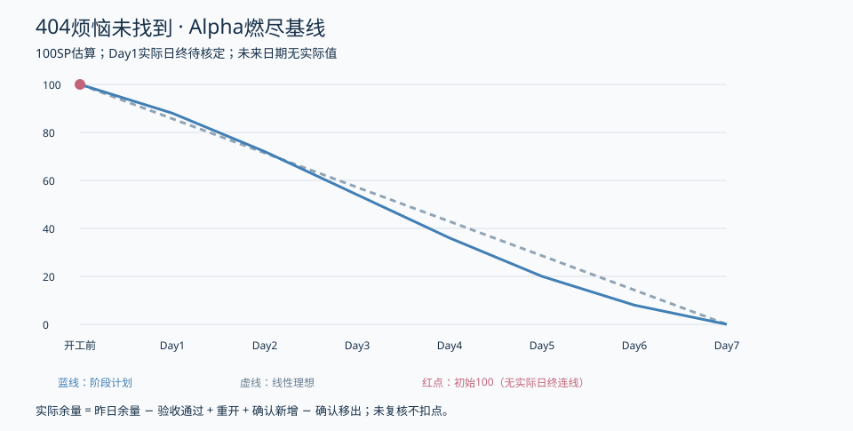

# 燃尽与验收台账

| 节点 | 理想剩余 | 阶段计划 | 实际剩余 | 说明 |
| --- | --- | --- | --- | --- |
| 开工前 | 100 | 100 | 100 | 初始估算基线，非完成数据 |
| Day1 | 85.7 | 88 | 待核定 | 待当日验收核定 |
| Day2 | 71.4 | 72 | 待核定 | 未来日期，未发生 |
| Day3 | 57.1 | 54 | 待核定 | 未来日期，未发生 |
| Day4 | 42.9 | 36 | 待核定 | 未来日期，未发生 |
| Day5 | 28.6 | 20 | 待核定 | 未来日期，未发生 |
| Day6 | 14.3 | 8 | 待核定 | 未来日期，未发生 |
| Day7 | 0.0 | 0 | 待核定 | 未来日期，未发生 |

初始100为估算基线；Day1实际不填88，也不凭本地材料自行减分。作者自查后仍需非作者复核。成员数据层1.5SP建议与本任务板2SP粒度差异见02号，未确认不扣点。

验收登记字段：任务ID、点数、成果/commit/Issue、运行版本环境、执行人/时间、自查、非作者/结论/时间、可访问证据、扣点日期。当前这些任务的非作者验收尚未提供，因此无扣点事件。

更新公式：当日实际=昨日实际−当日验收通过+重开+确认新增−确认移出。历史值只追加纠错说明，不回改美化。超过计划5SP或核心依赖阻塞半天升级PM。
