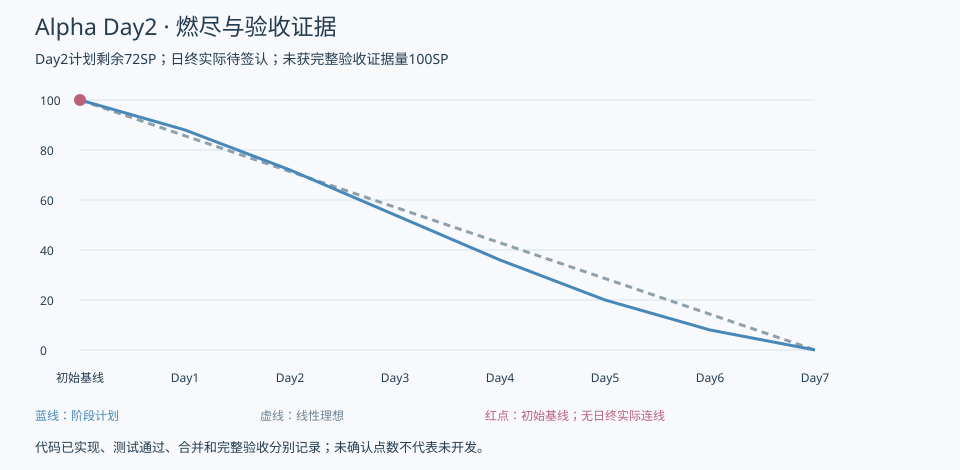

# 实际余量与燃尽更新

| 指标 | 本次值 | 解释 |
| --- | --- | --- |
| 初始估算 | 100SP | 延续原计划与Day1任务拆分 |
| Day2阶段计划剩余 | 72SP | 预测值，不是实际 |
| Day2线性理想剩余 | 71.4SP | 参考曲线，不是实绩 |
| 本次取得完整团队验收扣点事件 | 0条／0SP | 未取得作者自查+非作者成员通过+可访问证据的任务签认链 |
| 未获完整验收证据的台账量 | 100SP | 50项各2SP；不是“100SP都没开发” |
| Day1／Day2日终实际剩余 | 待签认，JSON为null | 本次尚非真实站会/日终全员核定，不能填88或72 |

| 工作包 | 初始SP | 完整验收扣点 | 未获完整验收证据SP |
| --- | --- | --- | --- |
| WP01 | 10 | 0 | 10 |
| WP02 | 18 | 0 | 18 |
| WP03 | 18 | 0 | 18 |
| WP04 | 10 | 0 | 10 |
| WP05 | 8 | 0 | 8 |
| WP06 | 6 | 0 | 6 |
| WP07 | 10 | 0 | 10 |
| WP08 | 6 | 0 | 6 |
| WP09 | 6 | 0 | 6 |
| WP10 | 8 | 0 | 8 |

任务实际状态、已实现代码和运行结果已逐项更新01号及[JSON](数据/tasks.json)。例如退出HTTP已通过，而页面仍模拟；仓储幂等通过而AuthService未接入。这样可清楚看到余量卡在验证和整合，而非抹掉开发成果。

## 日终更新规则

实际剩余=昨日实际−当日完整验收SP+重开SP+确认新增SP−确认移出SP。先补Day1验收事件，按真实验收时间归属，不倒填曲线。子任务未完全通过不按百分比扣点；修复原范围缺陷不重复加SP。
当前不能计算可靠的“实际较计划偏差”，因为实际日终缺少核定。若日终仍无可扣点事件，未验收量100较阶段72高28SP，应组织重排；这是一项条件判断，不是本次已确认实际偏差。核心PG16/浏览器接线阻塞已从Day1延续，另按阻塞升级规则处理。

Day1成员1.5SP建议仍不能直接映射本板2SP；需确认拆分并保持WP04总10。当前无范围移出或新增点数确认，原100保持不变。
