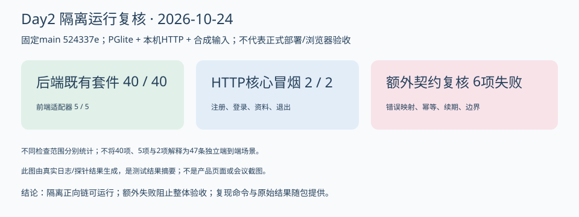

# 404烦恼未找到｜Alpha冲刺Day2：复跑核心接口，收敛联调缺口

| 项目 | 内容 |
| --- | --- |
| 这个作业属于哪个课程 | [2601_FZU_SE](https://bbs.csdn.net/forums/2601_CS_SE_FZU) |
| 这个作业要求在哪里 | [团队第四次作业](https://bbs.csdn.net/topics/620563653) |
| 这个作业的目标 | 跟踪环境阻塞，核对账号资料接口责任和依赖，评审任务实际进展并更新Day2交付记录 |
| 其他参考文献 | [项目固定main](https://github.com/impureWine/404NOTFOUND/tree/524337e3809f6efa123b609e16608415ff51ceca)、仓库七天计划、09号全功能接口规范、成员Issue/PR及本次隔离复跑证据 |

日期2026-10-24；整合责任张王昊；数据截止2026-10-24T16:11:08+08:00。**这是本地/仓库日志候选，尚无Day2真实站会和全员回执，不冒充已发布的完整课程随笔。**

## 今日目标与实际推进

Day2重点是账号、资料和数据访问基础。与Day1相比，main已有真实认证/资料/记录代码，Day1的PM、后端、安全、前端交付已合并。本次PM复核不再沿用“完全没有HTTP认证”的旧结论。
在隔离PGlite与本机HTTP环境复跑后端40项，全通过；前端适配器5项，全通过。补充冒烟确认注册不自动登录，登录200、资料200、退出204，退出后旧Cookie访问401。但真实React页面仍模拟，正式PG16没有验收，因此不能写“前后端全部联调完成”。

## 第一轮技术预审发现

额外六项契约探针全部未满足预期：非法JSON/超限请求返回503且缺requestId；相同注册和资料PATCH请求重放返回409；有效资料访问未刷新空闲时间；33字符合法登录名注册返回500。相关复现、定位、责任与复测门槛见[评审记录](03_第一轮任务评审记录.md)。
原有套件全绿与新发现同时保留，没有用新增检查失败否认原用例通过，也没有用原用例通过掩盖新问题。修复仍属于原任务范围，本次不重复新增工作点数。

## 成员进展、问题与下一步

| 成员 | 可核对进展 | 困难 | 下一步建议 | 证据/个人回执 |
| --- | --- | --- | --- | --- |
| 张王昊 | 本次完成源码/Issue核对、环境复跑、接口/任务预审及台账/日志整理 | 六项偏差及全员工时/验收未收齐 | 先促成后端修复和前端接线；收回容量/评审记录 | 本次技术记录，待本人采纳确认 |
| 郭昱祺 | #23设计交接已合并；未取得Day2页面编码提交 | 只认领组件方案，与总计划整页实现不一致 | 和程杰确认组件编码/页面装配分担 | 本人心得/工时待提供 |
| 程杰 | #24 API骨架及模拟清单已合并；本次适配器5项通过 | 页面仍模拟；Vite无/api代理；Electron无验证 | 接入注册登录退出，处理401和CSRF；提供运行图 | 本人心得/工时待提供 |
| 李泉毅 | main已有认证/资料/记录服务；本次40项后端测试通过 | 错误映射/注册和资料幂等/空闲续期/长登录名6项失败 | 按RV01～06修复，与仓储和前端集成 | 成员Day2材料可引用，工时未提供 |
| 程群 | PR15最新分支报告19项AI通过、mock=false真实成功10983ms | PR仍开放，内部入口不等于完整Agent链 | 复核并同步新PR描述，应用门面/许可/双代次对接 | 成员执行报告，未由本次重跑 |
| 庄剀涵 | #22及8a81a4e包含账号/资料/保存仓储改进；本次40项也复跑通过 | 正式PG16和AuthService调用幂等仓储待闭合 | 与李泉毅处理注册/资料请求摘要和事务；跟踪实网检索 | 本人原文心得见仓库Day2材料；实际工时未登记 |
| 关欣 | PR16安全基线已合并，本次安全用例随40项通过 | Day2认证/正文外发/Electron专项回执未取得 | 复核新增六项HTTP问题及权限/日志边界 | 本人心得/工时待提供 |
| 曾俊涛 | main有Day1运行图；本次在PM隔离副本可跑测试 | 未取得Day2本人CI/干净启动/正式PG16和会议图 | 建立可复现环境和CI，提供当天运行和真实站会证据 | 本次复跑不归算其本人贡献 |

AI分支最新材料报告真实模型glm-4.7-flash调用成功，input312/output71 tokens，耗时10983ms，mock=false；这是分支成员报告，见[执行记录](https://github.com/impureWine/404NOTFOUND/blob/4b9c0ba2971d8e9aea3c5585320c3423383f46ac/backend/evidence/程群_AI模型与命名卡路由_20261024.md)。PR15旧正文仍写未成功，存在信息滞后；本次未用本地密钥重跑真实外发，不把分支成果当作main集成通过。

## 燃尽与实际余量

计划剩余72SP，理想剩余71.4SP。当前未取得完整团队验收扣点事件，未获完整验收证据的台账量100SP；这不等于没有开发进展。Day2日终实际待站会和非作者签认后填写，不用计划线补实际线。

## 当天运行与测试展示

此图根据本次真实测试输出生成，是模块验证结果摘要，**不是产品界面截图或会议照片**。[后端输出](证据/backend-tests.tap.txt)、[适配器输出](证据/frontend-api-tests.txt)、[额外探针](证据/contract-probes.json)可复核。Day1原型图不复用为Day2运行图；Day2真实界面/GIF/视频仍需模块负责人提供。
首次沙箱本机HTTP受限导致5项fetch失败，移出该网络限制后相同源码40/40通过；前次失败记录也保留，不能当成5个产品缺陷。包内只有合成数据，无真实账户或私密正文。

## 站会与正式评审

实际时间、地点/线上方式、参会名单、逐人发言、决议及确认人：尚未取得当天记录。建议19:30站会/21:30日志是排期，不是已发生事实。
当天真实会议照片：待曾俊涛/团队提供，不使用Day1照片，不生成替代照片。本次已执行的是异步技术预审，不能写成八人评审会议已经召开。

## AI技术员贡献与局限

输入为固定源码、接口规范、Issue/PR和合成用例。AI辅助PM核对状态变化、拆解依赖、执行隔离复跑并编写六项边界探针，整理任务板/燃尽/日志；因发现实际失败，结论保留“部分完成”。未编造工时、心得、会议、非作者通过或博客发布时间，也未修改他人业务代码。
张王昊及专业负责人仍需审查、采纳和关闭问题。本次复跑归为PM辅助核验，不归算曾俊涛或其他成员本人完成，不量化未测量的效率提升。

## 到Day3前的重点与补证

先关闭六项HTTP契约缺陷并收敛backend运行说明，接线真实认证页面；再核对AI分支集成与真实检索来源；正式PG16/CI和工时/页面分工同步推进。发表完整Day2日志前补齐真实会议照片、八人确认的心得/工时、当天产品运行展示、非作者验收与实际燃尽、博客实际URL和集合记录。
