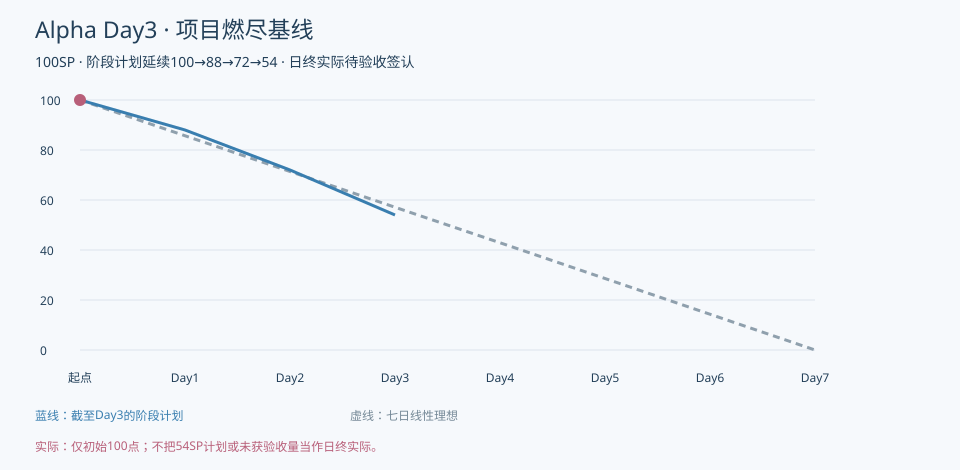
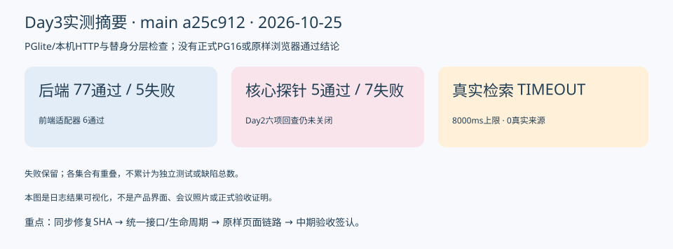

# 404烦恼未找到｜Alpha冲刺Day3：核对核心链路，为中期验收收敛接口

| 项目 | 内容 |
| --- | --- |
| 这个作业属于哪个课程 | [2601_FZU_SE](https://bbs.csdn.net/forums/2601_CS_SE_FZU) |
| 这个作业要求在哪里 | [团队第四次作业](https://bbs.csdn.net/topics/620563653) |
| 这个作业的目标 | 检查陪伴、命名卡、训练和查询进度，协调接口差异，准备Day4中期验收并记录范围与任务变化 |
| 其他参考资料 | [固定main](https://github.com/impureWine/404NOTFOUND/tree/a25c91203680abdbe216cb74f2b92dc3f1c5a09d)、七天计划、09号规范、各成员Issue/PR及本次原始日志 |

日期2026-10-25，Day3/7；整合责任张王昊；数据截止2026-10-25T10:48:32+08:00。**本稿为仓库/本地日志候选，今日真实会议和全员回执尚未取得，不标完整博客已发布。**

## 今日目标与实际推进

本日重点为陪伴、命名卡、训练与查询。代码已较前两日增加模型适配、认证接线、UX组件和Electron样机，不能继续笼统写“均无实现”。但实现层级、原样运行及版本同步仍有差距。
本次实际复跑后端82项，77通过、5失败；前端适配器6通过。追加12项核心探针，命名卡路由、合成查询完成、跨上下文拒绝、取消迟到不回填及双会话改密撤销共5项通过；7项未满足预期。Day2六项偏差回查仍未关闭。
真实Wikipedia只作一次公开合成查询，8秒超时、0来源，保留TIMEOUT，不把网络失败改为EMPTY或用替身来源补齐。真实模型成功继续引用10月24日成员记录，本次没有再次外发。

## 按核心场景核对

命名卡直接模块可确定性路由，但页面→正式/api/agent/tasks仍缺入口。内部模型路由的匿名调用闸门未通过；检索的显式取消可阻止迟到回填，但已完成结果在END或撤回许可后仍可读取，暂停后还可新建查询。会话/来源字段与共享Schema不一致，已形成10条具体协调项和22项中期清单。
后端Issue34称本地84全过和修复，当前main却有82项与5条失败；先要求提交与固定SHA复验，再关闭问题，不把成员本地工作与远端执行混在一起。

## 全体成员进展、困难和下一步

| 成员 | 可核对进展 | 当前困难 | 下一步建议 | 来源与回执边界 |
| --- | --- | --- | --- | --- |
| 张王昊 | 本次完成核心场景/Day2回查、字段协调方案、中期22项清单、变更与日志候选 | 当前main仍有失败，团队验收/工时未核定 | 跟踪修复入main，按清单组织Day4验收 | 本次PM辅助核查；本人采纳/心得待确认 |
| 郭昱祺 | #35/组件展示已合并：四场景16状态、20张Day2截图 | 固定展示数据不等于业务装配；未取得Day3新回执 | 与程杰按IF3映射组件事件与来源卡 | 旧成果作为前置，不重记今日完成 |
| 程杰 | 认证hook、对话框和Electron样机在main；适配器本次6通过 | proxy缺失、home/HOME不一致；聊天/查询仍示例链 | 原样认证接线，正式任务/取消/旧回复失效，逐项桌面复验 | #30/29；今日本人运行/心得待提供 |
| 李泉毅 | #34报告本地Day3会话/取消/改密及84全过；main已有部分任务服务 | 当前main82中5失败，与本地修复报告不一致 | 推送可复核修复SHA，关闭RV及D3生命周期/Schema缺口 | #34为计划日材料，不能当作当前main通过 |
| 程群 | PR15已合并，NamingCard直接路由本次通过；真实模型成功回执为10/24 | 正式Agent API缺失、内部入口缺授权、训练未前台验收 | 应用门面/许可/双代次接入，一种训练停止验证 | #25；不重复调用真实模型或冒充今日成功 |
| 庄剀涵 | 现有仓储/来源绑定用例通过；今日真实检索尝试已复核为TIMEOUT | 0真实来源；ID/时间语义和共享Schema有差异 | 推进可达真实来源，按IF3统一ID与来源时间、保存证据 | #11/#22；Day3模板仍待本人真实填写 |
| 关欣 | 既有22条安全专项在main，本次五条失败仍可复现 | 原修复报告未在main闭合，许可撤回和模型闸门仍缺 | 按新SHA复测安全/上下文/外部输入，保留失败 | #31；本次不归算其本人新执行 |
| 曾俊涛 | 新增Day2独立浏览器/桌面报告；明确原样失败与条件成功 | 原样接线/目标键阻断，拖动/置顶等待测；远程CI无run | 统一候选、无请求改写E2E与Day3训练/陪伴，正式环境取证 | 报告为10/24执行，不能写成10/25本人已复跑 |

上述下一步是依据分工和核查提出的建议；八人今日实际工时、本人心得及承诺时间均待本人提供，不根据工具耗时推算贡献。前两日成果不重记为今日新增完成量。

## 项目燃尽图

沿用100SP，阶段计划延续100→88→72→54；理想剩余57.1SP。阶段计划只画至Day3，未来计划不冒充已发生；实际日终待团队验收签认，图中只有初始实际基线点。

## 运行与测试证据

上图由本次真实日志生成，是测试结果摘要，**不是产品界面截图、录像或会议照片**。[回归TAP](证据/backend-regression.tap.txt)、[核心探针](证据/core-scenarios.json)、[旧问题回查](证据/day2-recheck.json)、[真实检索](证据/live-search.json)随文可核对。各集合有重叠，不相加为独立通过或缺陷总数。
Day2独立浏览器报告的“临时代理+目标键改写后A/B成功”仅作历史条件证据，不能当作今天原样闭环已过；Electron报告也只证明当时部分能力。本次没有重新拍摄产品界面，今日实际运行图/GIF/视频仍待模块负责人提交。

## 当天站会与验收记录

实际起止时间、方式/地点、参会名单、逐人发言及决议：待当天真实记录。会议照片：待团队提供10月25日真实非摆拍照片，不复用10月23/24日图片。19:30与21:30是计划节点，不能写成已经开会或发布。
本次已完成PM技术核查和可执行验收准备，不代表模块作者自查、非作者成员通过和团队范围签认都已完成。代码签入、Issue、日志发布与课程提交分别留证。

## AI技术员贡献

AI辅助按固定源码/计划/Issue/成员原始记录整理场景和接口差异，复跑现有测试、编写合成边界探针、尝试一次受控真实检索，并准备中期清单。人工仍需采纳方案、修改业务代码、复测与签认；失败和版本差异被保留，没有伪造真实模型、会议、工时或效率百分比。本次结果归PM辅助核查，不转算为他人本人执行。

## 中期验收前重点

优先把候选修复同步main并关掉安全/旧契约红灯；落地IF3模式、来源、响应和生命周期映射；原样页面接入真实受控任务；复测一种训练停止和真实检索；再按中期清单补正式环境、隔离、保存清除、销毁及桌面能力证据。
完整日志发布前补齐今日真实会议照片/信息、全员回执/心得、产品运行展示、非作者验收及实际SP、真实博客URL与集合链接。
