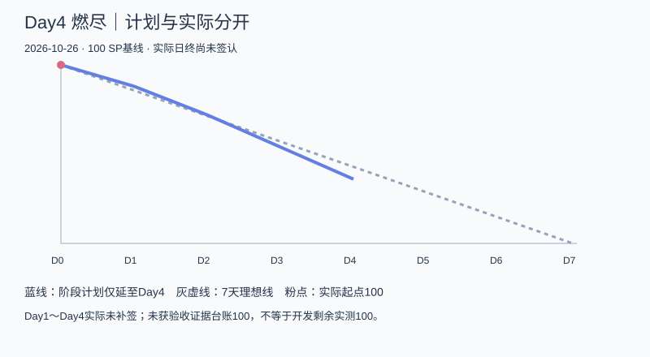
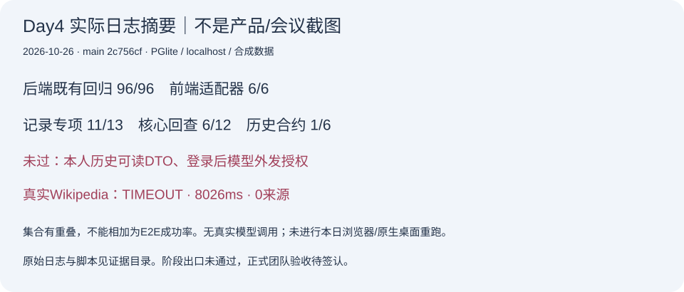

# 404烦恼未找到｜Alpha冲刺Day4：中期验收与隐私流程收敛

| 字段 | 内容 |
| --- | --- |
| 这个作业属于哪个课程 | [2601_FZU_SE](https://bbs.csdn.net/forums/2601_CS_SE_FZU) |
| 这个作业要求在哪里 | [团队第四次作业](https://bbs.csdn.net/topics/620563653) |
| 这个作业的目标 | Day4中期验收，核对主动保存、本人历史、隔离与端侧隐私，调整剩余任务 |
| 其他参考文献 | [七天计划](../../冲刺计划_20261023.md)、[固定仓库版本](https://github.com/impureWine/404NOTFOUND/tree/2c756cf5666b424f643098e029ed2bda2f4c2d1d)、[中期验收表](01_中期验收表.md)、成员Issue38/39/42/43/44/45与测试08报告 |

日期2026-10-26；截至2026-10-26T14:31:04+08:00。**日志候选，尚未取得真实会议/全员本人回执和正式发布证据**。不声称今天已经结束，也不补造会议照片、工时或成员心得。

## 今日目标与实际结果

张王昊负责组织中期验收和偏差排期。本次固定main 2c756cf，重跑既有后端96/96、前端适配6/6，并对保存/隔离增加13项探针，11过2失败；核心回查6过6失败，历史合约1过5失败。一次真实Wikipedia8026ms超时、0来源。不同集合有重叠，不汇总成整体成功率。

保存许可不会自动新增记录，显式保存、同请求重放、A/B和入口隔离、两步清除与退出旧Cookie拒绝在HTTP/PGlite层已有证据。完整历史仍不能展示可读正文，登录后内部模型外发闸门仍缺；陪伴/训练主线与页面、真实检索成功及销毁动态隐私尚未验收。中期结论为“技术基础有进展，完整核心出口未通过”。

## 站立式会议

建议时间10月26日19:30，实际时间/到会/照片：待真实会议后补齐。曾俊涛拍照、张王昊核对；不能用10月25日截图或AI生成图片替代会议。议题：确认R4-01/02/04优先级、各责任人采纳与容量、今日剩余必做和新SHA复测、材料签认与博客发布。

## 八名成员进展与回执收集

下表明确区分今天PM实际复核和成员前序成果。没有从仓库推断其他成员今天的新工作或实际耗时；本人心得由各成员提供后补入。

| 成员 | 可核对证据与日期边界 | 问题/困难 | 下次安排/本人心得状态 |
| --- | --- | --- | --- |
| 张王昊 | 本日实际完成28项中期证据核对、12风险、10行动、50任务/燃尽与日志候选；复跑与探针见本包 | 核心出口未达；会议、成员本人回执与SP签认缺失 | 按风险和时间表协调、收齐真实过程后发布；本人口述心得/工时待补 |
| 郭昱祺 | 前序10-25 Issue43/PR41组件走查93项、40图；API请求0，不计为Day4新增 | 保存/历史/详情与游客衔接尚需正式页面装配 | 按Day4分工提供保存确认/历史详情状态与销毁说明；本人当日完成/心得待回执 |
| 程杰 | 前序Issue42最新补充Electron45已可启动；认证proxy/HOME已在main | 业务页面仍演示，历史/清除与销毁动态隐私未闭环 | 与UX/后端接记录页面并留证；桌面逐项验收；本人当日进展待回执 |
| 李泉毅 | Issue44的Day4后端成果已于10-25提前准备并入main；本日PM复跑保存/隔离/清除通过 | 本人可读历史DTO、模型外发闸门和旧合约缺口未关 | 按R4-01/02/04/07优先修复并交新SHA；本人Day4工时/心得待回执 |
| 程群 | 前序Issue39/PR40陪伴五感分支有27项及独立HTTP3项替身报告，PR未合并 | 主线整合、真实许可与页面接线未完；真实模型历史为限流 | 审查与当前main冲突，完善AI_PROCESS与取消/换号边界；Day4本人回执待补 |
| 庄剀涵 | 前序Issue38来源UUID/URL/时间规范与仓储证据已入main，本日隔离使用这些实现 | 真实检索本次TIMEOUT；记录读DTO及清除后上下文还需协作 | 定位网络，配合服务层授权解密与正式PG验证；Day4本人回执待补 |
| 关欣 | 前序Issue45/PR46六条模型边界已合并；D3-05/06是缺口观察 | AI_PROCESS与动态销毁取证仍待；96全绿不等于安全验收 | 复核模型闸门、账号入口拒绝与端侧标记；Day4本人回执待补 |
| 曾俊涛 | 前序08报告有原样浏览器账号成功、main96项和PR40独立证据，本日PM另重跑 | 完整保存/陪伴/训练/真实检索/销毁整链未过 | 同SHA复测新修复、网络存储取证，拍真实会议并提供报告；Day4本人回执待补 |

## 燃尽与偏差调整

计划剩余100→88→72→54→36；实际Day4日终待签认，未填成36，也未把未验收台账100写成测量剩余。28项中期清单、12项风险和10条协调行动见[验收](01_中期验收表.md)、[风险](02_风险与缺陷处置.md)、[排期](03_偏差重新排期与剩余必做.md)。原范围17REQ/100SP保持，目标时限待责任人确认。

## 本日运行与开发证据

此图是本日原始日志的可视摘要，不是产品界面或会议照片。产品运行展示仍须补与当天候选SHA一致的页面截图/网络存储证据；不能用此图掩盖完整业务未运行。

- [后端原始TAP](证据/backend-tests.tap)、[前端输出](证据/frontend-api-tests.log)、[记录探针](证据/record-acceptance.json)、[真实检索](证据/live-search.json)。本次脚本与PM文档将随独立GitHub分支/PR签入。
- 开发依据：[#44](https://github.com/impureWine/404NOTFOUND/issues/44)后端记录；[#38](https://github.com/impureWine/404NOTFOUND/issues/38)来源绑定；[#39](https://github.com/impureWine/404NOTFOUND/issues/39)/[PR40](https://github.com/impureWine/404NOTFOUND/pull/40)分支AI；[#42](https://github.com/impureWine/404NOTFOUND/issues/42)前端/桌面；[#43](https://github.com/impureWine/404NOTFOUND/issues/43)UX；[#45](https://github.com/impureWine/404NOTFOUND/issues/45)安全。每条按实际日期与SHA引用，不当作今天八人都已交付。
- [完成证据更新表](04_完成证据与接口协调.md)解释旧安全五条转绿、前端原样账号已通和桌面已启动；历史PR37的旧版本结果保留，未改写。

## AI技术员协助（单列）

本次Codex辅助读取计划和固定GitHub快照、核对295份选定源码Git blob，执行隔离回归和合成探针，整理缺口、协调顺序、任务表与日志候选。探针只使用合成账号和计数模型替身，真实外发仅公开合成Wikipedia问题，不调用真实模型、不读取真实.env或密钥。日志如实保留超时与失败。

人工仍需核对范围、责任人承诺、正式非作者验收和发布内容。AI生成的排期不是成员接受记录；不计算节省工时百分比，不代写未经本人提供的心得。自动化96全绿并未覆盖历史可读性与登录后外发授权，额外探针发现这两项问题，说明人工验收门槛需与测试断言逐项核对。

## 发布前待补

- 当天真实会议时间、出席、非摆拍照片；八人本人进展/困难/下一步/心得与实际工作量。
- 当天可用候选版的产品运行截图、销毁网络与存储检查；缺陷修复的新SHA和非作者结论。
- 完整任务SP签认、真实博客URL/发布时间、置顶集合与课程提交记录。候选正文已入GitHub不等于CSDN发布或作业提交。

本次GitHub项目管理跟踪：[Issue #47](https://github.com/impureWine/404NOTFOUND/issues/47)。业务修复、会议/成员回执和正式签认待办继续开放。
