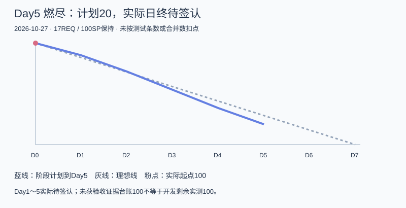

# 404烦恼未找到｜Alpha冲刺总结初稿（截至Day5）

| 字段 | 内容 |
| --- | --- |
| 这个作业属于哪个课程 | [2601_FZU_SE](https://bbs.csdn.net/forums/2601_CS_SE_FZU) |
| 这个作业要求在哪里 | [团队第四次作业](https://bbs.csdn.net/topics/620563653) |
| 这个作业的目标 | 汇总Alpha前五天计划与实际、成员交付、协作和AI辅助，准备总结终稿 |
| 其他参考文献 | [七天计划](../../冲刺计划_20261023.md)、[固定main](https://github.com/impureWine/404NOTFOUND/tree/66504bc3dc382c237c3650fb9d7ce8525a4f6478)、[预期与实际](03_预期与实际进度.md)、[缺陷分诊](01_缺陷分诊与优先级.md) |

**这是Day5总结初稿，不是7天结束总结。** 截至2026-10-27T10:39:44+08:00，Day6/7、最终贡献比例、真实心得、PPT与正式提交未发生或未核实，保留待补。不提前宣称完成课程提交。

## 一、预期目标与实际进展

本轮希望形成“游客命名卡/陪伴→注册登录→主动保存→本人历史→退出/换号隔离”的真实闭环，并完成真实查询、一种可停止训练、端侧销毁和Electron能力验证。当前已形成React/Vite前端、Node/Express与共享契约、加密记录仓储、模型/检索适配和多轮合成验证。账号段已有前序真实浏览器证据，主线正式Agent与五感HTTP在本日复验可运行。

但是，正式用户页面的保存/历史与销毁还依赖未合并前端分支；历史详情只返回密文。内部模型路径仍能在登录后绕过Origin/CSRF与外发用途许可；任务对同账号跨入口和旧登录会话的临时结果隔离也未达标。真实Wikipedia本日超时，真实模型本日未调用。不能把115项全绿等同完整产品通过。

本日主线115/115、前端6/6、构建成功；补充记录11/13、核心9/12、旧合约1/6、新业务8/12，集合重叠。候选评审标识alpha-day5-review-20261027+66504bc，正式发布仍BLOCKED。17REQ逐项差异见[进度表](03_预期与实际进度.md)，不以主观百分比代替完成证据。

计划曲线到Day5为20SP，实际日终待签认。团队已有工作与独立复核，但未取得完整任务扣点事件，不能把计划数当实际，亦不能将未获证据台账100SP解释为无人开发。

## 二、成员分工、已收成果与实际工作量依据

| 成员 | 可核对交付 | 证据入口 | 边界/待补 |
| --- | --- | --- | --- |
| 张王昊 | Day1范围任务/计划、Day3场景/协调、中期验收、Day5分诊与总结初稿 | PR19/37/48；本次Day5材料 | 正式会议/实际容量/SP/博客发布与总结终稿待补 |
| 郭昱祺 | 认证/首页/聊天/来源/命名/训练与保存历史详情组件及走查 | Issue43/51，PR41/50 | 主要为合成展示；Alpha PPT和真实业务非作者复核待收 |
| 程杰 | 账号适配、Electron样机与运行记录；记录/销毁分支 | Issue30/42/57；28354a2分支 | 分支未整合、完整UI E2E/桌面矩阵待验 |
| 李泉毅 | 认证/资料/任务/训练/记录HTTP，统一运行/发布配置 | Issue32/34/44/55；main115项本次复跑 | 内部旁路、可读DTO、历史合约等仍需修复；正式PG16未验 |
| 程群 | 模型适配、命名陪伴路由、五感训练；隐私分支 | PR15/40已合并；Issue53/PR54 | 本日模型替身；真实供应商成功/会话入口隐私收口待验 |
| 庄剀涵 | 迁移仓储、来源绑定/规范、清除回滚与显式上下文选择 | Issue11/22/38/49 | 真实检索仍超时；正式数据库/外部删除传播未验 |
| 关欣 | 账号权限、模型边界、销毁结构与清除隔离审查/测试 | PR16/33/46/58；Issue56 | 正式运行销毁及模型旁路/入口复核、腾讯评审表待收 |
| 曾俊涛 | 多版本独立复跑、原样账号浏览器及API辅助保存、入口取证 | docs/alpha/曾俊涛/Day1～4报告 | API辅助与临时QA挂载不等于正式页面链；Day5随笔/运行包待收 |

本次表述是PM依据仓库的成果核对，不代替成员本人心得。八人最终心得、工时/实际投入、作者及非作者签认需在Day6～7收齐。**工作量比例暂不填写**；不按100SP、测试条数、提交次数、代码行数或平均12.5%分配。终稿以实际任务与协作记录核对，确认后合计100%，附计算依据。

## 三、协作中已暴露的问题与改进

前期同源代理与HOME/home差异造成原样账号流程失败，后续已修，说明共享契约必须覆盖页面到服务的实际路径。仓储返回200与用户能读历史不是同一验收门槛；本次探针因此单独检查可读正文。默认不保存与AI外发用途分开已经在正式Agent合成链得到验证，但内部入口还存在旁路，安全审查必须检查所有可达路径。

多个分支与报告同时推进，旧版82/87/90/93/96/111项数字分别对应版本，不能混加或用旧红灯否定后续修复。本次固定main及424份Git blob，保留原始日志和失败实际值；前端28354a2与AI隐私PR54尚未合并，应先审差异和重跑，再对外描述完成。

Day5起本次候选评审冻结影响交付的新功能，优先修权限、DTO与生命周期，再补正式页面取证、真实来源和候选环境。收件按8人18:00台账推进；未收材料不编造，也不将模板文件当完成记录。

## 四、下一阶段展望与答辩材料

本轮剩余两天优先关闭P0及核心P1，固定修复SHA重跑同场景；取得授权PG16/HTTPS和真实供应商证据，或如实交付可复现本机版本及限制。之后再评估日历/寄存完整业务、更多训练、微信真实接入及桌面多屏体验，保持用户主动选择、保存与外发分别许可的约束。

答辩PPT由郭昱祺按已实现/原型/失败/未测组织，李泉毅主讲，庄剀涵与张王昊配合；腾讯共享评审表由关欣提供可访问链接及权限检查。仓库10月22日PPT是前次设计答辩，不冒充本轮Alpha总结PPT。本次未收到Alpha PPT初稿和腾讯表的有效交付证据，见[收件台账](05_18点材料收件与后续排期.md)。

## 五、AI技术员贡献与局限

团队已用AI协助组件/代码草稿、契约核对、测试脚本、故障归因和文档整理，证据分散在成员各日材料中，由各负责人承担最终审查。本次Codex具体完成固定仓库读取、424份源码哈希核对、隔离回归/业务探针、主线浏览器入口巡检与截图、分诊和本初稿；使用合成账户/输入及模型替身，没有真实模型调用或秘密读取，真实外发仅公开合成检索问题。

AI辅助测试使原有全绿之外的可读历史和授权/入口缺口被明确复现；但测试覆盖的断言、替身与正式环境边界仍需人工判断。自动化不能代替成员本人心得、真实会议、责任人承诺和非作者验收。未测量节省工时或效率百分比；本次所有错误和超时原样保留，不以文案改写成功。

## 六、终稿前补齐

Day6/7实际修复与回归、全部7篇日志和11篇正式博客链接、八人本人心得/投入与最终比例、会议照片、Alpha PPT、腾讯评审表、可复现运行版本及已知风险、真实发布/课程提交凭据。正式截止10月29日23:59，内部目标17:30；未来过程按实际发生再写。
