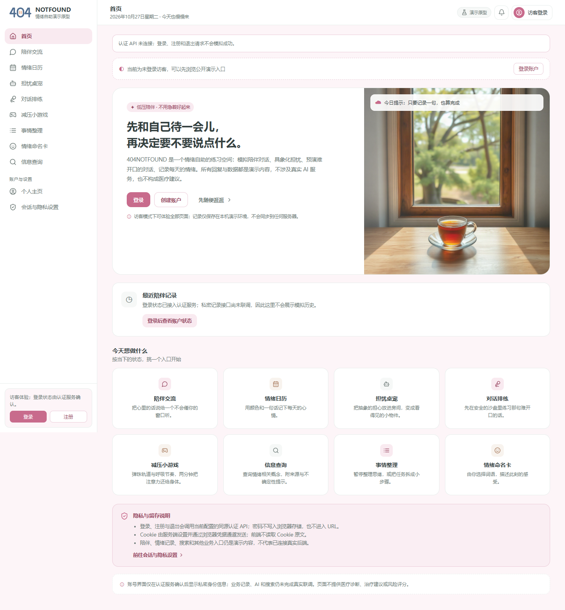
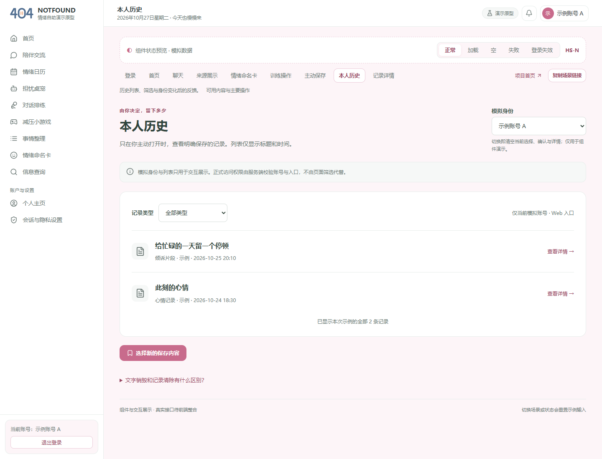

# 404烦恼未找到｜Alpha冲刺Day5：集中分诊与候选收口

| 字段 | 内容 |
| --- | --- |
| 这个作业属于哪个课程 | [2601_FZU_SE](https://bbs.csdn.net/forums/2601_CS_SE_FZU) |
| 这个作业要求在哪里 | [团队第四次作业](https://bbs.csdn.net/topics/620563653) |
| 这个作业的目标 | 缺陷分诊、冻结影响交付的新功能、核对预期与实际、形成总结初稿并18:00收件 |
| 其他参考文献 | [七天计划](../../冲刺计划_20261023.md)、[当前固定仓库](https://github.com/impureWine/404NOTFOUND/tree/66504bc3dc382c237c3650fb9d7ce8525a4f6478)、[分诊](01_缺陷分诊与优先级.md)、[总结初稿](04_Alpha冲刺总结_初稿.md) |

日期2026-10-27；截至2026-10-27T10:39:44+08:00。**当日过程候选，尚未发布或完成全天过程**；会议时间/到会/非摆拍照片、八人本人回执与实际投入待真实补齐，不复用旧图或代填工时心得。

## 今日实际工作与结果

张王昊按PM职责核对主线、分支和成员报告，整理15项缺陷优先级与责任/关闭条件，冻结本次候选中影响交付的新功能，完成17REQ预期实际、50任务/100SP、总结初稿及18:00收件台账。候选评审标识alpha-day5-review-20261027+66504bc，发布状态BLOCKED；时间与负责人承诺待本人确认。

本次实际复跑：后端115/115、前端适配6/6、完整前端构建通过；记录专项11/13、旧核心9/12、历史合约1/6、新业务8/12。真实许可服务允许合法合成陪伴，SAVE/AI_PROCESS互斥、训练暂停/继续/退出正确；内部模型旁路、同账号跨入口/重登旧回复、END/撤回结果与可读历史仍未过。一次公开合成Wikipedia问题8009ms TIMEOUT，0来源，没有真实模型调用。各集合重叠，不累计为E2E通过率。

## 当天最新运行展示

截图为本日main 66504bc默认生产构建，API处于默认mock模式，未接真实业务后端；页面明确“私密记录接口尚未联调”。销毁入口巡检发现首页无控件、五个候选地址无销毁UI，因此隐私交互未执行，不能当正文不外发验收。

这是UX展示页的示例账号与合成记录，不能当真实本人历史。浏览器本次27个资源请求、0个业务API、0个脚本错误；默认页面可能加载外部静态图片，0个API请求不表示系统无外网，更不表示销毁隐私通过。[机器证据](证据/browser-entry.json)保留入口与构建模式。

## 从昨日记录到现在的成员证据

| 成员 | 当前可核对成果 | 本日待回执/缺项 |
| --- | --- | --- |
| 张王昊 | 本包当前已备齐可独立完成的PM材料；本人心得/工时与会议待真实填写 | 待本人及非作者审阅；实际发布未核验 |
| 郭昱祺 | 已收到Day4组件79组/31图，非真实业务；未检出Day5 Alpha PPT | Day5 PPT与交互修订/本人条目待交 |
| 程杰 | Issue57与分支28354a2有Day4记录/销毁；尚未合并main | 整合新SHA、真实业务/销毁取证和桌面矩阵待交 |
| 李泉毅 | Day5材料于10-26提前提交；本次main115/115复跑，发布规则已核验 | 已收到作者稿/技术复跑，剩余P0/P1与正式环境须交新SHA |
| 程群 | Day3 PR40已合并；Day4隐私PR54仍open；本日BG专项8/12 | 主线许可/会话/入口收口与Day5回归及贡献稿待交 |
| 庄剀涵 | Day4数据清除/上下文增量已合并；Day5_缺陷修复和候选版本仍模板 | Day5实际数据候选、真实来源/失败记录与迁移交接待交 |
| 关欣 | Day4 PR58四条测试/结构及入口不可达证据已入main；无Day5腾讯表可访问证据 | 内部模型/跨入口/销毁动态复核与共享表链接权限待交 |
| 曾俊涛 | 已收到Day4增量/交叉报告；本包另有Day5PM复跑，不归为测试成员本人工作 | Day5测试随笔、用例/发布包、真实新SHA集成证据待交 |

成员表是PM仓库收件核对，不是全员本人Day5进展声明；李泉毅Day5稿注明提前10-26执行，其余前序成果不能重记为Day5新增。每人真实困难、下一步、心得及投入按[收件格式](05_18点材料收件与后续排期.md)补入。

## 站会与燃尽

建议19:30举行10～15分钟真实站会；实际时间/到会/照片待发生后登记。议题为P0旁路与入口隔离、候选分支整合、18点缺件与新SHA复测。照片由曾俊涛拍摄、张王昊核对，不使用产品截图替代会议照片。

计划20SP；实际日终未签认。未获完整任务验收证据台账100不是开发剩余实测，更不是无人工作。不按提交数/测试数计算个人贡献。原17REQ/100SP保留，例外和范围变化另行确认。

## AI技术员本次贡献

Codex辅助固定SHA取证、424份源码Git blob核对、测试/探针和浏览器入口巡检、截图审阅、分诊/冻结/进度/总结初稿及包检查。模型仅用合成计数替身，训练时钟可控；真实外发仅公开合成检索，不读取真实.env/密钥。自动化115全绿之外的新探针发现会话/入口失效缺口；结果保留失败，人工仍负责优先级接受、正式验收和发布。

安装过程中自动审批阻止会清空依赖目录的npm ci；确认新目录无依赖后改用不预先清理的安装，构建使用全新输出目录且emptyOutDir=false。没有删除项目文件，源码/锁文件424份哈希保持一致。没有衡量节省工时百分比，AI不代写本人心得或替团队签认。

## 证据与发布前待补

[后端TAP](证据/backend-tests.tap)、[前端TAP](证据/frontend-api-tests.tap)、[业务探针](证据/business-gates.json)、[构建](证据/frontend-build.log)、[真实检索](证据/live-search.json)、[收件台账](05_18点材料收件与后续排期.md)。代码来源包括[#55](https://github.com/impureWine/404NOTFOUND/issues/55)后端、[#49](https://github.com/impureWine/404NOTFOUND/issues/49)数据、[#53](https://github.com/impureWine/404NOTFOUND/issues/53)隐私分支、[#57](https://github.com/impureWine/404NOTFOUND/issues/57)前端分支、[#51](https://github.com/impureWine/404NOTFOUND/issues/51)UX、[#56](https://github.com/impureWine/404NOTFOUND/issues/56)安全；按实际分支/日期引用。

真实会议/八人回执/工时心得、18点材料齐收、Alpha PPT与腾讯表、任务SP签认、正式博客URL及集合链接、课程提交记录仍待真实补齐。本候选签入GitHub不等于CSDN已发布或课程作业已提交。

本次GitHub跟踪：[Issue #59](https://github.com/impureWine/404NOTFOUND/issues/59)；材料提交和后续修复/收件/正式验收分开跟踪，不自动关单。
