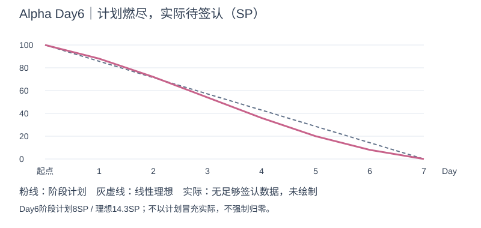
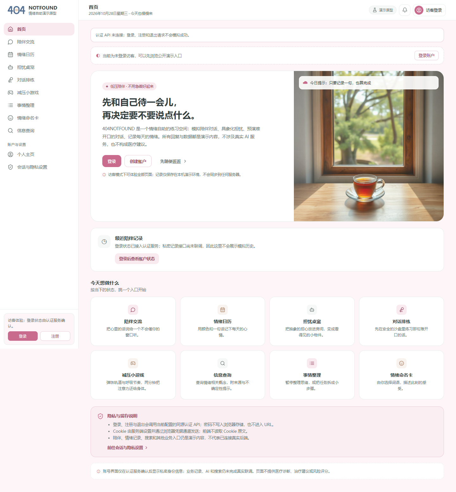
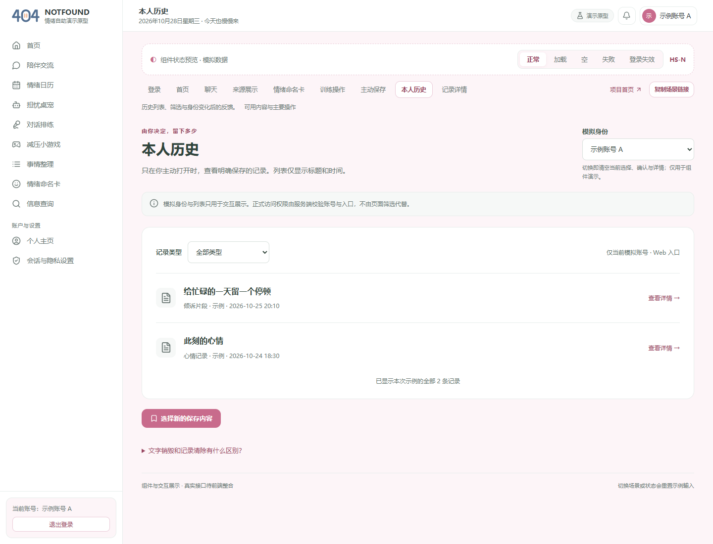

# 404烦恼未找到｜Alpha冲刺Day6：核对最终门槛，整合总结候选

| 项目 | 内容 |
| --- | --- |
| 这个作业属于哪个课程 | [2601_FZU_SE](https://bbs.csdn.net/forums/2601_CS_SE_FZU) |
| 这个作业要求在哪里 | [团队第四次作业](https://bbs.csdn.net/topics/620563653) |
| 这个作业的目标 | 据实记录Alpha验收、成员交付与心得、实际工作量依据、11篇博客及下一阶段安排 |
| 其他参考资料 | [七日计划](../../冲刺计划_20261023.md)、[代码规范](../../../代码规范.md)、[项目仓库](https://github.com/impureWine/404NOTFOUND)、《构建之法》 |

日期2026-10-28，Day6/7。产品main`3c6b3b3878f5d4e47f82eae23270e58238d73ceb`，整理截至2026-10-28T19:46:22+08:00。本文为当日可评审候选，正式站会、个人回执与发布证据不足部分明确待补。

## 今日计划与实际进展

PM负责最终核心场景验收、成员心得/分工/实际工作量依据、11篇博客清单，以及总结和下一阶段安排。本日完成28项场景结论、15项历史缺陷更新及新增命令问题、8人成果/缺项核对、11篇清单、总结候选和Day7责任/退出条件。数据Day6恢复专项独立复跑通过，UX PPT和安全xlsx/测试随笔已收进材料索引。

后端124/124、前端6/6及Vite构建通过；明确文件列表集成39/39、隔离恢复1/1。记录11/13、核心9/12、补充业务8/12、合约1/6，各集有重叠。两个P0、密文历史与临时结果生命周期等仍失败，发布BLOCKED。真实检索8005ms超时/来源0，未调用真实模型；PG16/HTTPS与完整业务E2E未验证。

## 当天站会与照片

实际会议时间、地点/形式、出席者、记录人：待真实回执。计划建议19:30站会并21:30前发布；不因已过计划时刻而自动勾选完成。当天真实非摆拍照片尚未取得，本包运行图不代替站会照；不复用其他天照片。不声称会议已经举行。

## 成员进展、问题、下一步与心得

| 成员 | 已核查进展与范围 | 问题/困难及下一步 | 心得/回执状态 | 证据 |
| --- | --- | --- | --- | --- |
| 张王昊 | Day6验收、总结、11篇清单、实际工作量依据和交接（本包）；Day5 PR60仍OPEN | 实际工时/贡献确认、团队评审 | 本日AI协作执行事实见07；不代写本人主观心得 | [本包](README.md) |
| 郭昱祺 | Day5交互修订及12页UX PPT已main；Issue68 CLOSED，README“尚未上传”已过时 | 团队Alpha结果/燃尽/后续计划PPT补页与实际试讲 | 已有稿说明焦点回归、模拟与真实业务边界；尚无完整冲刺心得签认 | [本人材料](https://github.com/impureWine/404NOTFOUND/blob/3c6b3b3878f5d4e47f82eae23270e58238d73ceb/docs/alpha/郭昱祺/Day5_20261027/Day5_个人站会材料_20261027.md) |
| 程杰 | Day6分支0379a56；作者12/12、构建、25入口200，非main；Electron ACL失败 | 整合分支、真实API/销毁隐私和桌面矩阵、工时心得 | Day6交接没有本人心得专栏，保留待补 | [Issue #71](https://github.com/impureWine/404NOTFOUND/issues/71) |
| 李泉毅 | Day6发布步骤与Day7提前稿在main；另有Issue72/PR73提前复核稿待合并；作者测试为旧/混合工作树 | Node22/PG16正式验证、修复命令、实际工时/完整心得 | 本人稿记述AI发现统计/命令问题与人工核验，不推算效率 | [本人材料](https://github.com/impureWine/404NOTFOUND/blob/3c6b3b3878f5d4e47f82eae23270e58238d73ceb/deliverables/alpha-backend/6天/李泉毅_Day6_成员进展与AI贡献_博客稿.md) |
| 程群 | PR54/63仍OPEN；Day3已入main，Day5分支作者AI专项40/40不能当主线修复 | AI授权/生命周期按新主线复测、真实调用及超时预案 | 没有取得Day6本人心得，不代填 | [PR #63](https://github.com/impureWine/404NOTFOUND/pull/63) |
| 庄剀涵 | Day6提交a0118cb：迁移/隔离恢复报告与测试已main；PM独立恢复1/1 | PG16/pg_dump/pg_restore、独立删除日志与真实来源、工时 | 已收Day6心得：恢复安全还依赖独立删除日志和旧会话撤销；隔离测试不能替代运维证据（摘要） | [本人材料](https://github.com/impureWine/404NOTFOUND/blob/3c6b3b3878f5d4e47f82eae23270e58238d73ceb/backend/evidence/daily/Day6_迁移隔离恢复与答辩交接.md) |
| 关欣 | PR69已合并；3条缺陷签名探针、xlsx评审草稿与Day5素材已收 | 修复后复核、腾讯共享链接及访问权限、Day6回执工时 | 已收Day5心得：将缺陷文字变为可复跑数字，对照记录与任务作用域发现隔离差异（摘要） | [本人材料](https://github.com/impureWine/404NOTFOUND/blob/3c6b3b3878f5d4e47f82eae23270e58238d73ceb/docs/alpha/关欣/Day5_冲刺随笔素材_20261027.md) |
| 曾俊涛 | Day5 main34d751c独立120/120、记录11/13、测试随笔更新稿已main | 最终回归/本机包或发布、测试随笔URL、会议照片和实际工时 | 已收Day5体会：自动化全绿仍可能缺可读历史/许可，截图需同次JSON佐证（摘要） | [本人材料](https://github.com/impureWine/404NOTFOUND/blob/3c6b3b3878f5d4e47f82eae23270e58238d73ceb/docs/alpha/曾俊涛/Day5_20261027/04_测试随笔更新稿_34d751c.md) |

以上是仓库成果收集，不代替“昨天会议以来”的本人陈述；前序材料日期保留，Day6新增本人心得/工时/出席待补。当前程杰0379a56作者12/12与25入口200在独立分支，不计为本日主线12项通过。李泉毅旧基线111/111与本日124/124也不相加。

## 项目燃尽

| 节点 | 线性理想剩余SP | 阶段计划剩余SP | 实际日终SP |
| --- | --- | --- | --- |
| Day1 | 85.7 | 88 | 待真实验收签认 |
| Day2 | 71.4 | 72 | 待真实验收签认 |
| Day3 | 57.1 | 54 | 待真实验收签认 |
| Day4 | 42.9 | 36 | 待真实验收签认 |
| Day5 | 28.6 | 20 | 待真实验收签认 |
| Day6 | 14.3 | 8 | 待真实验收签认 |
| Day7 | 0.0 | 0 | 明日按实填写 |

实际值为空而非0；未形成逐任务完整验收事件，不能把计划线当实际线。基线100SP和17REQ不变，不以测试数、提交数或主观完成百分比扣点。

## 当天最新运行展示

本日Edge实际构建：首页明确演示原型/认证未连接/业务未联调，销毁控件0。不是登录保存成功截图。

本日历史组件展示，合成账号A和内存示例，非真实持久历史。浏览器27个资源请求、业务API0、页面脚本异常0；默认页可能载入外部静态图，0API不等于不联网或隐私通过。未输入销毁正文、未执行销毁动态隐私验收。[本次原始浏览器记录](证据/browser-entry.json)。

## AI技术员工作

输入为七日计划、固定主线、成员报告/Issue和前序PM缺陷；任务是证据核对、可复跑测试与材料整合。实际运行结果与失败输出均保存；AI发现当前集成命令不可运行，改用明确文件列表验证39/39，并保持原命令待修。没有读取真实配置/密钥，不生成会议照片、个人心得、工时、实际SP或课程发布回执。源码/锁463份哈希未变；代码与报告待本人/团队审阅后签认。

## 下次会议前安排

按[缺陷与交接](02_剩余缺陷与Day7交接.md)优先P0、可读历史、生命周期和入口整合；补正式环境/真实调用/销毁隐私，今晚23:00前评审总结/PPT；明日完成真实Day7会议和材料提交。已到时限无回执则按逾期/待补记载，不编造执行。完整成员/博客材料见[核对表](04_11篇博客与答辩材料核对.md)。
