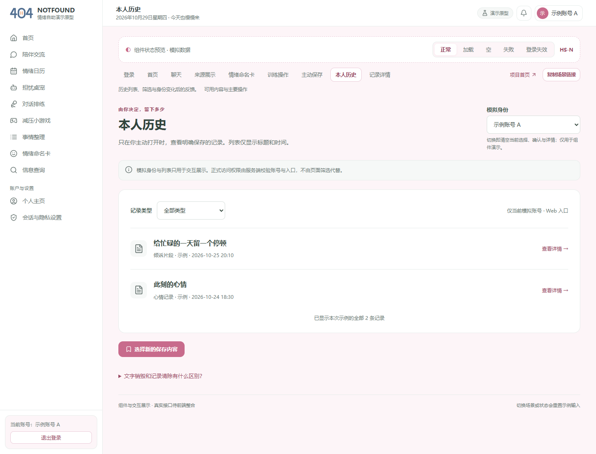

# 404烦恼未找到｜Alpha冲刺Day7：核对成果，保留真实未完成项

| 项目 | 内容 |
| --- | --- |
| 这个作业属于哪个课程 | [2601_FZU_SE](https://bbs.csdn.net/forums/2601_CS_SE_FZU) |
| 这个作业要求在哪里 | [团队第四次作业](https://bbs.csdn.net/topics/620563653) |
| 这个作业的目标 | 完成七日Alpha进度复盘、博客集合与总结、成员贡献依据及最终提交核对 |
| 其他参考资料 | [七日计划](../../冲刺计划_20261023.md)、[代码规范](../../../代码规范.md)、项目固定源码和成员交付 |

日期2026-10-29，Day7/7，整理截至2026-10-29T16:25:44+08:00。

## 今日目标与实际进展

按计划核对全部博客/集合，整合最后一天进度、燃尽与贡献，整理最终提交材料。本日完成固定主线独立复测、修正旧入口与退出结论、收录最终PPT/PDF和腾讯共享表，形成总结、集合、实际贡献依据、缺陷结转和作业回执清单。

本日固定main `1483f8330c3c47ecf88863968f518705a1a84918`（本日复测版本），Windows/Node26.2.0、锁定依赖与PGlite隔离库。后端141/141、显式枚举14个集成文件47/47、恢复专项1/1、前端客户端7/7、Vite构建成功。原`npm run test:integration`仍MODULE_NOT_FOUND，替代枚举脚本通过。记录12/13、核心9/12、业务9/12、旧合约1/6；集合重叠，不能相加。全量141含跨入口等“缺陷仍存在”的探针，不能当安全全过。

PR63已合并，缺内部令牌的匿名/错误Origin/无CSRF/无用途许可请求均403且模型调用0，原D5-01旁路在受测范围已阻断；同账号AI任务跨入口P0仍失败，历史正文仍不可读，END/撤回后已完成结果仍可读。BG-10退出重登旧临时回复失效已通过。真实公开Wikipedia一次8006ms TIMEOUT/0来源；本日PM未调用真实模型，AI作者10-29记录471ms限流是分支证据。正式PG16/HTTPS/外部删除日志恢复未验证，候选发布仍**BLOCKED**。

## 当日站会与成员进展

计划16:30真实站会、17:00日志总结集合、17:30内部提交；正式截止23:59。实际时间、出席和当天真实非摆拍会议照片尚未取得，不能用运行截图或旧照片替代。若实际晚于计划，记录真实时间，不倒填。

| 成员/角色 | 已收成果 | 问题/待补 | 来源 |
| --- | --- | --- | --- |
| 张王昊／PM/需求 | 本包：Day7日志、总结、集合、逐项提交核对、最终主线独立复测 | 本人审阅/会议/真实工时及贡献确认待补 | [本包](README.md) |
| 郭昱祺／UX/PPT | PR86已合并；12页最终PPTX、同版PDF、来源及检查记录已收到并登记 | 作者实际试讲/投影与接收方人工审阅待补；不等于团队业务通过 | [Issue #85](https://github.com/impureWine/404NOTFOUND/issues/85) |
| 程杰／前端/Electron | Issue88：分支0db4943作者12/12、1592模块构建、25静态入口200及当天图 | Electron有进程而窗口未确认；动态隐私/真实业务E2E未测。PR90 OPEN不当主线 | [Issue #88](https://github.com/impureWine/404NOTFOUND/issues/88) |
| 李泉毅／后端 | PR73已合并；API/配置与遗留项交接；111/111提前脏工作树结果保留原边界 | 本日PM干净固定主线141/141；原集成命令仍失败；正式PG/页面链未验 | [Issue #72](https://github.com/impureWine/404NOTFOUND/issues/72) |
| 程群／AI | PR84 OPEN；七天AI复盘/异常预案已通过UX引用材料取得 | 10-24历史成功；10-29真实请求限流471ms mock=false。分支40/40及107/111不算主线 | [Issue #83](https://github.com/impureWine/404NOTFOUND/issues/83) |
| 庄剀涵／数据/检索 | Issue87/ed57939已main；当天141/141、检索失败与数据交接有记录 | 正式PG16、独立删除日志重放与真实来源成功未完成；PM恢复专项1/1独立通过 | [Issue #87](https://github.com/impureWine/404NOTFOUND/issues/87) |
| 关欣／安全/评审 | Issue89已提交；跨入口P0仍未关闭，内部模型无令牌路径已阻断；腾讯文档已提供，本日PM无登录访问200/只读 | 作者“REQ14无UI”与新主线不符，本日已修正；未代签整体安全通过 | [Issue #89](https://github.com/impureWine/404NOTFOUND/issues/89) |
| 曾俊涛／测试/运维 | 主线Day6目录已有最新主线/安全增量及运行截图报告，测试随笔最新可核稿仍Day5 | 完整Day7独立报告/发布包与正式测试博客URL未取得，历史测试计数不替代今天 | [测试随笔稿](https://github.com/impureWine/404NOTFOUND/blob/1483f8330c3c47ecf88863968f518705a1a84918/docs/alpha/曾俊涛/Day5_20261027/04_测试随笔更新稿_34d751c.md) |

成员“昨日站会以来”的本人心得与实际工时仍须本人确认。已有心得只能按原材料摘要引用：庄剀涵强调隔离恢复不能替代独立删除日志和运维证据；关欣强调将缺陷写为可复跑数字；曾俊涛指出自动化全绿仍可能缺用户可读历史。其余未取得个人主观心得的条目保留待补，不由AI代述。

## 燃尽与运行展示

阶段计划最终0SP是目标，日终实际仍无完整逐任务签认，未强制归零。100SP证据台账未签认不等于团队没做工作；详见[贡献与燃尽](05_实际工作量贡献与燃尽核对.md)。

本日Edge默认mock主线：首页有REQ14独立输入，业务记录/AI仍标未联调。图不是完整后端业务成功证明。

历史组件为合成账号/内存示例。另行动态检查REQ14合成正文，受测清除与写入边界有限通过，[原始JSON](证据/req14-runtime.json)保留未覆盖分支。

## AI技术员与收尾

AI读取固定代码/Issue/前序材料、执行合成回归、核查腾讯访问并整合交付；实际发现安全旧报告的入口描述过时，以及退出重登已修，按本次结果修正。未调用真实模型、不读真实配置/密钥，不代填会议、心得、工时、比例或课程提交回执；人工仍负责内容审核、本人确认与正式发布。

当天后续按[提交核对](06_作业提交与回执核对.md)补齐正式URL/真实过程、试讲与贡献确认，并保留课程及群填报回执。未完成技术项进入[缺陷结转](数据/缺陷结转.json)，不因第七天结束自动关闭。
