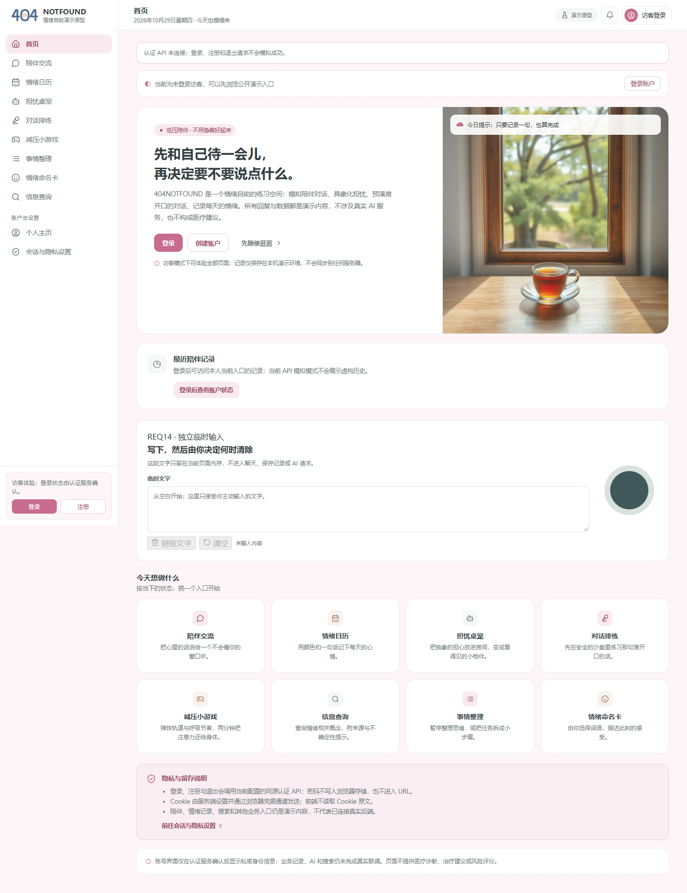
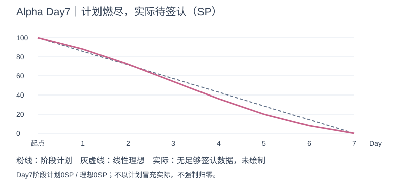

# 404烦恼未找到｜Alpha七日冲刺总结

| 项目 | 内容 |
| --- | --- |
| 这个作业属于哪个课程 | [2601_FZU_SE](https://bbs.csdn.net/forums/2601_CS_SE_FZU) |
| 这个作业要求在哪里 | [团队第四次作业](https://bbs.csdn.net/topics/620563653) |
| 这个作业的目标 | 完成七日Alpha进度复盘、博客集合与总结、成员贡献依据及最终提交核对 |
| 其他参考资料 | [七日计划](../../冲刺计划_20261023.md)、[代码规范](../../../代码规范.md)、项目固定源码和成员交付 |

周期2026-10-23—29，截至2026-10-29T16:25:44+08:00。本稿已整合第七天仓库成果，实际会议、全员主观心得/贡献比例和正式课程回执尚待补齐，不描述为全部课程任务已验收。

## 预期计划与现实进展

预期为游客命名/陪伴→注册登录→主动保存→本人历史/主页→退出换号隔离，另有真实来源、训练、端侧文字销毁、Electron与测试/发布/答辩材料。实际形成认证、用途许可、记录仓储/清除、AI/训练/检索与UX原型，但核心完整页面闭环仍有缺口。

| 需求 | 内容 | 当前层次 | 实际结果 |
| --- | --- | --- | --- |
| REQ01 | 陪伴 | 部分 | 正式Agent与真实许可/合成模型通；真实模型和页面链未过 |
| REQ02 | 基础训练 | 部分 | HTTP与受控时钟运行通过，真实页面训练未验 |
| REQ03 | 查询 | 阻塞 | 数据降级/幂等改进入main；本日真实TIMEOUT/0来源，公开Schema未齐 |
| REQ04 | 模式切换 | 部分 | 模块/双代次/取消在途通过，已完成结果生命周期未过 |
| REQ05 | 会话保存清除 | 阻塞 | 保存/清除规则通过；正文DTO仍不可读；退出重登旧AI回复失效已过，END/撤回仍未过 |
| REQ06 | 多入口 | 阻塞 | 记录双维隔离通过，AI跨入口失败；Electron Day6启动受限，微信仅适配/模拟 |
| REQ07 | 安全隐私 | 仍阻塞 | 内部模型无令牌请求403/调用0；AI跨入口仍失败，REQ14有限动态通过，整体安全未验收 |
| REQ08 | 日历 | 准备 | 数据/仓储与样例和不自动分析边界，未做完整业务 |
| REQ09 | 命名卡 | 部分 | 模块路由、UX组件存在；真实用户页面链未验 |
| REQ10 | 物件化 | 原型/准备 | 沿用设计与依赖，未做真实业务完成声明 |
| REQ11 | 排练室 | 原型/准备 | 契约/原型存在，真实业务未验 |
| REQ12 | 寄存 | 准备 | 仓储/样例及不自动展开边界，未做完整页面联调 |
| REQ13 | 屏幕发泄 | 原型 | 窗口/物理/音频依赖仍需后续运行证据 |
| REQ14 | 文字销毁 | 部分通过 | 主线首页有入口；销毁/清空/模拟pagehide/刷新及受测网络/Storage/IDB写入有限通过，异常/Cache/真实关闭等未覆盖 |
| REQ15 | 弹珠机 | 原型 | 前端分支资源释放作者回归，尚未入主线验收 |
| REQ16 | 认证 | 部分 | HTTP与旧会话撤销通过；幂等/续期/33字登录名未关 |
| REQ17 | 个人主页 | 部分 | 本人资料基础通过；资料重放/可读历史/页面绑定仍缺 |

本日固定main `1483f8330c3c47ecf88863968f518705a1a84918`（本日复测版本），Windows/Node26.2.0、锁定依赖与PGlite隔离库。后端141/141、显式枚举14个集成文件47/47、恢复专项1/1、前端客户端7/7、Vite构建成功。原`npm run test:integration`仍MODULE_NOT_FOUND，替代枚举脚本通过。记录12/13、核心9/12、业务9/12、旧合约1/6；集合重叠，不能相加。全量141含跨入口等“缺陷仍存在”的探针，不能当安全全过。

PR63已合并，缺内部令牌的匿名/错误Origin/无CSRF/无用途许可请求均403且模型调用0，原D5-01旁路在受测范围已阻断；同账号AI任务跨入口P0仍失败，历史正文仍不可读，END/撤回后已完成结果仍可读。BG-10退出重登旧临时回复失效已通过。真实公开Wikipedia一次8006ms TIMEOUT/0来源；本日PM未调用真实模型，AI作者10-29记录471ms限流是分支证据。正式PG16/HTTPS/外部删除日志恢复未验证，候选发布仍**BLOCKED**。

本日修正两项阶段判断：退出重登旧结果已失效；REQ14主线入口现可达且有限动态检查通过，异常/Cache/真实窗口离开等仍未验。PPTX/PDF最终稿、来源、腾讯表已收到，纠正前序缺项，不以材料交付代替产品发布。

[固定源码](https://github.com/impureWine/404NOTFOUND/tree/1483f8330c3c47ecf88863968f518705a1a84918)／[源码ZIP](https://github.com/impureWine/404NOTFOUND/archive/1483f8330c3c47ecf88863968f518705a1a84918.zip)，[本日验收与结转](01_最终版本验收与缺陷结转.md)列出版本和边界。

## 成员分工、协作与心得依据

| 成员/角色 | 已收成果 | 问题/待补 | 来源 |
| --- | --- | --- | --- |
| 张王昊／PM/需求 | 本包：Day7日志、总结、集合、逐项提交核对、最终主线独立复测 | 本人审阅/会议/真实工时及贡献确认待补 | [本包](README.md) |
| 郭昱祺／UX/PPT | PR86已合并；12页最终PPTX、同版PDF、来源及检查记录已收到并登记 | 作者实际试讲/投影与接收方人工审阅待补；不等于团队业务通过 | [Issue #85](https://github.com/impureWine/404NOTFOUND/issues/85) |
| 程杰／前端/Electron | Issue88：分支0db4943作者12/12、1592模块构建、25静态入口200及当天图 | Electron有进程而窗口未确认；动态隐私/真实业务E2E未测。PR90 OPEN不当主线 | [Issue #88](https://github.com/impureWine/404NOTFOUND/issues/88) |
| 李泉毅／后端 | PR73已合并；API/配置与遗留项交接；111/111提前脏工作树结果保留原边界 | 本日PM干净固定主线141/141；原集成命令仍失败；正式PG/页面链未验 | [Issue #72](https://github.com/impureWine/404NOTFOUND/issues/72) |
| 程群／AI | PR84 OPEN；七天AI复盘/异常预案已通过UX引用材料取得 | 10-24历史成功；10-29真实请求限流471ms mock=false。分支40/40及107/111不算主线 | [Issue #83](https://github.com/impureWine/404NOTFOUND/issues/83) |
| 庄剀涵／数据/检索 | Issue87/ed57939已main；当天141/141、检索失败与数据交接有记录 | 正式PG16、独立删除日志重放与真实来源成功未完成；PM恢复专项1/1独立通过 | [Issue #87](https://github.com/impureWine/404NOTFOUND/issues/87) |
| 关欣／安全/评审 | Issue89已提交；跨入口P0仍未关闭，内部模型无令牌路径已阻断；腾讯文档已提供，本日PM无登录访问200/只读 | 作者“REQ14无UI”与新主线不符，本日已修正；未代签整体安全通过 | [Issue #89](https://github.com/impureWine/404NOTFOUND/issues/89) |
| 曾俊涛／测试/运维 | 主线Day6目录已有最新主线/安全增量及运行截图报告，测试随笔最新可核稿仍Day5 | 完整Day7独立报告/发布包与正式测试博客URL未取得，历史测试计数不替代今天 | [测试随笔稿](https://github.com/impureWine/404NOTFOUND/blob/1483f8330c3c47ecf88863968f518705a1a84918/docs/alpha/曾俊涛/Day5_20261027/04_测试随笔更新稿_34d751c.md) |

已有本人心得按原日期摘要：数据岗指出恢复安全依赖独立删除日志与旧会话撤销；安全岗认为可复跑探针与作用域对照比形容词更易验证；测试岗指出全绿不等于用户目标达成。郭昱祺本人Day7材料说明需核对新主线与旧验收报告版本并保留未通过边界，试讲待实际完成；AI岗七天复盘区分10-24历史成功与10-29限流，强调人工负责范围与风险决定。其余个人心得及全部本人确认尚未齐，不替成员撰写主观感受。

协作中的主要问题是分支实现、main状态、旧报告和实际用户结果没有同步。前端/UX、后端/数据、AI/搜索、安全与测试须围绕同一固定版本协作，PM将每个差异映射到负责人、证据和关闭条件。当前材料已形成核对链，但独立检查不代替成员本人确认或正式环境验收。

## 工作量比例与燃尽

100SP基线、50×2SP和17REQ保留；实际日终SP为空。计划剩余0不能当实际0，测试数/提交数不直接换算SP或贡献。八人实际工时、协作分摊与贡献比例待团队确认，不能按人头均分。已有成果索引与登记字段见[实际工作量依据](05_实际工作量贡献与燃尽核对.md)，确认后比例应合计100%。

## 下一阶段与答辩附件

优先统一内部模型授权与任务入口作用域；修可读历史DTO和END/撤回生命周期；对齐公共查询Schema；整合前端真实API后跑完整页面核心链及隐私异常分支；再补真实供应商/来源成功、PG16/HTTPS/外部删除日志恢复和Electron矩阵。其余日历/寄存/物件化/排练等完整业务按原REQ依赖交接，不将原型和准备工作写成已开发完成，也不声称延期已获批准。

[最终PPTX](https://github.com/impureWine/404NOTFOUND/blob/1483f8330c3c47ecf88863968f518705a1a84918/docs/alpha/郭昱祺/Day7_20261029/UX_界面原型设计答辩_最终版_v1.0_20261029.pptx) · [同版PDF](https://github.com/impureWine/404NOTFOUND/blob/1483f8330c3c47ecf88863968f518705a1a84918/docs/alpha/郭昱祺/Day7_20261029/UX_界面原型设计答辩_最终版_v1.0_20261029.pdf) · [素材来源](https://github.com/impureWine/404NOTFOUND/blob/1483f8330c3c47ecf88863968f518705a1a84918/docs/alpha/郭昱祺/Day7_20261029/素材来源.md)。PPT作者已定稿12页并导出同版PDF；本次登记接收与链接核对，作者渲染结论按其报告引用，没有替其重渲染。实际计时试讲/投影检查待本人完成。腾讯共享[评审表](https://docs.qq.com/sheet/DTEZ1SHdVTUZ2b1JD)本日可匿名只读，现场编辑/记录权限按真实评委需求确认。

## AI技术员复盘

七天使用AI辅助契约/代码/用例草稿、差异核对、缺陷探针和材料整理。AI工程作者记录10-24真实成功，但10-29复查为限流；其PR84分支40/40、全量107/111不与本日main141/141混算。PM本日用合成数据复跑并保存失败，识别旧报告状态及P0授权观察过时、源码603份hash未变，没有可证明的节省工时百分比。

AI生成的实现和测试可能共享错误假设，必须靠反例、源码阅读和非作者复测纠正；Mock不能证明真实供应商、来源、生产或临床安全。下一阶段让AI优先产出可定位差异和可复跑反例，人工核对隐私、费用、范围及最终风险；保留输入约束、人工修改和失败结果，不拿AI自查代替团队签认。

## 正式提交前最后补录

11篇真实博客/审核状态与置顶、当天真实站会照片/全员回执、实际工时和贡献比例、最后候选及非作者签认、实际试讲、课程页面回执和群填报仍需补齐。17:30内部目标、23:59正式截止按真实提交时刻记录。未发生事项不提前填写，未完成技术项如实结转。
