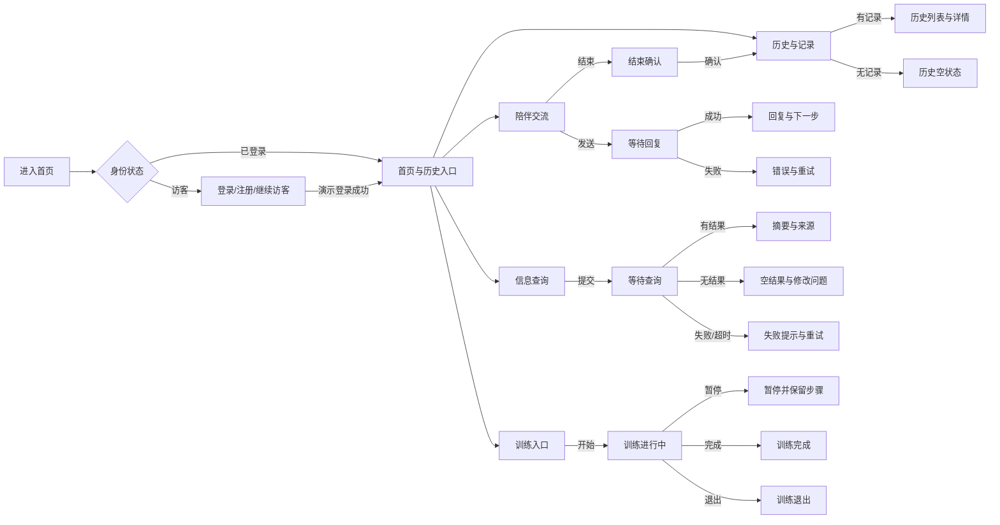

# 郭昱祺｜Day1 核心路径与状态走查基线

日期：2026 年 11 月 14 日
对应冲刺：Beta 七天冲刺 Day1「启动、交接与共同基线」
负责人：郭昱祺
协作对象：程杰（页面实现）、曾俊涛（操作复核）

## 1. 交付范围

本交付完成 Day1 的三项工作：

1. 梳理登录、陪伴、查询、训练和历史五条用户路径；
2. 为每条路径列出正常、等待、空、失败，以及必要的阻断、暂停和结束状态；
3. 形成可由前端和测试直接执行的交互验收项与首轮走查基线。

本文依据以下现有材料整理：

- [仓库原型总览](../../../../web-prototype/prototype-guide.html)
- [页面交互状态表](../../../../docs/第三次作业_郭昱祺/04_交互状态表/页面交互状态表.md)
- [接口映射与通用状态](../../../../docs/第三次作业_郭昱祺/04_交互状态表/接口映射与通用状态.md)
- [既有 UX 交付索引](../../../../docs/第三次作业_郭昱祺/README.md)
- 仓库 `web-prototype/` 下的登录、陪伴、查询、训练和历史页面

**边界说明：**当前依据是浏览器原型和交互设计材料。登录、AI 陪伴、检索、训练记录和历史保存在原型中仍是演示或本机内存行为；本文的“通过”只表示页面路径、反馈和状态规则可以走查，不表示真实认证、真实 AI、真实检索或服务端持久化已经完成。

## 2. 核心流程总览



## 3. 五条路径步骤表

### 3.1 登录路径（P4-23、P4-22）

| 步骤 | 用户操作 | 页面反馈 | 验收点 | 当前原型事实 |
| --- | --- | --- | --- | --- |
| L1 | 从首页进入登录 | 显示登录标题、账号/密码输入和演示边界说明 | 用户知道这是登录入口，字段有可见标签 | `web-prototype/login.html` |
| L2 | 点击示例账号或填写字段 | 输入框出现值；未提交前不跳转 | 示例填充不会绕过提交按钮 | 固定示例账号可填入 |
| L3 | 空字段提交 | 行内提示字段必填，停留在当前页 | 不清空已填写的安全字段，不误报成功 | 需在走查时记录实际提示文字 |
| L4 | 非空演示凭据提交 | 显示登录中遮罩，随后进入已登录外观首页 | 提交期间按钮不可重复触发 | 原型为本地演示，不发送凭据 |
| L5 | 点击注册 | 进入注册页，说明不会真实创建账号 | 登录与注册入口互相可返回 | `register.html` 已提供边界说明 |
| L6 | 选择访客继续 | 进入访客首页，私密历史不可声称已开放 | 访客与已登录视觉状态可区分 | 原型允许访客浏览页面 |
| L7 | 点击退出 | 回到访客/登录入口，私密内容遮蔽 | 退出不应被描述为真实会话吊销 | 原型是页面状态切换 |

### 3.2 陪伴路径（P4-02～P4-05）

| 步骤 | 用户操作 | 页面反馈 | 验收点 | 状态 |
| --- | --- | --- | --- | --- |
| C1 | 进入陪伴交流 | 显示模式名称、输入区和“本地演示”边界 | 用户知道当前不是查询或训练 | `companion.html` |
| C2 | 输入表达并发送 | 输入保留；出现等待/回复区域 | 发送中不可重复提交；当前内容不被静默丢弃 | 正常：`idle → waiting → success` |
| C3 | 点击快捷开场 | 示例文本进入输入区，可继续修改 | 快捷词不能直接冒充用户已发送 | 正常辅助入口 |
| C4 | 发送后等待 | 显示“正在准备回复”等等待提示、可结束或取消 | 等待状态不显示确定性结论 | P4-03 独立加载示例 |
| C5 | 回复成功 | 显示本地演示回复和下一步入口 | 回复明确标记演示/不确定性 | `companion.html` 固定脚本 |
| C6 | 无历史/新会话进入 | 显示开始交流引导和空输入区 | 空状态提供开始动作，不伪造历史 | P4-04 `companion-empty.html` |
| C7 | 请求失败 | 显示原因范围、重试和返回入口 | 失败不能显示保存成功；重试不能重复创建任务 | P4-05 `companion-error.html` |
| C8 | 结束本次会话 | 弹出结束确认，区分“清除本次表达”和“确认结束” | 取消确认保留当前页；确认结束进入空/结束状态 | 原型已有结束确认弹窗 |

### 3.3 查询路径（P4-18～P4-19）

| 步骤 | 用户操作 | 页面反馈 | 验收点 | 状态 |
| --- | --- | --- | --- | --- |
| Q1 | 进入信息查询 | 显示查询说明、输入框和常见查询词 | 页面明确是事实/概念查询，不是陪伴 | `info-query.html` |
| Q2 | 空输入提交 | 提示先输入问题并聚焦输入框 | 不创建空任务，不清除已有安全草稿 | `INVALID_INPUT` 对应 UI |
| Q3 | 提交查询 | 显示等待或进度提示，禁重复提交 | 可返回；旧查询响应不能覆盖新问题 | 目标：`idle → loading` |
| Q4 | 查询成功 | 显示摘要、逐条来源、时间/适用范围和不确定性提示 | 摘要与来源一一对应；来源不完整时降级说明 | `success/ready` |
| Q5 | 查询无结果 | 显示“没有找到可确认资料”等空态，提供修改问题/常见词 | 空结果不构造来源，不当作系统故障 | P4-19 `info-empty.html` |
| Q6 | 冲突/过期/超时 | 显示具体不确定性类型和可恢复动作 | 不把冲突或超时写成确定结论 | 设计材料已有目标状态，原型需逐项复核 |
| Q7 | 查询失败 | 显示暂不可用和重试/返回 | 503、断网与无结果文案不能混用 | `error/failed/expired` 分开 |
| Q8 | 离开查询 | 取消或使旧任务代次失效，不自动保存结果 | 返回后不出现迟到的旧结果 | 目标由接口 I19～I21 支持 |

### 3.4 训练路径（P4-11～P4-16）

| 步骤 | 用户操作 | 页面反馈 | 验收点 | 状态 |
| --- | --- | --- | --- | --- |
| T1 | 进入训练入口 | 显示呼吸、五感、暂停整理、任务拆分等工具、时长和说明 | 训练不会自动开始 | `games.html` / 训练入口 |
| T2 | 选择工具 | 显示开始前说明和开始按钮 | 用户知道预计时长、输入范围和退出方式 | `ready` |
| T3 | 点击开始 | 显示步骤/阶段/进度 | 开始后禁用冲突操作，保留退出 | `running` |
| T4 | 中途暂停 | 停止计时、动画、声音和物理；显示“继续训练” | 暂停不等于失败；返回后不自动继续 | `paused` |
| T5 | 点击继续 | 从上次步骤继续 | 不补算后台时间，不重复提交 | `paused → running` |
| T6 | 完成全部步骤 | 显示训练完成结果、再做一次/返回/结束 | 完成与退出必须有不同文案和视觉 | `completed` |
| T7 | 主动退出 | 显示训练退出结果或确认 | 退出不标记为失败；清理 timer、监听和临时输入 | `exited/ended` |
| T8 | 训练中需要帮助 | 提供现实支持入口并停止当前训练 | 不继续生成普通训练建议 | 需与安全流程联调 |
| T9 | 清空练习 | 说明清除对象，确认后清除当前草稿 | 取消确认不改变内容 | `clear-confirmation` |

### 3.5 历史路径（P4-06、P4-08、P4-10、P4-20～P4-21）

| 步骤 | 用户操作 | 页面反馈 | 验收点 | 状态 |
| --- | --- | --- | --- | --- |
| H1 | 从首页/个人主页进入历史 | 显示日历、会话、物件、寄存或排练记录入口 | 入口名称说明记录类型 | 当前为固定示例或本机内存 |
| H2 | 有记录进入列表 | 显示时间、摘要、类型和详情入口 | 不泄露其他身份或其他入口记录 | `ready/list` |
| H3 | 无记录进入 | 显示“暂无记录”及首次记录/返回入口 | 空列表不显示旧缓存或假历史 | `calendar-empty.html` |
| H4 | 打开详情 | 显示正文、来源范围和保存状态 | 详情与列表记录对应；默认不自动展开敏感正文 | `detail` |
| H5 | 取出/展开寄存内容 | 只展开当前条目，显示“已取出”或“再次收起” | 展开不删除条目；延期/重新寄存需确认 | `worry-room` 规则 |
| H6 | 编辑/保存 | 显示保存确认或待核实状态 | 不把本地停止误报为服务端已保存 | `write-confirmed` / `write-unconfirmed` |
| H7 | 删除/清除 | 先显示对象范围和确认；取消则保留 | 只删除用户确认的对象，不误删其他类别 | I26 → I27 目标流程 |
| H8 | 切换账号/退出 | 私密历史隐藏，旧请求与旧内容清理 | 账号 B 不得看到账号 A；迟到响应不得回填 | `blocked/auth-required` |

## 4. 状态与文案清单

### 4.1 通用状态词

| 状态 | 页面必须表达 | 推荐主文案 | 可用动作 | 禁止表达 |
| --- | --- | --- | --- | --- |
| idle | 尚未开始，告诉用户下一步 | “准备好后再开始，不用急。” | 填写、开始、返回 | “已完成” |
| loading / waiting | 已提交，仍在等待 | “正在准备回复，通常很快完成。” | 取消、返回 | “一定会成功” |
| ready / success | 有可展示结果 | “这是当前可查看的结果。” | 查看、编辑、保存 | 把演示结果说成真实结果 |
| empty | 查询成功但没有条目 | “这里还没有记录。” / “没有找到可确认资料。” | 新增、修改问题、返回 | “系统出错” |
| error / failed | 明确失败原因范围 | “暂时无法完成，请稍后重试。” | 重试、返回 | “已保存”“已完成” |
| blocked | 未登录、无权限或能力不支持 | “登录后才能查看这部分内容。” | 登录、返回 | 暴露他人数据或权限细节 |
| paused | 用户主动暂停 | “已暂停，当前步骤已保留。” | 继续、重来、退出 | “训练失败” |
| completed | 用户完成全部步骤 | “训练完成了。” | 再做一次、返回 | 与退出共用“结束” |
| ended / cancelled | 用户主动结束或取消 | “本次已结束，临时内容不会继续处理。” | 新会话、返回 | “任务失败” |
| write-unconfirmed | 本地停止但服务端结果未知 | “结果尚未确认，请核对后再继续。” | 核对、返回 | 自动重复创建或显示已保存 |

### 4.2 业务文案清单

| 场景 | 标题/提示 | 按钮 | 备注 |
| --- | --- | --- | --- |
| 登录 | “欢迎回来，先坐下，不用急着说话” | “登录（演示）”“去注册”“访客使用” | 原型必须保留“演示、不发送凭据”说明 |
| 注册 | “注册一个演示账号，看看完整的样子” | “注册并进入（演示）” | 不写成真实注册、短信或邮箱验证 |
| 陪伴 | “陪伴交流” | “发送”“结束本次会话” | 标出“回复由本地演示脚本生成” |
| 陪伴等待 | “正在准备一条回复…” | “取消”“结束” | 取消后不回填迟到回复 |
| 陪伴空态 | “从一句话开始就好” | “开始交流” | 不伪造历史消息 |
| 陪伴失败 | “这次没有完成回复” | “重试”“返回陪伴” | 不显示保存成功 |
| 查询 | “信息查询” | “查询”“换个说法” | 结果与陪伴入口区分 |
| 查询空态 | “没有找到可确认资料” | “修改问题”“查看常见查询” | 空结果不展示假来源 |
| 查询不确定 | “资料之间存在差异，先把它当作线索” | “查看来源”“返回修改” | 冲突、过期、超时要分别说明 |
| 训练准备 | “选择一个适合现在的练习” | “开始训练” | 显示预计时长和退出方式 |
| 训练暂停 | “已暂停，当前步骤已保留” | “继续训练”“重新开始”“退出训练” | 暂停不等于失败 |
| 训练完成 | “这轮练习完成了” | “再做一次”“返回放松入口” | 与退出结果分离 |
| 历史空态 | “这里还没有记录” | “记录这一刻”“返回首页” | 不显示旧身份内容 |
| 删除确认 | “确认清除这条记录吗？” | “取消”“确认清除” | 写清对象、范围和不可恢复性 |
| 账号失效 | “登录状态已失效，请重新登录” | “去登录” | 清理私密正文和旧请求 |
| 网络失败 | “暂时无法连接，内容没有被确认保存” | “重试”“返回” | 不与空状态混用 |

## 5. Day1 走查基线

### 5.1 执行条件

- 浏览器：Edge 或 Chrome，桌面宽度至少 1280px；另补 390×844 窄屏检查。
- 入口：`web-prototype/login.html`；无真实账号时使用公开演示账号或“访客使用”。
- 记录：每项写“通过 / 部分通过 / 未通过 / 不适用”，保存页面、状态、文案和截图路径。
- 证据边界：原型固定数据、模拟回复、本机内存和静态状态页必须单独标记，不得写成真实服务结果。

### 5.2 首轮检查项

| 编号 | 路径 | 操作 | 预期 | 当前基线 |
| --- | --- | --- | --- | --- |
| B01 | 登录 | 空字段提交 | 行内错误、留在当前页 | 待现场复核 |
| B02 | 登录 | 示例账号提交 | 出现演示登录中状态并进入首页 | 可依据页面走通；非真实认证 |
| B03 | 登录 | 访客进入后打开历史 | 访客不看到私密记录 | 待复核退出/访客遮蔽 |
| B04 | 陪伴 | 输入、发送、等待、查看回复 | 顺序明确，等待期间不重复提交 | 页面有固定回复演示 |
| B05 | 陪伴 | 直接打开空状态页 | 显示开始引导和返回入口 | `companion-empty.html` |
| B06 | 陪伴 | 打开错误状态页并重试 | 失败说明可理解，重试可回到陪伴 | `companion-error.html` |
| B07 | 陪伴 | 结束会话并取消确认 | 取消不丢当前内容 | 结束确认已存在 |
| B08 | 查询 | 空输入提交 | 聚焦输入、提示补充问题 | 待现场复核 |
| B09 | 查询 | 提交常见词 | 等待→摘要→来源，来源逐条对应 | 固定查询演示 |
| B10 | 查询 | 打开无结果页 | 明确无结果，可修改问题 | `info-empty.html` |
| B11 | 查询 | 复核冲突/过期/超时 | 不确定性文案与重试入口清楚 | 设计已列目标；原型需复核 |
| B12 | 训练 | 打开训练入口 | 先看说明，不能自动开始 | `games.html` |
| B13 | 训练 | 开始并暂停 | 计时/动画停止，步骤保留 | 依据 v1.2 规则复核 |
| B14 | 训练 | 继续、完成 | 从原步骤继续，完成有独立结果 | 需复核各工具差异 |
| B15 | 训练 | 主动退出 | 退出与失败、完成区分 | 需复核提示层级 |
| B16 | 历史 | 打开有记录页面 | 列表、详情和类型对应 | 固定示例/本机内存 |
| B17 | 历史 | 打开空日历 | 空态有首次记录入口 | `calendar-empty.html` |
| B18 | 历史 | 展开、延期、删除寄存 | 只作用于当前条目，删除有确认 | 依据第三轮规则复核 |
| B19 | 历史 | 退出/切换账号后返回 | 旧记录隐藏，旧响应不回填 | 重点复核身份隔离 |
| B20 | 跨路径 | 陪伴→查询/训练 | 有未保存内容时说明是否携带 | 目标规则已有，需现场确认 |
| B21 | 跨路径 | 训练中返回/切后台 | 进入暂停，不补算后台时间 | 需在实际页面复核 |
| B22 | 窄屏 | 390×844 打开五条路径 | 无横向溢出，按钮仍可操作 | 待执行截图基线 |
| B23 | 文案 | 查看所有等待、空、失败提示 | 不把模拟/空/失败混写 | 以第 4 节为核对表 |
| B24 | 安全边界 | 查看登录、查询、危机说明 | 不承诺诊断、救援或真实检索 | 需与关欣复核 |

### 5.3 记录格式

```text
检查编号：B__
执行日期：2026-11-14
浏览器/视口：
前置条件：
实际步骤：
实际结果：
状态：通过 / 部分通过 / 未通过 / 不适用
证据截图：
发现问题：
建议负责人：程杰 / 曾俊涛 / 程群 / 李泉毅 / 关欣 / 其他
```

## 6. 交接与后续动作

| 接收人 | 交接内容 | 下一步 |
| --- | --- | --- |
| 程杰 | 五条路径的页面入口、状态触发和文案核对表 | 对照真实实现标注“已接线 / 模拟 / 待接入”，补按钮状态和迟到响应处理 |
| 曾俊涛 | B01～B24 走查基线和记录格式 | 复现关键路径，保留截图与实际结果，不把固定示例写成真实服务通过 |
| 程群 | 陪伴、训练等待/取消/超时/结束状态 | 核对模型和训练任务终态，补异常反馈边界 |
| 关欣 | 登录阻断、账号隔离、历史遮蔽、外发边界 | 复核未登录、切换账号、危机指引和日志/配置暴露 |
| 李泉毅、庄剀涵 | 目标接口 I01～I32 与状态映射 | 后续接入时核对身份、任务代次、记录归属、清除确认和错误码 |

### Day1 出口判断

- **已交付：**流程步骤表、状态与文案清单、24 项走查基线、交接责任和原型边界说明。
- **尚未宣称：**真实登录、AI 调用、查询服务、训练后端、历史持久化、真实用户测试和线上部署。
- **Day2 可直接进入：**等待/取消/会话失效/结束/撤回提示走查，以及页面与服务端状态对齐。
