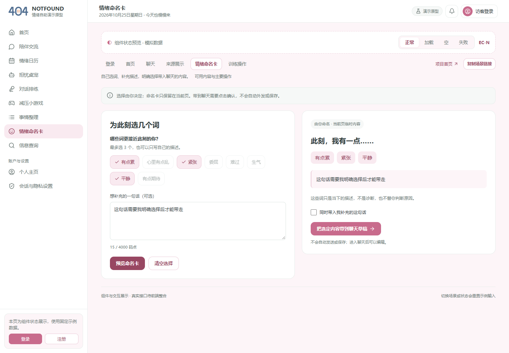
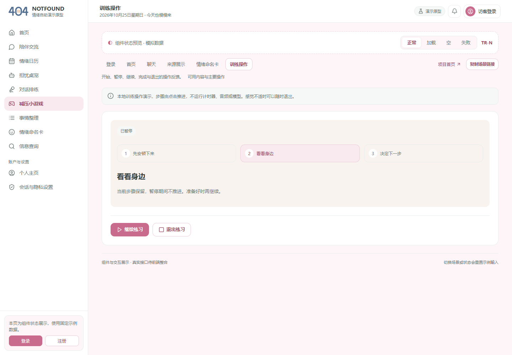

# Day 3：页面组件与交互走查记录

成果日期：2026-10-25（Asia/Shanghai）。成员：郭昱祺（102400413）· UX／产品设计。关联任务：[#23](https://github.com/impureWine/404NOTFOUND/issues/23)。

今天交付与程杰当前前端匹配的页面组件，以及实际执行的交互走查记录。新增命名卡、训练操作和聊天／查询超时展示；保留登录、首页、聊天与来源四场景的既有交付。本次以组件交付为范围，业务 API 装配仍需前端整合。

## 交付入口

| 材料 | 内容 |
| --- | --- |
| [页面组件交付](页面组件交付.md) | 源码位置、组件职责、props／事件、状态、复用与运行方法 |
| [交互走查记录](交互走查记录.md) | 实际步骤、预期与观察、发现及修复、验证范围与待复核事项 |
| [验证与截图清单](验证与截图清单.json) | 93 项浏览器检查、40 张截图及哈希、代码文件指纹 |
| [可复现走查脚本](scripts/walkthrough.cjs) | 使用 Playwright 操作 Edge，检查显示与关键交互；独立验证工具 |
| [构建输出](build-output.txt) | Vite 双入口构建结果 |
| [现有测试输出](test-output.txt) | 6 项 API 适配器测试结果 |
| [浏览器执行输出](browser-output.txt) | 78 组场景／状态／宽度检查与 15 组交互／样式／网络检查 |

## 今日结果

页面组件现与现有 React 首页共同使用导航、顶栏、欢迎卡、工具网格和主题。命名卡支持用户自行选词、补充描述、预览及明确选择携带范围；聊天、查询提供与明确失败和无结果区分的超时状态；训练操作展示开始、暂停、继续、完成、退出及重来。

本地构建和现有 6 项测试通过。浏览器检查覆盖 6 场景的 24 个基础状态，以及聊天／查询 2 个超时状态，在 1440、390、320px 三种宽度共 78 组显示；另执行 15 组交互、计算样式与网络检查，合计 93 项通过。场景组件走查期间观察到的 API 请求为 0，截图与日志不代表真实后端、模型或检索联调完成。

本次执行方式为 AI 辅助的浏览器自动操作与截图审阅。非作者人工复核、真实接口和跨设备验收仍待实际执行；未代填他人评审结论。

## 启动

在仓库的 `prototype` 目录运行：

```powershell
npm ci
npm run dev -- --host 127.0.0.1 --port 5184 --strictPort
```

打开 `http://127.0.0.1:5184/ux-components.html?page=emotion&state=normal`。支持 `page=login/home/chat/sources/emotion/training`；基础状态为 `normal/loading/empty/error`，聊天及来源额外支持 `timeout`。

GitHub 中的 JSX 和 HTML 源码链接用于阅读，需要本地运行才能操作；上面的 localhost 地址不代表公开部署。




