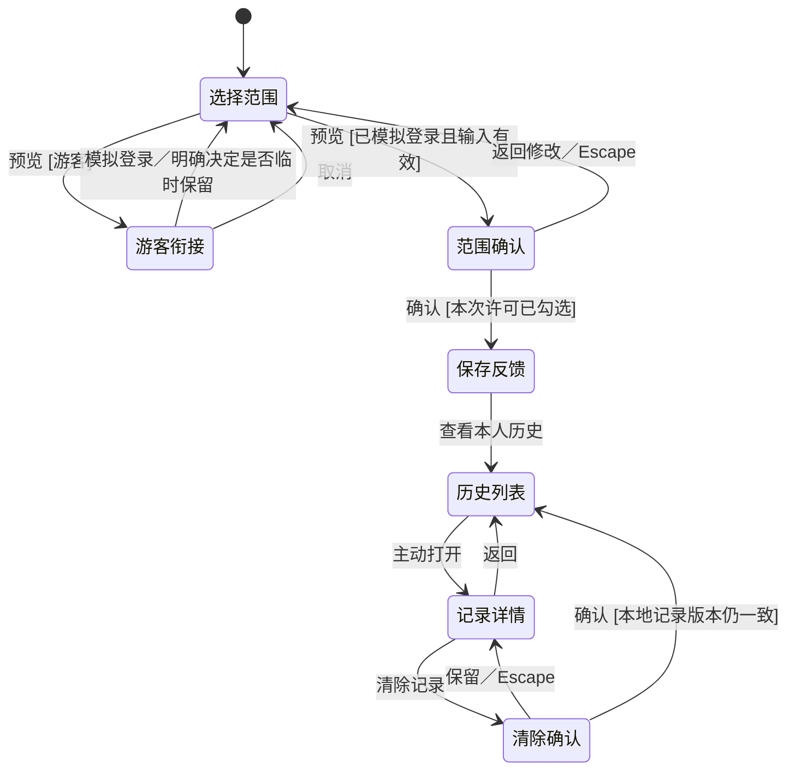

# 保存与历史页面交付

2026-10-26 · 郭昱祺（102400413）· 本地 React 组件展示交付。

任务依据：[冲刺计划 Day 4](../../冲刺计划_20261023.md)。交互约束依据：[全功能接口与限制规范 §2.2、§4、REQ-14](../../../第三次作业_张王昊/09_全功能接口与限制规范.md)。

## 用户场景与操作流程

**场景一：只留下本人选中的一句话。** 用户不希望整段倾诉自动留存。进入主动保存后，消息默认不选；填写标题并勾选片段，预览完整范围，再勾选本次保存确认。成功后可前往本人历史；未选中的回复不进入这条记录。修改范围、取消后重开均需重新确认。

**场景二：游客决定是否继续保存。** 游客选择保存范围后先看登录衔接弹窗。临时保留默认关闭；不保留时，模拟登录后不迁移片段。主动勾选保留时，只在本页内存留下选定片段；模拟登录后仍需重新预览并勾选保存确认，不自动生成记录。

**场景三：回看与清除。** 本人历史仅展示标题、类型、时间；用户主动选中一条才显示正文。清除先展示目标记录及范围，初始焦点为“保留记录”。取消维持原记录，确认才从本次模拟历史移除；随后关闭详情，防止继续显示已清除内容。

下面是组件演示的状态图，非服务端会话状态机：

## 页面与预置状态

| 页面参数 | 正常 N | 加载 L | 空 E | 失败 F | 扩展状态 |
| --- | --- | --- | --- | --- | --- |
| `page=save`（SV） | 无默认勾选，可编辑标题与范围 | 固定等待，锁定范围及重复提交 | 无片段，可载入虚构样例 | 保留所选内容，重新预览及确认 | T 超时结果待确认；S 固定已保存反馈；X 登录失效隐藏选择 |
| `page=history`（HS） | 元数据列表、类型筛选、打开详情 | 不显示旧列表 | 无记录／筛选无匹配 | 明确读取失败，允许重试 | X 登录失效隐藏记录 |
| `page=record-detail`（RD） | 正文、返回、清除入口 | 正文隐藏 | 未选择记录 | 正文隐藏，可重试 | X 登录失效；U 统一不可用；C 状态变化，先重读再确认清除 |

共 19 个可用 URL 复现的预置状态。游客身份、范围确认、清除确认、筛选无匹配和真实点击后的成功反馈属于交互分支，不重复算作预置状态。顶部 S 状态只是反馈样张，不会生成记录。

超时 T 不显示“保存失败”或直接“重试保存”。范围被锁定，可查看历史；“查看明确失败示例”明确是评审用的本地状态切换，不代表调用了写入结果核实接口。

## 组件契约

| 组件 | 主要输入／事件 | 交互与视觉要求 |
| --- | --- | --- |
| `RecordSceneHeader` | `identity`、`onIdentity` | 展示页身份选择器；切换清除未确认选择与详情，不用作真实认证 |
| `SaveSelection` | `items`、`selectedIds`、`title`、`locked`；`onToggle/onTitle/onPreview` | 受控选择；标题 trim 后 1～80 Unicode 码点；消息最多 20 条、合计 12000 码点；无选择或超限时禁用预览，不静默截断 |
| `SaveConfirmation` | `snapshot`、`consent`；`onConsent/onCancel/onConfirm` | 完整显示本次快照；许可默认关闭；明确区分保存与 AI 处理 |
| `GuestSaveGate` | `keepSelection`；`onKeepSelection/onCancel/onLogin` | 不输入凭据；默认不保留游客片段；登录后重新授权 |
| `RecordHistoryList` | `items`、`filter`、`status`；`onFilter/onOpen/onRetry/onStart/onLogin` | 只渲染列表元数据；失败不渲染为空；类型筛选空态有明确文案 |
| `RecordDetail` | `record`、`status`；`onBack/onRetry/onClear/onLogin` | 正常时展示正文；失效、不可用、冲突及失败均不渲染正文 |
| `ClearRecordConfirmation` | `record`；`onCancel/onConfirm` | 显示目标标题及本次范围；默认“保留记录”，确认才清除 |
| `RecordDialog` | `title/description/children`、`onCancel` | 原生模态框、有名称及描述；打开后焦点到安全操作，限制模态交互，Escape 取消，关闭恢复触发焦点 |

本地 `useDay4Workspace` 仅负责合成账号 A／B、记录集合与活动详情；不作为正式数据仓库或鉴权模块。`SavePreview` 的提交保护防止本次组件重复插入，但不能替代服务端幂等键。

## 正式页面接入映射

下表是接入契约，本次组件尚未调用这些 HTTP 接口。后端的实现和测试情况应引用对应负责人的交付证据。

| 页面操作 | 对应接口／依赖 | 接入时应保持的行为 |
| --- | --- | --- |
| 身份判断、重新登录 | 现有 `GET /api/auth/context`、`POST /api/auth/login` | 使用认证容器；游客与真实账号切换后清旧草稿、详情和授权，不直接使用模拟选择器 |
| 保存确认 | `POST /api/consents`，`purpose=SAVE`；随后 `POST /api/records` | CONVERSATION 使用真实 `sessionId/selectedMessageIds`；绑定精确范围；不能将示例消息 ID 或本地正文结构直接当 API 请求 |
| 读取历史、筛选、翻页 | `GET /api/records?kind=...&cursor=...&limit=...` | 只接收当前账号及入口的元数据；503 保持失败；本次固定数据无分页 |
| 打开详情 | `GET /api/records/:id` | 主动打开才读正文；401 隐藏私密内容；404 统一不可用，不透露归属 |
| 清除确认、执行 | `POST /api/records/:id/clear-confirmations`；`POST /api/records/:id/clear` | 绑定记录、账号、入口、版本及有效期；取消不执行 clear；成功才移除缓存和正文 |
| 状态变化、失败、超时 | 接口 409／503／网络超时及幂等契约 | 409 先重新读取，再次确认；明确失败可重试；写超时先核实原操作，不换 requestId 自动重发 |
| 文字销毁 | 无 HTTP、AI、仓储接口 | 独立输入与私有视图内存，见[操作说明](文字销毁操作说明.md) |

真实清除的在途态、失败重试、确认过期，以及跨入口权限校验仍需正式页面容器接入，本次不把同步的内存移除宣称为服务器清除完成。

## 源码与适配

主要源码：[Day4Components.jsx](../../../../prototype/src/ux-showcase/Day4Components.jsx)、[Day4Previews.jsx](../../../../prototype/src/ux-showcase/Day4Previews.jsx)、[day4.css](../../../../prototype/src/ux-showcase/day4.css)。入口和状态：[main.jsx](../../../../prototype/src/ux-showcase/main.jsx)、[data.js](../../../../prototype/src/ux-showcase/data.js)。模拟边界：[mock-data-manifest.js](../../../../prototype/src/api/mock-data-manifest.js)。

桌面采用双栏保存布局；1050px 以下单栏；560px 以下调整面板间距、身份选择、列表和弹窗操作。320px 时预置状态按钮按行排列，保留完整标签。共用导航和主题，新增样式限定在组件展示页及记录模态框。
