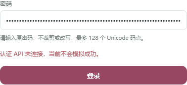
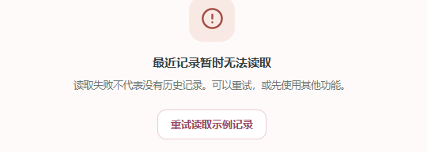

# UX_界面原型设计答辩_初稿_v0.1_20261027

- Source: `UX_界面原型设计答辩_初稿_v0.1_20261027.pptx`
- Total slides: 12

## Slide 1

404NOTFOUND

UX 交互修订与界面原型初稿

郭昱祺 · UX / 产品设计

- 2026-10-27

### Speaker Notes

今天展示的是 404NOTFOUND 的 UX 交互修订与界面原型初稿，我负责组件、状态规范和设计交接。接下来会沿用户操作路径说明页面怎样帮助用户理解当前状态，再介绍今天修了什么，以及哪些内容仍需要团队整合。

## Slide 2

个人范围与当前交付层次

01

设计交付：场景、流程、原型与说明

将用户目标落实到页面、按钮和可恢复的操作状态。

02

本轮重点：组件与交互规范

提供可运行组件展示、状态证据和答辩材料。

03

团队协作：正式页面装配与业务联调

独立展示入口使用合成数据，业务接入仍需前端整合。

个人范围沿用 10 月 23 日确认；组件演示不代表生产系统验收。

- 02

### Speaker Notes

我的完整设计任务包括用户场景与操作流程、原型主稿、说明书对应章节和原型答辩材料。本轮沿用已经确认的组件方案，主要提供组件、状态规范和可检查的设计交接。正式页面装配与业务接口联调仍需要前端负责人整合，所以我会明确区分正式首页的界面修订与独立组件入口的演示结果。

## Slide 3

从用户目标到操作路径

01

倾诉与自助：选择心情 → 聊天草稿

带入内容需主动确认；进入聊天后仍可编辑、发送或结束。

02

信息查询：输入问题 → 摘要与逐条来源

展开来源核对时间；空结果与读取失败使用不同恢复路径。

03

主动保存：选择 → 预览 → 确认 → 本人历史

只有明确确认的片段进入示例历史，打开详情后再决定清除。

这是操作路径总览；路径与组件展示代码对应，不表示已完成真实后端闭环。

- 03

### Speaker Notes

这页先把页面放回用户目标中看。想倾诉的用户可以先给心情命名，再把自己确认的内容带进聊天草稿；想查资料的用户需要看到摘要和对应来源，而不是只有一句结论。想留下内容的用户则先选片段、核对范围，再确认保存并主动打开历史。我们用这些路径检查入口、反馈和恢复操作是否连贯。

## Slide 4

登录：规则可见，焦点可进可退

关闭后回到入口

密码超限明确提示

断连保持未登录

正式首页运行局部 · mock 配置：API 未连接，不模拟登录成功。

- 04

### Speaker Notes

这是当前正式首页认证表单的实际运行局部，不是成功登录的截图。今天把弹窗改为原生模态对话框，检查了初始焦点、键盘操作、Escape 关闭和关闭后的焦点归还。密码按 Unicode 码点做边界反馈，保留原始输入，不用字符截断掩盖超限。右侧的 API 未连接反馈保持访客身份，不能把本地校验通过写成认证成功。

## Slide 5

主页：空记录与读取失败分开

空记录：引导开始

读取失败：提供重试

HP-E / HP-F · 组件固定示例；记录分区状态不阻断其余功能入口。

- 05

### Speaker Notes

首页承担入口分发，同时要让用户读懂最近记录分区的状态。左侧是确认没有记录的空态，提供开始聊天的方向；右侧是读取失败，明确告诉用户失败不代表没有历史，并提供重试。两者使用不同文案和操作，避免把服务问题误讲成用户没有保存过内容。这一页展示的是独立组件入口中的固定示例。

## Slide 6

聊天：结束可取消，超时可核实

取消保留当前草稿

确认清空当前页

超时不自动重发

CH-N 结束确认局部 · 安全默认焦点为“继续留在这里”；本页仅模拟会话。

- 06

### Speaker Notes

聊天既要支持发送，也要考虑用户想退出或网络没有明确结果时怎么办。结束确认现在把焦点放在继续留在这里，按 Escape 会保留草稿，只有明确选择结束才清空当前页的演示消息和草稿。超时则单独提示结果待确认，保留提交快照，不自动重发。这些按钮演示的是本地状态切换，不代表已经执行了服务端取消或模型请求。

## Slide 7

来源展示：让依据和未知都可见

摘要绑定来源编号

未知时间保持未知

标签不等于可信度

SR-N 来源详情局部 · 固定引用关系，未实时抓取或核验原文。

- 07

### Speaker Notes

信息查询的重点是让用户能够核查，而不是只看到一段看似确定的回答。组件中每条摘要绑定来源编号，点击后可以定位并展开对应来源。发布时间未知时直接写未知，获取时间没有发生时也保持未抓取。时效标签只表达时间限制，不能代替事实核验；这页采用固定示例，不能作为真实检索成功的证据。

## Slide 8

情绪与训练：由用户控制下一步

选定内容带入聊天草稿

开始、暂停、退出与完成

EC-N / TR-N 局部 · 当前页临时内容；训练按点击推进，无计时、音频或模型。

- 08

### Speaker Notes

情绪命名卡让用户选择贴近当下的词语，也允许补充描述。带入聊天要由用户主动点击，补充描述还需要单独选择，进入草稿后不会自动发送或保存。训练演示提供开始、暂停、继续、退出和完成的明确状态，重新开始回到第一步。这里的训练按点击推进，不把界面状态当作计时训练或专业判断。

## Slide 9

主动保存：每次范围都要再确认

默认不勾选许可

只保存确认片段

保存与 AI 许可分开

SV-N 确认控件局部 · 页面内存演示；完整范围截图随交付资料附上。

- 09

### Speaker Notes

主动保存的操作顺序是先选片段，再预览范围，最后确认。截图放大了确认控件：许可默认不勾选，返回修改后再进入也需要重新确认，而不是沿用上一份范围的许可。今天给标题为空白或超过八十码点的情况补了明确错误提示，用户不必只看一个禁用按钮猜原因。保存许可与 AI 处理许可分开，这里只把确认的片段加入页面内存中的示例历史。

## Slide 10

本人历史：可返回，也可保留

无匹配：一键清除筛选

清除前：默认保留记录

HS-N / RD-N 局部 · 列表只显示元数据；示例清除不代表删除服务器数据。

- 10

### Speaker Notes

本人历史列表先展示标题、类型和时间，用户主动打开后才看正文。今天修正了筛选无匹配时的主操作，让用户一键清除筛选回到全部记录；真正没有记录时才引导去选择保存内容。清除记录先弹出范围确认，并把安全默认操作设为保留记录。取消不会改变正文，确认后的本地移除也不能描述为已经清除服务器或备份数据。

## Slide 11

交互修订：问题、修改与证据

01

表单反馈：规则与错误可见

密码码点上限／确认密码；标题空白与超限均有明确提示。

02

操作恢复：每个状态有下一步

无匹配清除筛选；结束默认保留；遮罩关闭后焦点归还。

03

验证证据：36 组新增走查 + 77 组回归

1440／390／320 px 运行检查；构建及既有 6 项测试通过。

本地浏览器自查结论 · 认证忙碌态使用拦截响应验证；仍待非作者复核。

- 11

### Speaker Notes

今天把修订整理成可以追踪的问题、改动与证据。表单补了码点边界和可读错误，筛选空态补了返回路径，聊天结束确认采用安全默认焦点。走查还发现点击登录弹窗遮罩后焦点没有回到入口，修复后重新运行通过。本轮新增三十六组浏览器检查，加上保存与历史的七十七组回归，以及既有六项测试和构建通过；这些是本地自查结果，仍需要非作者复核。

## Slide 12

初稿交付与后续整合

01

已准备：交互修订与 12 页 PPT 初稿

附运行截图、可复现脚本、修订记录和逐页说明。

02

待协作：正式页面装配与业务接口联调

组件状态展示已可运行；真实会话、来源和记录闭环待整合验收。

03

待评审：非作者走查与本人试讲

按约 8 分钟组织；根据团队反馈修订讲述顺序和演示截图。

Day 5 · 2026-10-27 · 仅汇报有证据的设计与交互成果，不提前宣称整体验收。

- 12

### Speaker Notes

这份初稿把用户路径、组件状态和今天的交互修订连成一个可讲述的交付。代码、截图、验证记录和逐页说明可以供团队继续复核。下一步需要前端完成正式页面与业务接口整合，并由非作者走查，再由我按约八分钟试讲调整。当前可以汇报的是有证据的本地设计和交互成果，项目整体运行验收仍以团队最新验证为准。
