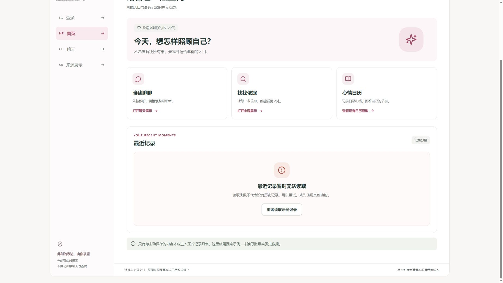
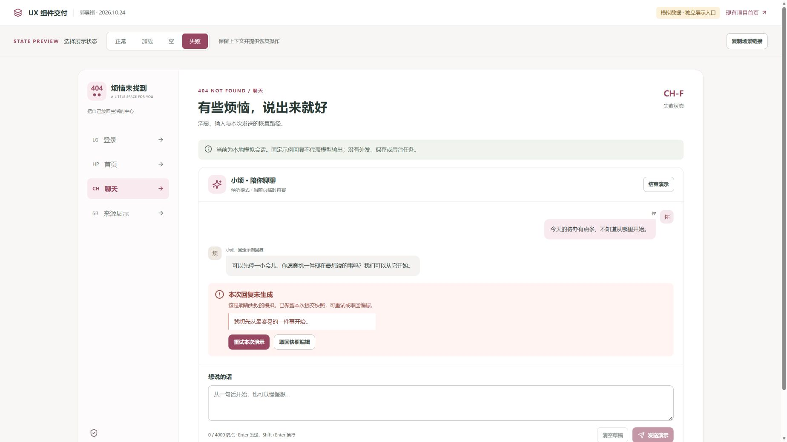

# React 组件展示页与状态截图交付

提交成员：郭昱祺（102400413）· UX／产品设计 · 日期：2026-10-24 · 状态：待非作者复核。

2026-10-25 修订：独立展示页现与程杰当前 React 首页共用导航、顶栏、欢迎卡和主题；登录改用现有认证弹窗样式。[最新界面、截图与验证](../界面对齐_20261025/README.md)。本文件以下截图记录 10 月 24 日历史版本。

[返回个人导航](../README.md) · [Issue #23](https://github.com/impureWine/404NOTFOUND/issues/23) · [组件规范基线](../组件规范_20261023.md) · [交互状态基线](../交互状态表_20261023.md)

## 1. 本次交付与边界

根据已确认的“组件展示页”方案，新增一个独立 React 入口，呈现登录、首页、聊天和来源展示的组件及正常／加载／空／失败状态。交付包含源码、16 张状态截图、4 张首页记录分区补充截图、复现步骤与组件交接说明。

这是实际在本地浏览器运行的**组件演示**。加载和失败由评审工具选择，截图不能证明真实网络请求、账号认证、模型、检索、保存或取消接口已经成功／失败。演示数据全部为固定示例，未使用真实用户数据或凭据，来源链接没有被本地抓取核验。正式页面装配与接口联调仍由前端负责人按既有分工组织。

开发基线：`af3701e`（main 的前端首页合并提交）；交付分支：`feat/guoyuqi-ux-state-showcase-20261024`。本说明随源码一并提交，确切交付 commit 以 Issue #23 的新增评论和 Git 历史为准。10 月 23 日三份文档保留为历史交接基线，不将其“未实现”记录改写成当时已经编码。

## 2. 启动与复现

环境：Node.js v24.16.0、npm 11.13.0、React 18.3.1、Vite 6.4.4（仓库锁文件）。在仓库根目录打开 PowerShell：

```powershell
cd prototype
npm ci
npm run dev -- --host 127.0.0.1 --port 5184 --strictPort
```

访问 `http://127.0.0.1:5184/ux-components.html?page=home&state=normal`。GitHub 源码浏览器不执行 JSX，需要先下载仓库并运行上述命令。

- 侧栏切换四个场景；顶部控制条切换四类状态，右上角显示 LG／HP／CH／SR 状态编号。
- 场景导航与顶部状态切换会重置该场景的示例输入；场景内部的恢复操作保留有效上下文。
- “复制场景链接”只复制 `page` 与 `state`，不复制用户名、密码、问题或消息正文。链接复现预置状态，不还原用户修改后的草稿。
- `page` 接受 `login/home/chat/sources`；`state` 接受 `normal/loading/empty/error`。无效值回退到首页正常态。
- 正式首页仍使用原入口 `index.html`。构建配置增加多入口，独立样式仅由展示入口导入。

## 3. 源码与组件交接

| 文件 | 用途 |
| --- | --- |
| [ux-components.html](../../../../prototype/ux-components.html) | 独立 HTML 入口 |
| [main.jsx](../../../../prototype/src/ux-showcase/main.jsx) | 场景／状态控制、复现 URL、评审工具条 |
| [components.jsx](../../../../prototype/src/ux-showcase/components.jsx) | 展示组件及事件；复用现有 `Button`、`Panel` |
| [pages.jsx](../../../../prototype/src/ux-showcase/pages.jsx) | 四场景的本地演示容器，承接用户操作，不调用 API |
| [data.js](../../../../prototype/src/ux-showcase/data.js) | 固定示例、状态编号、码点计数与合法链接校验 |
| [showcase.css](../../../../prototype/src/ux-showcase/showcase.css) | 柔粉主题、焦点、状态与响应布局 |
| [模拟数据登记](../../../../prototype/src/api/mock-data-manifest.js) | `MOCK-UX-SHOWCASE-01` 的数据边界与重置方式 |

| 基线组件 ID | 本次组件及可交接内容 | 尚待正式页面接入 |
| --- | --- | --- |
| C01～C04 | `Button`、`FormField`、`PasswordField`、`AuthForm`；受控输入、字段错误、密码显隐、加载禁用与失败反馈 | 认证回执、真实身份跳转、注册入口；本地表单校验通过不等于登录成功 |
| C05～C07 | `AppShell`、`FeatureEntryCard`、`RecentRecordList`；导航、功能入口和记录分区四状态 | 身份／能力适配、真实记录读取与详情。日历卡仅跳到已有静态原型 |
| C08～C11 | `SessionToolbar`、`MessageList`、`MessageBubble`、`MessageComposer`；草稿、输入限制、失败快照恢复、结束确认 | 模式切换、任务创建／轮询、消息选择、单次授权与保存；本次工具栏固定为倾听模式 |
| C12～C15 | `SearchBar`、`ClaimItem`、`SourceList`、`SourceCard`；逐条引用定位、展开、合法外链及 EMPTY／失败区分 | 真实查询任务、契约适配、取消与过期处理；示例引用不代表事实已核验 |
| C16～C20 | `UncertaintyNotice`、`AsyncState`、`ConfirmDialog`、`StatusBadge`、`InfoNotice` | `ConfirmDialog` 仅确认清空本地演示；正式异步确认、`ConsentDialog` 与许可仍待接入 |

主要事件：`AuthForm.onSubmit(values)` 返回首个错误字段 ID 或 `null`；`MessageComposer.onChange(value)`／`onSend()` 表达草稿与发送意图；`ClaimItem.onLocateSource(id)`／`SourceCard.onToggle(id)` 只使用当前来源 ID。完整 props 仍需与前端正式容器共同对齐；不把展示页的本地消息 ID、提示字段或状态键当作新增 API 字段。

组件采用受控数据与事件。正式复用时提取所需导出并适配作用域样式，避免全局主题叠加；`pages.jsx` 中固定回复、演示状态按钮及本地成功回退不能直接作为真实业务容器。

## 4. 四场景状态与截图索引

N＝正常、L＝加载、E＝空、F＝失败。截图为 10 月 24 日 Edge 默认视口实际页面捕获，未裁切、拼接或合成。首页较长，另有向下滚动后的记录分区图；主图保留场景编号和状态选择，细节图用于看清恢复操作。聊天失败主图包含失败文案、快照与两个恢复按钮，页面可继续向下滚动查看输入区。

| 场景与 URL page | 正常 | 加载 | 空 | 失败 |
| --- | --- | --- | --- | --- |
| 登录 `login` | [LG-N](screenshots/LG-N_login_normal.jpg) | [LG-L](screenshots/LG-L_login_loading.jpg) | [LG-E](screenshots/LG-E_login_empty.jpg) | [LG-F](screenshots/LG-F_login_error.jpg) |
| 首页 `home` | [HP-N](screenshots/HP-N_home_normal.jpg) | [HP-L](screenshots/HP-L_home_loading.jpg) | [HP-E](screenshots/HP-E_home_empty.jpg) | [HP-F](screenshots/HP-F_home_error.jpg) |
| 聊天 `chat` | [CH-N](screenshots/CH-N_chat_normal.jpg) | [CH-L](screenshots/CH-L_chat_loading.jpg) | [CH-E](screenshots/CH-E_chat_empty.jpg) | [CH-F](screenshots/CH-F_chat_error.jpg) |
| 来源 `sources` | [SR-N](screenshots/SR-N_sources_normal.jpg) | [SR-L](screenshots/SR-L_sources_loading.jpg) | [SR-E](screenshots/SR-E_sources_empty.jpg) | [SR-F](screenshots/SR-F_sources_error.jpg) |

首页分区补充：[正常记录](screenshots/HP-N_home_normal_detail.jpg) · [记录加载](screenshots/HP-L_home_loading_detail.jpg) · [确认空列表](screenshots/HP-E_home_empty_detail.jpg) · [读取失败与重试](screenshots/HP-F_home_error_detail.jpg)。

[截图清单 JSON](截图清单.json) 记录每张图片的复现 URL、像素尺寸、保存时间、文件大小和 SHA-256。主图编号对应 [10 月 23 日交互状态表](../交互状态表_20261023.md) 的 16 项核心状态；补充分支 X01～X11 未因此全部完成。

| 状态 | 本地画面与可操作反馈 | 解释边界 |
| --- | --- | --- |
| LG-N | 演示值可编辑、显隐；提交后报告本地校验结果并清空演示密码 | 不建立登录会话，不核对真实账号 |
| LG-L | 字段与提交禁用，显示登录中；访客入口可离开 | 顶部选择后固定保持，不模拟真实耗时 |
| LG-E | 登录名和密码均为空；提交后提示并聚焦首个无效字段 | 是初始空表单，无“无账号记录”的含义 |
| LG-F | 统一凭据错误，允许编辑与重试 | 不透露账号是否存在；重试只做本地字段校验 |
| HP-N | 两条固定记录元数据，可选择并显示组件边界反馈 | 不读取或展示历史正文 |
| HP-L | 仅记录分区加载，其他入口可用 | 不预填假记录或显示 0 条 |
| HP-E | 确认无主动保存记录，提供聊天入口 | 是成功空列表的示例 |
| HP-F | 明确读取失败，重试回到示例列表 | 失败不等于没有历史，重试不调用接口 |
| CH-N | 固定示例对话；可发送本地示例消息、清草稿、确认结束 | 无模型输出和自动保存 |
| CH-L | 等待示例；禁重复发送，允许编辑下一条草稿，提供停止操作 | 停止仅结束本地等待展示 |
| CH-E | 空会话引导，可填入示例句后编辑／发送 | 引导不伪装成真实 AI 回复 |
| CH-F | 失败说明、本次提交快照、手动重试或取回编辑 | 只演示明确失败；超时结果未知的核实流程待接入 |
| SR-N | 摘要按 sourceIds 关联来源；引用定位展开；逐条时效提示 | 来源及日期是固定展示数据，未实时抓取核验 |
| SR-L | 只显示等待状态，不沿用旧摘要／来源，可停止演示 | 不代表后台查询实际启动 |
| SR-E | 预置为完成后 EMPTY，保留问题；清空后显示“尚未查询” | 初始与完成空结果分别说明 |
| SR-F | 明确查询失败，保留问题供编辑／重试 | 不写成“查不到资料”，无可保存结果 |

## 5. 本次已执行检查

检查对象仅为独立组件展示和构建入口，未执行全项目回归或真实接口联调。

| 检查 | 实际结果 |
| --- | --- |
| Vite 构建 | `npm run build` 成功，输出 `index.html` 与 `ux-components.html`；见 [构建输出](build-output.txt) |
| 场景与状态浏览 | 已打开四场景的正常／加载／空／失败视图并保存 16 张主图 |
| 登录空表单 | 提交后显示两个字段错误，焦点到登录名 |
| 聊天失败恢复 | “取回快照编辑”将快照放入输入框，恢复发送；不自动补发 |
| 聊天结束 | 打开原生模态确认，默认焦点到取消；确认后消息、快照与草稿清空，回到空会话 |
| 来源引用 | 点击引用 [2] 展开对应来源卡并聚焦；未知发布时间与时效限制分别展示 |
| 首页失败恢复 | 读取失败仍保留功能入口，点击重试恢复固定示例记录 |
| 构建／文档静态检查 | 交付前核对本次文件、相对链接、截图清单与 Git 空白差异 |

源码提供登录名 NFKC 后 3～64 位 ASCII 校验、密码非空且最多 128 码点、正文最多 4000 码点及中文输入法组合保护。上述边界规则未全部逐项执行人工边界验证，不写作完整验收通过。未新增或运行自动化测试；移动布局虽有实现，未形成跨设备验收证据；外链可访问性、屏幕阅读器、对比度及真实用户任务仍待检查。

## 6. 后续交接与 AI 协助记录

郭昱祺本次交付组件演示、交互状态和截图；正式四页面的业务容器、身份／权限、单次许可、任务轮询／取消、结果失效与保存待前端负责人整合，后端按正式接口独立校验。非作者复核人、日期和意见待实际发生后补充，当前不标“已验收”。

AI 协助范围：根据既有原型与组件规范生成独立 React 展示代码、整理模拟数据与样式、操作本地浏览器留存截图、整理说明及 GitHub 提交。用户确认了方案 2；本次运行与截图范围如上。AI 产物仍需成员及非作者复核，不代替站会照片、团队燃尽图或真实后端联调记录。




