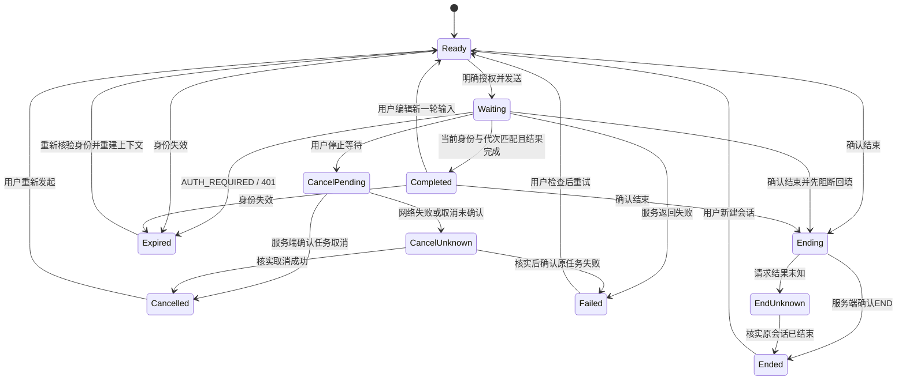

# 异步状态交互说明

## 1. 范围与原则

覆盖陪伴／整理／排练、信息查询，以及训练的暂停、完成与退出。异步界面应分别反映“本机已停止等待”“应用服务已确认取消”“供应商侧停止处理”三个事实。前两者不可推断第三者。许可撤回、取消任务、结束会话、清除已保存记录是四种不同操作，不能使用同一成功提示。

以下为 UX 交接规则，当前实现差异见第 03 份材料；不代表新规则均已实现。延续组件规范职责，新增端到端页面工作由前端负责人安排。

## 2. UML 状态机

状态机中的英文是 UX 视图状态。后端任务现有 `pending/completed/failed/expired/cancelled`，会话另有 `ready/running/paused/reviewing/ended`；禁止把两者共用一个 busy 布尔值后宣称含义相同。保存、结束、请求生成分别持有操作状态。

## 3. 状态与恢复规则

| 状态 | 页面与按钮 | 可恢复操作 | 内容处理 |
| --- | --- | --- | --- |
| Ready | 输入可编辑，空输入／未授权时发送禁用 | 填写并授权后发送 | 不自动带入历史、不自动外发 |
| Waiting | 立即显示等待文案，发送和重复提交禁用；停止等待按钮可用 | 停止本轮等待；离开先使结果回填失效 | 同账号同入口暂存本轮输入；不写浏览器持久存储 |
| CancelPending | 立即停止本机回填，按钮“正在请求取消…”禁用防重复 | 等待取消响应 | 保留本页草稿，不称“删除成功” |
| Cancelled | 显示“服务端已确认取消本次任务” | 用户手动再次发送，使用新任务 requestId | 取消不等于清除历史 |
| CancelUnknown | 显示本机已停、服务端待确认 | 核实原任务；不自动重复建任务 | 保留原任务标识用于核实；已迟到结果不回填 |
| Failed | 按服务类别显示失败，恢复编辑与重试 | 用户手动重试；限流遵循重试时间 | 本轮输入保留在原上下文；不写成空结果 |
| Expired | 统一锁定私密内容及写操作，停止轮询 | 重新登录并读取身份；不自动重发 | 隐藏并清理旧账号临时正文、选择和授权；换号不得继承 |
| Ending | 默认焦点先放“继续交流”；用户确认后禁用重复结束 | 服务端应答后结束；失败只提供核实 | 本机立即阻断旧结果，未确认不声称后台清理 |
| Ended | 提示本次会话结束，提供“新建交流” | 新会话、新代次、新授权 | 清理本次临时内容，保留用户此前主动保存的记录 |
| EndUnknown | 本机已停止、服务器结束状态待核实 | 核实原会话，不重新恢复旧轮询 | 不恢复已经清理的旧正文，不冒充删除成功 |
| Saving | 独立显示“正在保存…”；保存按钮禁用 | 请求未知时用同一保存 requestId 核实 | 不显示由模型 AbortController 驱动的“停止本次请求” |

`AUTH_REQUIRED/401` 应驱动统一身份失效；`ACCESS_DENIED/403` 本身不证明会话过期，应说明权限／许可问题。已知安全岗 P0-02 指出失效写请求返回 403，后端修复已提交 PR #128（查询时未合并，未经本次复核），需在修复候选独立复测，前端不能把全部 403 当退出。

同身份内的普通失败保留输入；身份失效或换号清理旧账号临时正文。二者恢复策略不同。重新登录后允许新输入，不能自动恢复并发送之前账号的草稿。

## 4. 取消、结束与许可撤回接口映射

| 用户动作 | 当前接口 | UI 必须依据的事实 | 当前限制 |
| --- | --- | --- | --- |
| 等待 AI | `POST /api/agent/tasks` → `GET /api/agent/tasks/:requestId` | 只接纳当前账号、入口、会话／活动代次的完成结果 | 前端等待上限目前 75 秒，轮询间隔 600ms；这是代码现状，不是性能承诺 |
| 等待查询 | `POST /api/search/tasks` → `GET /api/search/tasks/:requestId` | 查询失败和无结果分开 | 查询与模型文案分开 |
| 停止本次等待 | `POST /api/agent/tasks/:requestId/cancel` 或 `POST /api/search/tasks/:requestId/cancel` | 本地 Abort 先发生，成功文案必须有取消响应支撑 | 当前 business.js 吞掉取消失败，见 UX-D2-02 |
| 结束会话 | `POST /api/sessions/:sessionId/actions`，`action: END`、两个 expectedGeneration | 有结束响应才称服务端确认；回填保护即时生效 | 当前 Dialogue 无结束确认；后台已完成任务可读性需复核 |
| 许可撤回 | `POST /api/consents/:consentId/revoke` | `revoked:true` 仅说明应用许可已撤回 | apiClient 无对应方法，runTask 不把 consentId 暴露给界面；缺入口 |
| 重新登录 | `/api/auth/context` 与 `/api/profile` | 新身份由服务端核验 | 不复用旧任务、许可或输入 |
| 清除已保存记录 | 先申请 `/api/records/:id/clear-confirmations` 再 `/clear` | 清除响应与版本一致性 | 与 END／取消／撤回分开，网络未知沿用原请求核实 |

## 5. 撤回的准确含义

1. 未提交时取消勾选：仅表示本轮不授权；没有调用撤回接口，不展示“服务端已撤回”。
2. 已签发许可：需保存其标识后请求 revoke。服务端确认后，该许可不能再次用于新任务／保存。
3. 任务已提交：撤回许可应与请求取消分开展示状态；不能承诺已外发内容从供应商侧删除，也不能仅取消勾选就宣布正在进行的任务停止。
4. 已主动保存的记录：许可撤回不等于删除记录，应引导用户在历史中单独清除。

当前 ConsentService.revoke 只设置 revoked 标记，未调用 TaskService，也不能证明停止已受理任务。任务执行期间是否应二次校验撤销、以何种状态回包，由程群／李泉毅确认；UX 只显示可证实的范围。

## 6. 训练与无障碍要求

训练：未开始不计时；暂停冻结输入与计时，主动继续才恢复；完成页面提供返回修改、再做一次、完成并返回。有填写的重来／退出先说明清空范围；完成不自动保存或生成情绪评分。当前训练 UI08/UI09 符合本次观察，页面隐藏恢复另有既有单测，不能当作本次真实浏览器隐藏测试。

通用：等待信息用 `role=status/aria-live=polite`，忙碌区域设置 `aria-busy`；错误用 `role=alert`；停止按钮放在被禁用的 fieldset 之外并保持键盘可达；状态不能只靠颜色。取消后焦点回原输入，结束确认默认焦点为非破坏动作，关闭弹窗回触发按钮。断网未知状态要提供可见核实入口。
