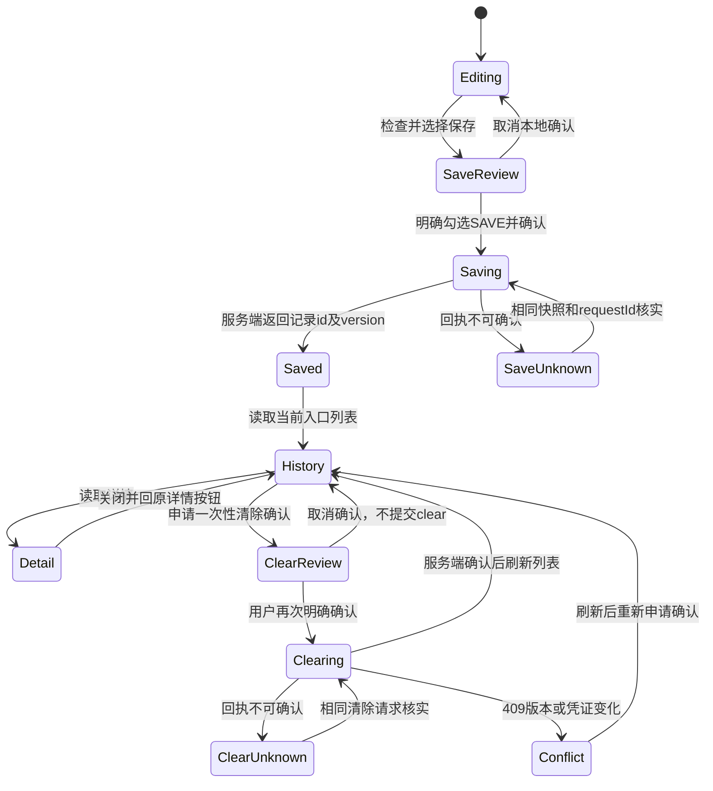

# 历史与清除交互修订

## 1. 本日变更

| 编号 | 修订前 | 修订后 | 实现与证据 |
| --- | --- | --- | --- |
| UX-D3-01 | 键盘展开保存确认，原按钮禁用后焦点落到body | 聚焦“保存前确认”标题，Tab进入独立SAVE勾选；完成／取消确认后回原检查按钮 | RecordVault；H05/H06 |
| UX-D3-02 | 打开详情后焦点落到body | 聚焦详情标题，Tab可进入“关闭详情” | RecordDetail；H09 |
| UX-D3-03 | 关闭详情后焦点丢失 | 回到该条记录的“详情”；记录已移除时回历史标题 | RecordVault；H10；已移除的回退分支待独立复核 |
| UX-D3-04 | 清除确认缺少明确范围；第一步后焦点丢失 | 说明只清除此条及正文，默认聚焦非破坏性“取消确认”；取消后回原清除按钮，清除完成无原记录时回历史标题 | RecordVault；H12～H17；成功后焦点回退需独立复核 |
| UX-D3-05 | 查询记录请求失败同时出现“暂无记录” | loading只显示读取中；ready且空才显示空列表；error仅错误及重新读取 | Library；H19；适用查询、物件、排练及寄存共用列表 |
| UX-D3-06 | 390px下清除按钮文字纵向折行 | 将历史行按钮样式匹配到实际btn类，清除仍放操作列，文字不折行 | current-home.css；H20，46×31px |

仅对现有组件和状态做局部修订，不认领四个React页面的完整开发，不将设计稿描述为完成的生产系统。保存、许可、清除API和后端数据规则未在本次改动中重定义。

## 2. 保存与清除状态转换

列表读取失败单独展示错误，不应转换为History的“成功空列表”。这些是已有业务规则与本次界面行为的整理，状态图不代表本包执行了每条真实服务分支。

## 3. 操作与焦点规则

| 用户操作 | 预期焦点与按钮 | 内容／请求约束 |
| --- | --- | --- |
| 正文填写后Tab、Space检查保存 | 进入保存确认标题；Tab到未勾选的SAVE选项 | 此时不提交records创建；不授权AI处理 |
| 勾选后确认 | 保存中防重复；确认完成后回检查按钮 | 只有服务端确认后清空编辑内容 |
| 保存未知 | 固定确认快照，禁止改载荷／取消，显示同请求核实 | 相同内容沿用requestId；合成测试只验证前端复用 |
| 保存前取消 | 回检查按钮，可继续编辑 | 未继续提交保存请求，不叫“撤回服务器数据” |
| 展开详情 | 聚焦详情标题；Tab到关闭按钮或来源链接 | 请求本人当前入口详情，列表本身不预载正文 |
| 关闭详情 | 回该记录的详情按钮 | 仅收起当前视图，不删除已保存内容 |
| 第一步清除 | 聚焦取消确认；Tab／Shift+Tab可选择动作 | 仅签发一次性确认，尚不调用clear |
| 取消清除确认 | 回原清除按钮 | 保留记录，不宣称服务端撤销或删除 |
| 第二步确认清除 | 处理中禁用重复动作；确认成功刷新列表 | 用expectedVersion及confirmationId清除当前一条 |
| 清除未知 | 保留原请求，可用同一标识核实 | 不显示成功，不让用户重新生成另一笔清除请求 |
| 清除409 | 解释版本／确认变化，刷新后重新确认 | 不自动把“重新读取”当再次同意清除 |
| 换号或离页 | 取消旧视图请求，清理当前临时确认与正文 | 不跨身份恢复快照；本包未执行实际换号验证 |

内联确认采用`role=group`，不是模态对话框；不设置模态焦点陷阱、不声称Escape关闭。焦点标题用tabIndex=-1接收程序焦点，正常Tab顺序仍按DOM顺序。错误与等待分别由alert/status展示；未运行读屏软件，不将DOM检查表述为完整无障碍认证。

## 4. 接口对照

| 步骤 | 接口 | 关键规则 |
| --- | --- | --- |
| 保存许可 | POST /api/consents，purpose=SAVE、operation=RECORD_CREATE | 载荷仅包含用户明确确认的快照，与AI／检索许可分离 |
| 保存记录 | POST /api/records | 同一意图重试复用requestId；成功须有id和整数version |
| 当前入口历史 | GET /api/records?limit=20 | 成功空列表与读取失败分开；本页最多20条，未新增翻页功能 |
| 正文详情 | GET /api/records/:id | 由服务端校验归属；404不回退显示此前正文 |
| 申请清除确认 | POST /api/records/:id/clear-confirmations | requestId与expectedVersion；不直接删除 |
| 再次确认清除 | POST /api/records/:id/clear | confirmationId、expectedVersion及清除requestId |

实现提交：`eab0123d8dbe1715fe8c66fde8d67770c816586b`；API契约来源为shared/contracts/record.js，本次未改Schema。后端安全结论由对应接口、数据库与独立复核证据支撑。
