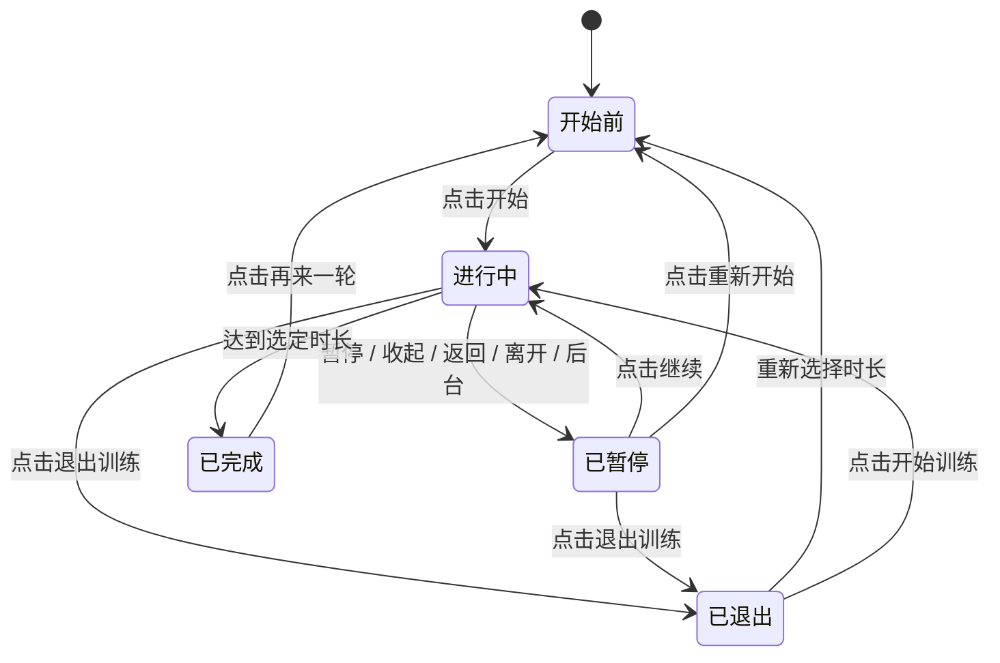

# 404NOTFOUND 桌宠原型交互说明 v0.1

日期：2026-10-14。用途：课程原型体验、交互说明和后续功能评审。

## 1. 已确认的设计范围

采用「悬浮桌宠＋快捷气泡」。按用户确认，团团、404小猫、小信使三种角色全部保留，可在原型顶部切换；最终角色尚未选定。初始展示团团仅作为演示初始状态。

桌宠以轻量唤起、状态展示和互动陪伴为主。浏览器中模拟桌面场景；完整的物件化、排练、查询、文字销毁等功能通过用户主动打开Web页面进入。

## 2. 体验入口

1. 直接使用浏览器打开交付包根目录的 `桌宠原型.html`，无需安装依赖。
2. 需要开发版本时，在 `源码/` 目录启动 `启动桌宠演示.cmd`，或运行开发服务并访问 `http://localhost:5173/#pet`。
3. 从Web原型的「桌宠 / 微信入口规划」进入「查看桌宠面板演示」。

角色选择、桌面位置与当前任务在本次页面演示中保留；刷新重置。演示账户 A：`demo_a / demo1234`；账户 B：`demo_b / demo1234`。不要使用真实凭据。

## 3. 界面与需求对应

| 界面或控制 | 用户操作与反馈 | 对应需求 |
| --- | --- | --- |
| 角色选择 | 切换三种形象，保留当前任务、聊天和训练进度 | REQ-06：桌宠入口适配 |
| 桌宠本体 | 点击展开/收起；拖动调整位置；摸摸显示动作反馈 | REQ-06：轻量唤起与陪伴 |
| 快捷气泡首页 | 聊一聊、放松一下、记心情、先放一放 | REQ-01、02、09、12 |
| 聊天面板 | 倾听/梳理、发送、预设回应、结束确认 | REQ-01、04、05 |
| 心情命名 | 自选词、日期、强度与可选事件，主动加入日历 | REQ-09、08 |
| 心情日历 | 月份/日期选择、同日多条、编辑、确认删除 | REQ-08 |
| 呼吸训练 | 开始、暂停、继续、重来、退出、完成 | REQ-02 |
| 烦恼寄存 | 输入、确认寄存、取出正文、确认延期/删除 | REQ-12 |
| 抱包裹状态 | 根据本入口寄存条目显示包裹；不展示正文 | REQ-12、07 |
| 更多入口 | 用户确认后打开Web完整页，不自动携带文字 | REQ-03、10、11、15、16、06 |
| 偏好与清除 | 安静陪伴、大小、恢复位置、按身份清除桌宠内容 | REQ-05、07 |
| 演示登录 | 登录后回到桌宠，账号隔离，访客草稿不迁移 | REQ-17、18、06、07 |
| 求助 | 提供支持指引，停止训练计时，不自动拨号或发送消息 | REQ-07 |

此表描述原型中的需求追踪关系。原型使用内存与预设反馈，未调用后端接口；接口地址、请求结构和服务契约需与开发人员另行核对。

## 4. 主要操作流程

**轻量陪伴：** 点击桌宠 → 聊一聊 → 选择倾听/梳理 → 输入并发送 → 查看明确标记的预设回应 → 收起保留当前对话，或确认结束并清除会话。

**心情记录：** 点击桌宠 → 记心情 → 自选情绪词、日期、强度和可选事件 → 主动加入心情日历 → 若为访客，选择前往演示登录或继续临时体验 → 在账户下重新确认内容 → 查看、编辑或确认删除自己的记录。命名不触发AI分析。

**呼吸训练：** 点击桌宠 → 放松一下 → 选择时长 → 主动开始 → 可暂停/继续 → 达到选定时长显示完成。返回快捷入口、收起气泡、离开桌宠或页面进入后台会暂停，再次进入不会自动恢复。

**烦恼寄存：** 点击桌宠 → 先放一放 → 填写可选包裹名称、正文和查看时间 → 登录后确认寄存 → 宠物显示包裹 → 用户主动取出、确认延期或删除。查看时间到达仅将条目标记为「可取出」，不打开正文、不发送提醒、不调用AI。

**打开完整页：** 更多入口 → 选择功能 → 查看入口与内容范围说明 → 确认打开Web完整页。桌宠记录和草稿各自保留，两个入口不自动复制内容。

## 5. 训练状态

| 状态 | 呈现与可用操作 |
| --- | --- |
| 开始前 | 显示节奏、时长和「开始训练」；不自动计时 |
| 进行中 | 显示呼吸阶段、阶段秒数、总进度；可暂停或退出 |
| 已暂停 | 显示「先停在这里」、保留秒数；可继续、退出或重新开始 |
| 已完成 | 显示「这一轮结束了」和完成进度；「再来一轮」回到开始前 |
| 已退出 | 显示「已退出这次训练」，本轮进度清零；可重新选择时长并开始 |

「收起」保留草稿与任务；「结束会话」清除当前聊天和临时训练进度；「清除当前桌宠内容」经确认后清除当前身份在桌宠入口的全部内容。日历/寄存的单条删除、延期及清除操作可取消，取消不修改记录。

## 6. 可用性与数据边界

- 快捷任务使用图标与文字共同标识，颜色不作为唯一含义。
- 角色动作对应用户明确选择的任务状态，不推断心理情况。
- 支持可见键盘焦点；宠物支持方向键移动、Enter/空格展开，Esc收起；确认弹窗支持取消、Esc与焦点约束。
- 气泡根据桌面可用空间调整位置与高度，长内容在气泡内滚动；角色拖动限制在模拟桌面中。
- 安静陪伴减少待机动作；系统「减少动态效果」设置优先。
- 桌宠内容按访客/账户分开，并与Web入口记录分开。登录不表示保存、迁移或跨端同步。
- 日历与寄存需登录后由用户主动保存；本次演示没有真实认证、数据库或持久化存储。
- 没有真实桌面悬浮窗、系统快捷键、全桌面输入接管、真实AI/搜索/微信接入或外部消息发送。

## 7. 本次交付与后续评审

本次产出包括React桌宠界面、三个可切换矢量角色、启动文件、角色对比图和界面预览图。编译构建和预览导出属于本次交付检查，不等同于完整流程测试或真人可用性验证。

本轮未新增或运行自动化测试。后续功能评审可重点检查：角色切换理解度、快捷入口发现率、训练暂停与恢复、记录保存意图、寄存正文隐私，以及两个入口的内容边界。角色最终选择、真人评审与说明书/PPT更新继续按项目阶段确认。
