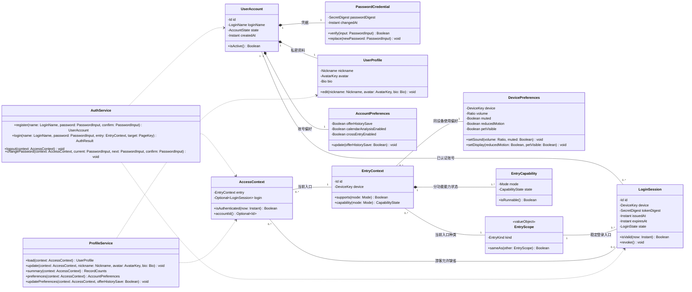
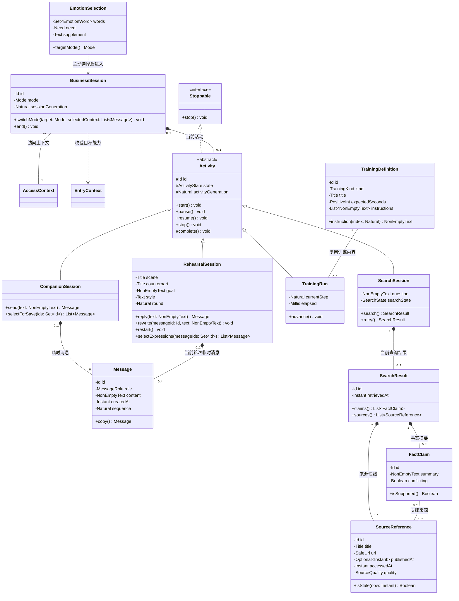
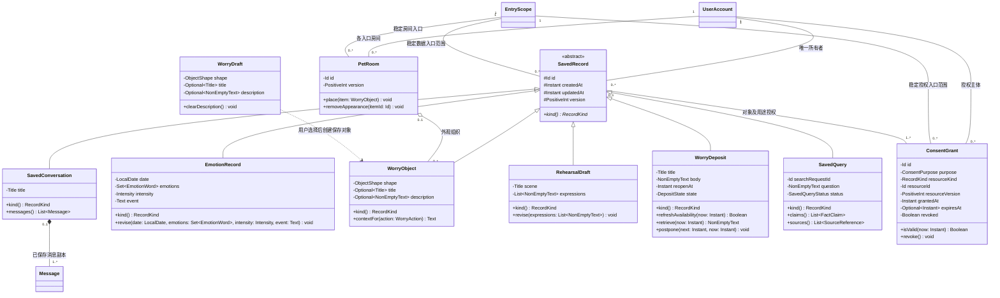
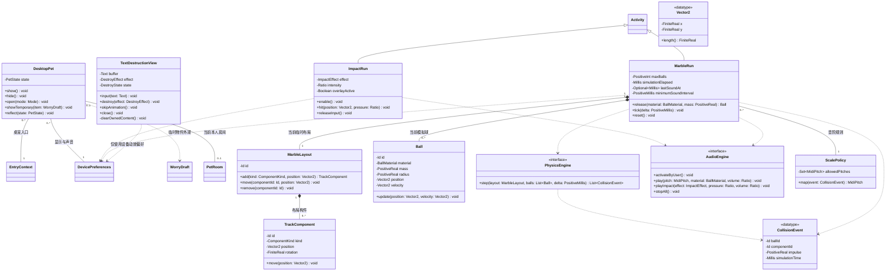
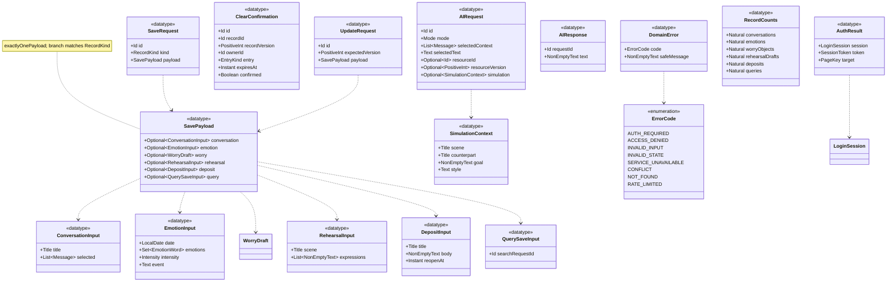

# 404NOTFOUND UML 类图设计 v1.2（第三次作业技术基线完善版）

设计日期：2026-10-15；第三次作业增量：2026-10-19。
> v1.2 增量声明（2026-10-19）：本稿保留 v1.1 的六张分图、全部原有类及关系，只按第三次作业技术决策更新。`LocalRecordRepository` 改为 `PostgresRecordRepository`；增加 `AgentApplicationService` 和实现 `AIClient` 的 `LangChainModelAdapter`；明确 `sessionGeneration`/`activityGeneration` 双代次；错误码加入 `NOT_FOUND`/`RATE_LIMITED`；新建及修改密码统一为 12～128 Unicode 码点。HTTP DTO 是应用边界映射，不替代领域模型。

范围：最新功能总览 v0.3 的 17 项需求，REQ01～REQ17。

## 1. 依据与模型边界

- 主依据：`404烦恼未找到_项目功能总览与新增需求_v0.3.md`，特别是功能清单、数据规则、多端能力及 2026-10-14 范围修订。
- 补充依据：`output/桌宠原型/原型说明.md`、对应 HTML 概念原型及需求规格说明书整合稿 v0.2。
- 这是面向开发的设计模型，当前项目没有已经实现这些类的完整应用源码。类名、接口、字段长度、状态机与算法边界属于本次设计建议，不能当作已实现或已验收能力。
- 最新功能总览优先于旧说明书：只保留已登录修改密码，不包含忘记密码、重置密码、恢复凭据；不增加公开主页、社交关系、账号注销、自动跨端同步。
- 按用户 2026-10-15 补充要求，烦恼漂流瓶不纳入范围，不设计其实体、匿名投递、接收或回复关系。烦恼寄存所仍保留；它是本人私密暂存，不是漂流瓶。当前可检索的项目 Markdown、HTML、CSV、JSON、TXT 文本未发现漂流瓶条目，无需修改这些材料；历史二进制交付包未作内容审查或改写。
- 分为五张模块类图、一张数据类型图及一张总览图，均可独立渲染。同名类是同一个模型元素，分图中无成员的类是引用，不是新类。图中只列核心领域、应用服务和必要技术接口，不把每个 HTML 页面机械地变成一个业务类。

## 2. UML 表达与类型契约

### 2.1 符号

| 表达 | UML 语义 | 本模型用法 |
|---|---|---|
| `+` / `-` / `#` | public / private / protected | 状态封装在属性中，通过公开方法改变 |
| `A <|-- B` | 泛化：B 继承 A | 活动子类、持久化记录子类 |
| `I <|.. C` | 实现：C 实现 I | 可停止活动、仓储和端侧算法接口 |
| `A ..> B` | 依赖 | 临时参数、调用或使用 B |
| `A "1" -- "0..*" B` | 关联 | 一对多；无箭头表示本图不限定导航性 |
| `A "0..1" o-- "0..*" B` | 共享聚合 | 房间组织物件；移出房间不删除物件 |
| `A "1" *-- "0..*" B` | 组合 | 部件只属于一个整体，生命周期由整体管理 |

多重性标在关联两端；继承、实现、依赖没有实例数量语义，因此不标多重性。菱形位于整体端，空心三角指向父类或接口。`<<abstract>>`、`<<interface>>`、`<<enumeration>>` 为分类标记。

属性采用 `-类型 属性名`；方法采用 `+方法名(参数名: 类型) 返回类型`，适配 Mermaid 类图语法。结构化解释等价于 UML 的 `-属性名: 类型`、`+方法名(参数名: 类型): 返回类型`。

### 2.2 属性取值范围：约束类型

图中每个属性均使用下列基础类型、约束类型、枚举或模型类类型；约束类型是 UML 数据类型，不要求编程语言原生支持。所有未带 `Optional` 的属性非空，集合元素也非空。关联端的对象数量由多重性决定。

| 类型 | 底层类型与取值范围 |
|---|---|
| `Id` | UUID；合法且非全零；实体 ID 在对应实体集合中唯一 |
| `Instant` | UTC 时间戳；合法可表示时刻；业务前后顺序另列不变量 |
| `LocalDate` | 合法公历日期；按用户所在时区解释，不按 UTC 截断日期 |
| `Boolean` | `true` 或 `false` |
| `Natural` / `PositiveInt` | Integer；分别为 ≥0 / ≥1 |
| `Ratio` | Real；有限数，0～1 |
| `PositiveReal` | Real；有限数且 >0 |
| `FiniteReal` | Real；有限数，排除 NaN、正负无穷 |
| `Intensity` | Integer；建议 1～5，待团队确认；不是诊断评分 |
| `LoginName` | String；建议 3～64 字符；标准化后账号集合内唯一 |
| `Nickname` | String；建议 1～32 字符；允许重名 |
| `Bio` | String；建议 0～200 字符 |
| `Title` | String；建议 1～80 字符；去除首尾空白后非空 |
| `Text` | String；建议 0～4000 字符；字段允许为空时使用此类型 |
| `NonEmptyText` | String；建议 1～4000 字符；去除首尾空白后非空 |
| `EmotionWord` | String；建议 1～20 字符，支持预设词和用户补充词 |
| `PasswordInput` | 临时敏感 String；12～128 Unicode 码点；不作为持久化属性、不进入日志或 AI 上下文 |
| `SecretDigest` | 非空带算法/参数的不可逆凭据摘要；不得为明文密码或原始令牌 |
| `AvatarKey` | 预设头像目录中的有效键；首轮不建模自定义文件上传 |
| `DeviceKey` | 本产品生成的非空设备实例标识；不包含硬件身份数据 |
| `SafeUrl` | 合法 HTTP/HTTPS URL；展示、请求前按实际用途校验；不执行 URL 或页面中的指令 |
| `PageKey` | 产品允许的内部页面键；不接受任意外部跳转地址 |
| `MidiPitch` | Integer；0～127；实际可播放值还必须属于当前音阶集合 |
| `Millis` | Integer；≥0 毫秒 |
| `PositiveMillis` | Integer；>0 毫秒 |
| `Optional~T~` | T 或缺省，数量 0..1；缺省不等于空字符串 |
| `List~T~` / `Set~T~` | 0..* 个 T；Set 元素唯一；额外下限由业务不变量限定 |
| 模型类类型 | 符合相应类的属性、状态和不变量的对象；引用不得越权 |

字段长度、密码规则、强度标尺和运行资源上限均是建议，不是已冻结需求。接口边界也执行验证，不能只靠页面控件限制。

### 2.3 枚举

| 类型 | 完整取值 |
|---|---|
| `EntryKind` | WEB、DESKTOP、WECHAT |
| `CapabilityState` | AVAILABLE、SIMULATED、UNAVAILABLE |
| `AccountState` | ACTIVE、LOCKED；锁定是认证保护状态，不代表新增账号管理页面 |
| `LoginState` | VALID、EXPIRED、REVOKED |
| `ActivityState` | READY、RUNNING、PAUSED、COMPLETED、STOPPED |
| `Mode` | LISTEN、ORGANIZE、SEARCH、REHEARSE、TRAIN、CALENDAR、ROOM、LOCKER、IMPACT、MARBLE |
| `Need` | LISTEN、ORGANIZE、SEARCH |
| `MessageRole` | USER、ASSISTANT；不把内部系统提示作为用户可保存消息 |
| `RecordKind` | CONVERSATION、EMOTION、WORRY_OBJECT、REHEARSAL_DRAFT、DEPOSIT、QUERY |
| `ConsentPurpose` | SAVE、AI_PROCESS、SEARCH_PROCESS、ANALYZE、CROSS_ENTRY；后两者首轮默认不开放 |
| `ObjectShape` | YARN、STONE、NOTE |
| `WorryAction` | DECOMPOSE、PUT_ASIDE、SMALL_STEP |
| `DepositState` | STORED、AVAILABLE、RETRIEVED；删除成功后不存在对象，不用 DELETED 代替实际清除 |
| `TrainingKind` | BREATHING、FIVE_SENSES、PAUSE_ORGANIZE、TASK_SPLIT |
| `SearchState` | READY、SEARCHING、SUCCESS、EMPTY、FAILED；时效和冲突作为来源/断言质量标记 |
| `SavedQueryStatus` | SUCCESS、PARTIAL_SUCCESS、CONFLICTED、STALE_SOURCE；仅用于用户明确保存后的查询快照 |
| `SourceQuality` | CURRENT、STALE、UNKNOWN |
| `ImpactEffect` | CRACK、SPLASH、DENT |
| `DestroyEffect` | SHRED、BURN、BLACK_HOLE |
| `DestroyState` | EMPTY、EDITING、ANIMATING、CLEARED |
| `ComponentKind` | RAIL、SPRINGBOARD、CHIME、WHEEL |
| `BallMaterial` | WOOD、GLASS、METAL |
| `PetState` | IDLE、LISTENING、PACKAGE、RELAXING；只表达功能状态 |
| `RiskLevel` | NORMAL、SUPPORT_NEEDED；不作为临床诊断标签 |

## 3. 图一：账号、个人中心与入口身份



约束：

1. 一个账号拥有且仅拥有一份密码凭据、资料及账号偏好；不存在 Guest 账号实体，游客由 `AccessContext.login` 缺省表示。
2. `issuedAt < expiresAt`。有效登录要求账号 ACTIVE、会话 VALID、当前时间早于 expiresAt，且登录会话的稳定入口种类、device 与当前上下文一致。`AccessContext.login` 和 `entry` 是图中关联端的属性表示，不表示另建两份对象。
3. 一个 DeviceKey 对应一份 DevicePreferences，可供该设备的多个入口上下文使用；音量默认建议 0.5，静音/减少动效默认 false，桌宠显示默认 true。
4. 三个账号偏好默认 false；offerHistorySave 只控制是否显示保存提示，永不自动保存。首轮不开放分析与跨端授权的更新方法；即使以后开放，偏好也不能替代逐对象、逐用途授权。
5. 注册失败不产生有效账号；昵称不参与身份判断；验证密码的中间值不持久化。修改密码必须验证当前密码，成功后撤销该账号所有旧登录会话并要求重新登录。
6. 退出只撤销当前登录会话，取消它发起的账号任务、清理界面缓存；不会删除主动保存的记录。同一入口可有多个设备的登录会话，不以入口种类相同替代会话身份。
7. `summary` 返回每种记录的非负数量，不含正文、情绪评分和文字销毁统计。资料按本人访问；私密业务记录还必须校验入口范围。

## 4. 图二：临时业务活动、陪伴、训练、排练与查询



约束：

1. Activity 属性对派生类可见；所有子类继承统一停止能力。方法调用的合法状态：READY→RUNNING、RUNNING→PAUSED、PAUSED→RUNNING；任意未结束状态可→STOPPED；自然结束可→COMPLETED。非法调用返回结构化错误，不偷偷推进状态。
2. BusinessSession 是业务任务容器，不是 LoginSession。一个容器至多有一个当前活动；临时聊天/排练/训练/查询 Activity 必须恰有一个 BusinessSession 所有者；端侧 ImpactRun/MarbleRun 可独立运行，因此 Activity 的容器端为 0..1；日历/房间等界面模式可以没有运行中的 Activity。切换先校验目标能力，再停止旧活动；仅复制用户指定的内容。结束后清理临时消息及上下文。
3. `generation` 为非负递增版本。切换模式、退出、暂停、重来或改写时使旧请求失效；异步回调必须匹配业务会话、当前活动、账号/登录会话及 generation，避免迟到回复和账号串用。
4. 每条 Message 的三个候选组合所有者均为 0..1，且必须满足 {xor, exactlyOneOwner}：恰属于临时聊天、临时排练、已保存会话中的一个。关联端不能分别标为 1，否则会错误要求消息同时属于三个整体。保存使用 `copy()` 产生新 ID 的快照，不让两个组合整体共享同一个 Message 实例。
5. Message.sequence 在其所属消息序列内唯一且有序。EmotionSelection.words 至少一个；need 必须明确选择，选择卡片不自动新增日历或历史。
6. RehearsalSession.round 从 0 开始。选择表达只能引用当前有效轮次的用户消息；重来清理旧轮次，改写使该位置之后的旧回复失效；整理稿只复制用户认可的表达。
7. 训练 instructions 至少一项；currentStep 小于 instructions.size；未 start 不推进计时，暂停冻结 elapsed，退出停止计时。共享定义不是执行实例的部件，因此使用关联而非组合。
8. SearchSession.searchState 与 Activity.state 协同：SEARCHING 对应 RUNNING，SUCCESS/EMPTY 对应 COMPLETED，失败将 Activity 转为 PAUSED 且保留 searchState=FAILED；retry 先清理旧结果并递增 generation，再转为 RUNNING/SEARCHING；SUCCESS/EMPTY 后的新查询创建新活动，不重用已完成活动。失败不能伪装成 EMPTY。
9. 每个事实摘要必须关联同一 SearchResult 内至少一个来源。多个摘要可复用同一来源；冲突来源保留独立引用。无检索结果时不得创造 FactClaim 或虚构链接；缺少时间使用 Optional，不能臆造发布日期。
10. 查询结果、训练执行和排练对话默认仅在当前活动内存在。事实来源为不可信数据，不能执行来源内容中的指令。

## 5. 图三：主动保存记录、日历、物件、寄存与授权



约束：

1. SavedRecord 是已持久化的私密业务记录；所有者和创建入口为关联端属性，由服务从 AccessContext 赋值，客户端不得指定其他账号。`createdAt <= updatedAt`。全体子类 ID 在仓储中唯一。version 从 1 开始，每次成功更新加 1，用于防止并发覆盖与旧删除确认失效。
2. 范围由 `(accountId, EntryScope.kind)` 判断；EntryScope 是仅包含 EntryKind 的不可变值对象，不是临时 EntryContext。记录、授权、房间和登录引用稳定范围，不绑定页面或请求上下文实例的生命周期。同账号重新登录同入口可读本人记录，同账号另一入口默认不可读。
3. 保存前不存在 SavedRecord，可有临时输入/草稿；保存时为目标记录预分配 ID，产生明确 SAVE 授权，再将记录与授权原子提交。每条已保存记录至少有一份已发生的 SAVE 授权凭据；同一记录可有独立 AI_PROCESS 授权，不能从 SAVE 推导 AI 授权。
4. 每份 ConsentGrant 最多指向一条 SavedRecord；授权的 resourceId/resourceKind 必须匹配记录，授权主体和入口也必须匹配。resourceVersion 绑定用户批准的数据版本：创建 SAVE 凭据绑定初始版本；AI_PROCESS 必须匹配当前版本，更新正文后旧 AI 授权不可复用。0..1 表示保存前、临时处理或数据清除后的授权可没有关联记录；不得在授权里保存正文。
5. expiresAt 缺省表示无预设截止时间；非缺省时必须晚于 grantedAt。撤销授权停止后续使用；清除已保存正文是独立且需确认的操作，不能仅以 revoked=true 假装已删除记录。
6. EmotionRecord.emotions 至少一个；event 可空；设计允许同日多条记录，展示策略待确认。不自动分析、不强制每天记录、不生成情绪评分。
7. WorryObject 可只保存形状，title/description 缺省；临时 WorryDraft 不要求登录。选择 PUT_ASIDE 不触发 AI，临时正文可清空；AI 梳理只传入被选中物件的必要描述及对应授权。
8. PetRoom 是本人某入口的持久化外观组织，一个账号在一个 EntryKind 下最多一间。游客使用临时 WorryDraft 展示，不创建持久化 PetRoom。房间与物件的账号、入口必须一致；物件至多属于一间房间。移除外观仅解除聚合，不清除正文。
9. RehearsalDraft.expressions 至少一条，按用户选择顺序复制文本；不持有原临时消息或整轮 AI 对话。未选择的建议不进入整理稿。
10. 寄存创建/延期要求 reopenAt > now；到期只从 STORED→AVAILABLE，不展开正文、不调用 AI、不弹窗催促。retrieve 要求到期且由用户主动操作，可转为 RETRIEVED，保存条目仍存在；postpone 转回 STORED。进程重启及读取时重新计算到期状态。refreshAvailability 返回是否发生转换，更新时同步递增记录版本并事务落库；RETRIEVED 不因后续时间比较自动变回 AVAILABLE。
11. 查询结果默认临时；只有用户在有效结果窗口内明确保存时才创建 QUERY 记录。保存操作以 searchRequestId 引用服务端已完成结果，服务端复制规范化问题、主张、来源和不确定性，客户端不能自行伪造证据链。持久状态按 CONFLICTED → PARTIAL_SUCCESS → STALE_SOURCE → SUCCESS 的优先级确定，不能把临时 SearchState 直接写入 SavedQueryStatus。
12. contextFor(PUT_ASIDE) 返回空文本；其他处理返回选定物件的必要描述，描述缺省时不臆造原因。房间 version 从 1 开始，每次关联变更加 1。RoomRepository.save 的 expectedVersion=0 仅用于创建，不允许覆盖已存在房间；修改须匹配当前版本。清除物件正文时在同一事务解除所有房间外观关联。记录修改和删除必须校验身份、归属、入口；更新不把授权扩展到新用途。删除失败保持原记录和界面实际状态，不提前显示成功。

## 6. 图四：端侧解压、桌宠与物理音频



约束：

1. DesktopPet 只出现在 DESKTOP 入口。桌面浮层效果仅该端可启用；Web 的 ImpactRun 仅为产品画布，overlayActive=false；微信聊天不具备这些图形活动的原生能力。
2. ImpactRun 只在用户启用且 RUNNING 时接收其产品浮层/画布的点击；压力和强度在 0～1。releaseInput、stop、Esc、失去运行条件均释放输入并停止音频。效果不修改桌面文件。
3. TextDestructionView 独立于 BusinessSession、Message、SavedRecord、AuthService、AI 与仓储；不带账号标识、统计次数、恢复键或日志接口。buffer 仅在当前视图临时内存中持有。
4. 文字状态为 EMPTY→EDITING→ANIMATING→CLEARED；跳过、关闭及动画异常同样调用 clearOwnedContent，清空页面文本、DOM 副本、粒子/纹理等由页面持有的效果缓存。可再次输入转为 EDITING。代码实现还须隔离自动草稿、埋点、崩溃正文上报及屏幕回放，类图本身不能证明零留存。
5. 不允许从文字销毁视图调用保存、模型或搜索；微信只可跳转独立端侧页面，不能在微信消息中输入待销毁正文。
6. MarbleRun.maxBalls 为启动配置的正整数，上限需样机验证；运行球数不超过该值。布局构件上限、质量/半径的实际上限及单位在物理契约中配置；本图 mass/radius 均有限且 >0，position/velocity 使用一致的画布坐标及时间单位。
7. Vector2 是值类型，position 和 velocity 是不同的值，不表示两条持久化关联。坐标受当前画布有效边界约束；移出有效区域的小球由运行实例回收。CollisionEvent 的两个 ID 必须引用本次运行存在的球与构件。
8. ScalePolicy.allowedPitches 至少一个；map 的结果必须在该集合内。MarbleRun.minimumSoundInterval 和 lastSoundAt 以模拟时间节流密集碰撞发声，ScalePolicy 只负责映射音高；AudioEngine 由用户主动开启后播放，遵守静音和总音量。
9. simulationElapsed 从 0 开始；CollisionEvent.simulationTime 不得超过当前模拟时间，reset 同时重置计时和 lastSoundAt。pause 冻结物理模拟并 stopAll，resume 后才继续；reset 清除当前球并重置模拟时间，保留用户搭建布局；stop 释放模拟、音频和布局缓存。首轮布局只临时存在，不提供默认保存活动记录的路径。
10. 桌宠状态只反映用户选择的任务；不推断心理状况、不因离开降低亲密度、不显示烦恼正文或催促用户处理。

## 7. 图五：应用编排、权限、仓储及可替换基础设施

```mermaid
classDiagram
direction LR
class AccessContext
class ConsentGrant
class SavedRecord
class BusinessSession
class CompanionSession
class RehearsalSession
class SearchSession
class AuthService
class ProfileService
class AuthorizationPolicy {
  +requireLogin(context: AccessContext, now: Instant) void
  +requireOwner(context: AccessContext, record: SavedRecord) void
  +requireEntry(context: AccessContext, record: SavedRecord) void
  +requireConsent(context: AccessContext, grant: ConsentGrant, purpose: ConsentPurpose, resourceId: Id, resourceVersion: PositiveInt, now: Instant) void
}
class RecordService {
  +save(context: AccessContext, request: SaveRequest, grant: ConsentGrant) SavedRecord
  +load(context: AccessContext, id: Id) Optional~SavedRecord~
  +list(context: AccessContext, kind: RecordKind) List~SavedRecord~
  +update(context: AccessContext, request: UpdateRequest) SavedRecord
  +requestClear(context: AccessContext, id: Id) ClearConfirmation
  +clear(context: AccessContext, confirmation: ClearConfirmation) void
}
class IdentityRepository {
  <<interface>>
  +findAccount(name: LoginName) Optional~UserAccount~
  +createAccount(account: UserAccount) void
  +storeSession(accountId: Id, session: LoginSession) void
  +findSession(tokenDigest: SecretDigest) Optional~LoginSession~
  +revokeSession(sessionId: Id) void
  +replacePasswordAndRevokeSessions(accountId: Id, expectedDigest: SecretDigest, nextDigest: SecretDigest) void
  +saveProfile(accountId: Id, profile: UserProfile) void
  +savePreferences(accountId: Id, preferences: AccountPreferences) void
}
class RoomRepository {
  <<interface>>
  +find(ownerId: Id, entry: EntryKind) Optional~PetRoom~
  +save(ownerId: Id, entry: EntryKind, room: PetRoom, expectedVersion: Natural) void
}
class RoomService {
  +getOrCreate(context: AccessContext) PetRoom
  +place(context: AccessContext, recordId: Id, expectedVersion: PositiveInt) void
  +removeAppearance(context: AccessContext, recordId: Id, expectedVersion: PositiveInt) void
}
class RecordRepository {
  <<interface>>
  +insert(record: SavedRecord, grant: ConsentGrant) void
  +find(ownerId: Id, entry: EntryKind, id: Id) Optional~SavedRecord~
  +list(ownerId: Id, entry: EntryKind, kind: RecordKind) List~SavedRecord~
  +update(ownerId: Id, entry: EntryKind, record: SavedRecord, expectedVersion: PositiveInt) void
  +delete(ownerId: Id, entry: EntryKind, id: Id, expectedVersion: PositiveInt) void
}
class PostgresRecordRepository {
  +insert(record: SavedRecord, grant: ConsentGrant) void
  +find(ownerId: Id, entry: EntryKind, id: Id) Optional~SavedRecord~
  +list(ownerId: Id, entry: EntryKind, kind: RecordKind) List~SavedRecord~
  +update(ownerId: Id, entry: EntryKind, record: SavedRecord, expectedVersion: PositiveInt) void
  +delete(ownerId: Id, entry: EntryKind, id: Id, expectedVersion: PositiveInt) void
}
class PendingRequest {
  -Id id
  -Id businessSessionId
  -Id activityId
  -Natural sessionGeneration
  -Natural activityGeneration
  -Optional~Id~ accountId
  -Optional~Id~ loginId
  -EntryKind entry
  -DeviceKey device
  -Boolean cancelled
  +cancel() void
}
class AIProcessingService {
  +respond(context: AccessContext, request: AIRequest, grant: Optional~ConsentGrant~) AIResponse
  +cancel(requestId: Id) void
}
class AgentApplicationService {
  +createTask(context: AccessContext, request: AgentTaskRequest) TaskAccepted
  +getTask(context: AccessContext, requestId: Id) AgentTaskResult
  +cancelTask(context: AccessContext, requestId: Id) void
}
class LangChainModelAdapter {
  +respond(request: AIRequest) AIResponse
  +cancel(requestId: Id) void
}
class AIClient {
  <<interface>>
  +respond(request: AIRequest) AIResponse
  +cancel(requestId: Id) void
}
class SearchProvider {
  <<interface>>
  +search(question: NonEmptyText) List~SourceReference~
}
class SafetyPolicy {
  +assess(text: NonEmptyText) RiskLevel
  +supportMessage() NonEmptyText
  +sanitizeSource(text: NonEmptyText) Text
}
class TaskCoordinator {
  +open(context: AccessContext, mode: Mode) BusinessSession
  +switchMode(session: BusinessSession, mode: Mode, selected: List~Message~) void
  +registerRequest(session: BusinessSession, context: AccessContext) PendingRequest
  +cancelByLogin(loginId: Id) void
  +acceptReply(response: AIResponse, context: AccessContext) Boolean
}
RecordRepository <|.. PostgresRecordRepository
AuthService "0..*" -- "1" IdentityRepository : 账号与登录事务
ProfileService "0..*" -- "1" IdentityRepository : 资料与偏好保存
RoomService "0..*" -- "1" RoomRepository : 房间关联保存
RoomService ..> RecordService : 校验物件归属与入口
RoomService ..> AuthorizationPolicy
DesktopPet ..> RoomService : 加载本人房间
RecordService "0..*" -- "1" RecordRepository : 注入仓储
RecordService "0..*" -- "1" AuthorizationPolicy : 注入权限策略
RecordService ..> ConsentGrant
RecordService ..> SavedRecord
ProfileService ..> RecordService : 仅本人入口统计
ProfileService ..> AuthorizationPolicy
AuthService ..> TaskCoordinator : 退出及改密取消任务
TaskCoordinator ..> AuthorizationPolicy
TaskCoordinator ..> BusinessSession
CompanionSession ..> AIProcessingService
CompanionSession ..> SafetyPolicy
RehearsalSession ..> AIProcessingService
RehearsalSession ..> SafetyPolicy
SearchSession ..> SearchProvider
SearchSession ..> SafetyPolicy
AIProcessingService "0..*" -- "1" AIClient : 注入外部模型客户端
AIClient <|.. LangChainModelAdapter
AgentApplicationService ..> AIProcessingService : 应用层AI门面
AgentApplicationService ..> TaskCoordinator : 双代次与取消
AIProcessingService ..> AuthorizationPolicy : 外部调用前权限校验
AIProcessingService ..> SafetyPolicy : 输入与回复边界
AIProcessingService ..> TaskCoordinator : 请求登记与迟到回复拦截
TaskCoordinator "1" *-- "0..*" PendingRequest : 未完成请求登记
AIProcessingService ..> ConsentGrant
```



### 7.1 参数与返回数据类型

以下是 UML 数据类型，作为接口参数和返回值使用；不把它们当作拥有独立持久化生命周期的业务实体。

| 类型 | 属性定义（可见性、类型、范围） | 方法/约束 |
|---|---|---|
| `SaveRequest` | `+id: Id`；`+kind: RecordKind`；`+payload: SavePayload` | 不含 ownerId/entry；按 kind 恰选择一种有效载荷 |
| `SavePayload` | `+value: ConversationInput 或 EmotionInput 或 WorryDraft 或 RehearsalInput 或 DepositInput 或 QuerySaveInput` | UML 联合类型；禁止文字销毁输入、密码、完整排练对话、未经选定的消息或客户端自造查询证据 |
| `ConversationInput` | `+title: Title`；`+selected: List<Message>` | selected 至少一条，仅复制本人当前有效会话选定的消息 |
| `EmotionInput` | `+date: LocalDate`；`+emotions: Set<EmotionWord>`；`+intensity: Intensity`；`+event: Text` | emotions 至少一个 |
| `RehearsalInput` | `+scene: Title`；`+expressions: List<NonEmptyText>` | 至少一条，仅当前排练中用户认可的表达 |
| `DepositInput` | `+title: Title`；`+body: NonEmptyText`；`+reopenAt: Instant` | 时间晚于创建时刻 |
| `QuerySaveInput` | `+searchRequestId: Id` | 仅引用本人当前入口仍有效的已完成查询；服务端复制问题、主张和来源 |
| `UpdateRequest` | `+id: Id`；`+expectedVersion: PositiveInt`；`+payload: SavePayload` | 类型必须匹配既有记录，不能修改所有者/创建入口；版本不符报 CONFLICT；会话消息快照首轮只读 |
| `ClearConfirmation` | `+id: Id`；`+recordId: Id`；`+recordVersion: PositiveInt`；`+ownerId: Id`；`+entry: EntryKind`；`+expiresAt: Instant`；`+confirmed: Boolean` | 短时、单次使用；默认 confirmed=false，界面明确对象及范围并由用户确认；服务校验其签发记录和版本，不能仅信任客户端布尔值 |
| `AIRequest` | `+id: Id`；`+mode: Mode`；`+selectedContext: List<Message>`；`+selectedText: Text`；`+resourceId: Optional<Id>`；`+resourceVersion: Optional<PositiveInt>`；`+simulation: Optional<SimulationContext>` | 仅 LISTEN/ORGANIZE/REHEARSE；必要上下文，无凭据、其他物件正文或销毁文本；可标注角色场景，但不得扩大数据范围 |
| `AuthResult` | `+session: LoginSession`；`+token: SessionToken`；`+target: PageKey` | 原始令牌只在签发结果和安全客户端凭据容器短暂出现，不保存为 LoginSession 属性 |
| `SessionToken` | 非空、高熵临时敏感字符串 | 不进入日志、URL、AI上下文或正文记录；持久化会话只保存摘要 |
| `AIResponse` | `+requestId: Id`；`+text: NonEmptyText` | 传输返回值不直接写入界面，先按 PendingRequest 验证 |
| `SimulationContext` | `+scene: Title`；`+counterpart: Title`；`+goal: NonEmptyText`；`+style: Text` | 仅 REHEARSE 使用；始终明确标记为模拟 |
| `RecordCounts` | UML 数据类型，底层为 Map<RecordKind,Natural>；键为 RecordKind，值为 ≥0 Integer | 缺少某类别时前端按 0 展示；加载失败不能返回全零冒充无内容；使用类型别名避免 Mermaid 对逗号泛型的兼容问题 |
| `void` | 无业务返回值 | 只有操作实际成功才正常返回；失败走下述错误通道 |

数据类型通常只承担构造与验证，不强行加入没有业务意义的 getter/setter。错误契约统一为 `DomainError(code, safeMessage)`：code 为 AUTH_REQUIRED、ACCESS_DENIED、INVALID_INPUT、INVALID_STATE、SERVICE_UNAVAILABLE、CONFLICT 中之一；safeMessage 为不含私密正文的 NonEmptyText。此为 UML 异常通道，不与正常返回值混合，也不能把“未找到”与“权限拒绝/查询失败”混为一谈。

### 7.2 架构约束

1. RecordService 是受保护业务记录的入口；调用仓储前校验有效登录、所有者与 EntryKind，保存/AI 用途还需对应授权。仓储接口再次以 ownerId+entry 限定查询和清除范围；不得按 id 单独查询后直接泄露数据。
2. PostgresRecordRepository 是本轮确定的服务端 PostgreSQL 仓储实现，负责参数化查询与事务；它实现 RecordRepository，后续基础设施仍可经端口替换，但不得自动开启跨入口同步。
3. 插入记录与 SAVE 授权、更新记录、删除记录及其消息副本需事务保证。清除后不得在活动上下文、缓存或后续 AI 请求中继续使用对应数据；失败时不返回成功。
4. 持久化仅保存主动提交的记录。临时聊天的外部 AI 处理按明确告知与选择执行；不要求游客建立持久化授权表。对已保存物件的 AI 处理必须有对应对象的单独 AI_PROCESS 授权。
5. AIProcessingService 在外部调用前执行用途和内容范围校验；AIClient 只负责模型传输，不把业务权限判断推给底层接口。PendingRequest 捕获请求、会话/活动 ID、两个 generation、账号/登录 ID、入口与设备；回复必须全部匹配且请求未取消，并重新验证登录有效性。当前模型不指定 AI/检索厂商，不把网页内容视为可信指令。
6. SafetyPolicy 遇明显危机表达停止常规引导，输出经产品审核的现实支持提示；不称为自动救援，不生成诊断结论。本文没有提供真实求助号码或新增外部发送动作。
7. TaskCoordinator 取消与账号相关的异步请求和活动。登录不会把游客临时输入自动迁移为已保存数据；用户必须在身份确认后重新主动提交保存。
8. IdentityRepository.createAccount 原子创建账号及其三个部件并校验登录名唯一；replacePasswordAndRevokeSessions 原子校验旧摘要未并发改变、更新摘要并撤销全部旧会话。ProfileService 保存资料/偏好必须经该仓储提交，RoomService 通过 RoomRepository 持久化房间外观关联；与物件删除相关的变更必须共享事务协调，不允许悬空引用。ClearConfirmation 是拟开发产品中的记录清除确认，不是删除本工作区文件的授权。本次只新增修订版交付文件并保留旧版，没有删除已有项目文件。

## 8. 关系审查要点

| 关系 | 多重性/类型 | 工程含义 |
|---|---|---|
| 账号→资料、凭据、账号偏好 | 各 `1 *-- 1` | 专属部件；不提供新增账号注销流程 |
| 账号→登录会话 | `1 -- 0..*` | 多设备会话，可过期撤销；与业务任务分开 |
| 访问上下文→登录会话 | `0..* -- 0..1` | 游客无登录；多个请求上下文可引用同一有效登录 |
| 业务会话→当前活动 | `0..1 *-- 0..1` | 切换时停止并释放旧活动，避免并发推进旧模式 |
| 活动→消息/查询结果 | 组合 | 临时部件随活动结束清理，不自动持久化 |
| 摘要→来源 | `0..* -- 1..*` | 每个事实摘要可追溯，多摘要复用来源 |
| 账号→已保存记录 | `1 -- 0..*` | 退出后记录仍存在；所有者不可更改 |
| 已保存记录→授权 | `0..1 -- 1..*` | 分对象分用途；授权未提交时允许无已保存记录 |
| 房间→物件 | `0..1 o-- 0..*` | 外观组织不拥有正文生命周期 |
| 布局→构件，运行→小球 | 组合 | 明确临时模拟对象的唯一整体和退出回收 |
| 具体活动→Activity | 继承 | 复用状态、generation 与停止协议 |
| Activity→Stoppable | 实现 | 统一取消能力，而非“活动是一种仓储”之类错误继承 |
| 本地仓储→仓储接口 | 实现 | 隔离存储技术决策 |
| 服务→AI/查询/权限等 | 依赖或注入关联 | 临时使用标依赖；长期持有注入对象标关联 |

共享聚合在 UML 中不自动定义删除规则，所以房间解除关联、物件正文清除分别在业务契约中约束。组合仅用于专属部件，不能用组合暗示“账号一退出就删除全部历史”。

## 9. 需求覆盖

| 需求 | 核心模型及相关图 |
|---|---|
| REQ01 陪伴交流 | CompanionSession、Message、AIProcessingService、AIClient、SafetyPolicy；图二/五 |
| REQ02 基础训练 | TrainingDefinition、TrainingRun、Activity；图二 |
| REQ03 信息查询 | SearchSession、SearchResult、FactClaim、SourceReference、SearchProvider、SavedQuery；图二/三/五 |
| REQ04 模式切换 | BusinessSession、TaskCoordinator、EntryContext；图一/二/五 |
| REQ05 会话控制 | SavedConversation、ConsentGrant、RecordService；图三/五 |
| REQ06 多入口隔离 | EntryScope、EntryContext、EntryCapability、AccessContext、AuthorizationPolicy；图一/五 |
| REQ07 安全隐私 | ConsentGrant、AuthorizationPolicy、SafetyPolicy及全局不变量；全部图 |
| REQ08 情绪日历 | EmotionRecord、EmotionInput、RecordService；图三/五 |
| REQ09 情绪命名卡 | EmotionSelection、Need、BusinessSession；图二 |
| REQ10 烦恼物件化 | WorryDraft、WorryObject、PetRoom、DesktopPet；图三/四 |
| REQ11 沟通排练 | RehearsalSession、RehearsalDraft、RehearsalInput；图二/三/五 |
| REQ12 烦恼寄存 | WorryDeposit、DepositInput、RecordService；图三/五 |
| REQ13 屏幕无损发泄 | ImpactRun、DevicePreferences、AudioEngine；图四 |
| REQ14 文字焚化与黑洞 | TextDestructionView 独立临时状态；图四 |
| REQ15 禅意弹珠机 | MarbleRun、MarbleLayout、TrackComponent、Ball、PhysicsEngine、ScalePolicy、AudioEngine；图四 |
| REQ16 注册登录 | UserAccount、PasswordCredential、LoginSession、AuthService；图一/五 |
| REQ17 私密个人主页 | UserProfile、AccountPreferences、DevicePreferences、ProfileService；图一/五 |

## 10. 评审与实施前待定项

需团队确认：认证字段和密码规则、凭据有效期和失败重试策略；存储位置、加密、备份与保留期；强度标尺及同日记录展示；桌面平台/浮层退出能力；物理单位、球/构件上限、音频节流参数；微信实际能力及模拟标记。

模型静态检查关注：所有持久化记录都有账号和入口；所有事实摘要都有来源；没有找回密码实体；文字销毁没有仓储/AI关联；组合部件没有共享实例；17项需求均有对应模型。运行验证仍须实现后进行，尤其是退出取消异步任务、权限隔离、事务清除、端侧正文零上传及物理音频停止，不能仅凭类图宣称测试通过。

## 11. 图六：接口数据类型（展开版）

以下数据类型的 public 属性用于传输，构造后按值使用；约束见类型表。SavePayload 是带 kind 判别的联合类型，exactlyOnePayload 约束保证恰有一个分支有值。



值对象间依赖表达类型使用，值的数量由属性类型表示，不额外用组合线暗示独立实体生命周期。RecordCounts 是原映射类型的展开表示，六个数对应六个 RecordKind，二者一一等价。

## 12. v1.1 复核改进及严格约束

1. **组合端数量修正**：Message 的三个候选整体端均为 0..1，并要求恰一个有值；全模型中所有组合部件遵守唯一整体。Activity 的 BusinessSession 所有者可缺省，以允许端侧玩法独立运行；临时服务活动则不允许缺省。
2. **稳定入口范围**：新增 EntryScope，持久化记录/房间/授权/登录不再引用瞬时页面上下文；EntryCapability 按功能区分 AVAILABLE/SIMULATED/UNAVAILABLE，避免一个模拟标记误代表整个入口。
3. **职责分离**：AIProcessingService 负责用途校验和异步编排，AIClient 只处理传输；音阶映射不属于 AudioEngine，撞击音效新增独立方法。
4. **原子版本校验**：仓储 update/delete 的 ownerId、entry、expectedVersion 必须在同一原子操作中校验。无匹配记录、被拒绝或版本冲突分别报错；删除前清除确认必须仍有效且已被用户确认，不能先读版本再无条件删除。
5. **授权范围完整**：ConsentGrant 带 resourceVersion；AI处理已保存内容的请求必须同时提供 resourceId/resourceVersion，且与有效授权匹配。更新后再次处理需新的当前版本授权；SAVE 创建凭据只证明当时主动保存，不表示后续所有用途获得许可。
6. **迟到回复登记**：PendingRequest 在发送前登记，记录不可由返回正文改写。活动退出/暂停/切换/改写/重来、账号退出/改密均取消相关请求；仅一次接受有效回复，接受或取消后移除登记。游客请求捕获缺省账号/登录，登录后旧游客请求不得套用新账号上下文。
7. **状态机与时钟**：SearchSession 失败/重试的活动状态明确，WorryDeposit 到期状态变更受版本约束，弹珠碰撞使用模拟时间，暂停不推进节流计时。
8. **类型与范围可独立查阅**：补齐 AuthResult、令牌类型、排练上下文、请求/回复及错误码。接口值对象可以没有业务方法；不得为满足形式要求添加空洞 getter/setter。
9. **保存提示不等于授权**：offerHistorySave 仅控制提示；聊天/日历/物件/寄存保存仍由用户逐次操作。授权及删除确认的过期时间、grant时间、状态计算时间均由可信应用服务注入，不信任客户端传入的 now。
10. **选择消息的来源校验**：保存消息和排练表达只允许本人当前有效活动中的选定内容；登录后保存此前游客草稿须显式再次选择，不能接受客户端伪造归属。选定文本以快照进入新记录，无可共享的 Message 组合实例。

形式化审查约束（UML约束文本）：

```text
Message: count(companionOwner, rehearsalOwner, savedOwner where present) = 1
SavedRecord: owner != null and scope != null and version >= 1
ConsentGrant[AI_PROCESS]: owner/scope/resourceId/resourceVersion = current target
SavePayload: count(non-null branches) = 1 and branch matches SaveRequest.kind
FactClaim: sources.size >= 1 and all sources belong to the same SearchResult
PetRoom: unique(owner, scope.kind); item.owner/scope = room.owner/scope
MarbleRun: balls.size <= maxBalls; all played pitched notes in allowedPitches
TextDestructionView: no dependency on auth, model, search, repository or account records
```

以上为可读约束，不声称已经编译为 OCL 或已执行系统测试。烦恼漂流瓶和密码找回/重置流程持续排除；不新增自动保存、账号注销或跨端共享。
