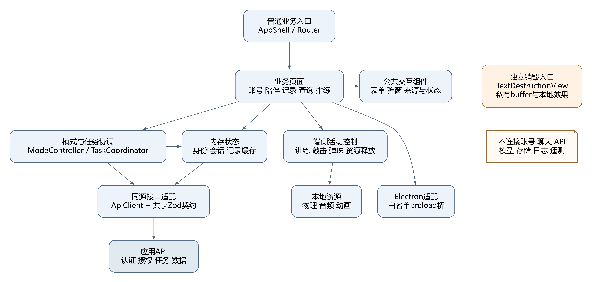
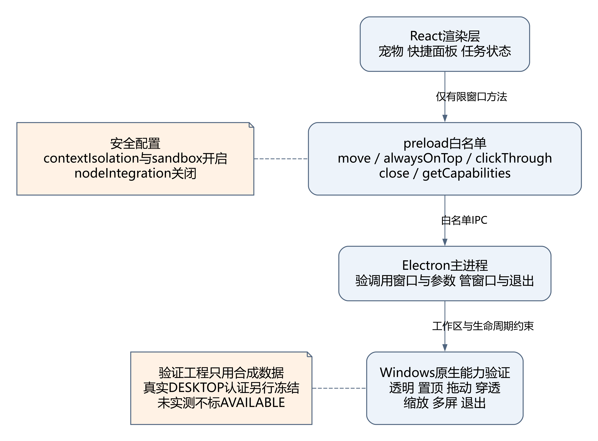

# 前端组件关系与依赖说明

版本 v1.0　对应 T03　关联 REQ01～REQ17

## 1 组件总览

图1用实线表示调用或组合依赖。独立销毁入口位于普通业务树之外，图中不与 ApiClient、身份或通用聊天状态连接。图源 F01_components.dot 可编辑，SVG 可缩放，PNG 用于说明书插图。

| 组件或模块 | 职责 | 允许依赖与边界 |
|---|---|---|
| AppShell 与 Router | 普通导航、入口能力提示、页面装配 | IdentityStore、CapabilityAdapter；路由切换只下达退出事件，不读取销毁正文 |
| 业务页面 | 表单与正常、空、加载、失败、权限视图 | 公共 UI、当前业务状态、ApiClient；不直连模型或数据库 |
| IdentityStore | 游客、登录、过期及客户端身份代次 | auth/context；不持有原始 Cookie 或密码 |
| BusinessSessionStore | 当前模式、活动、消息选择、双代次 | 会话接口和 TaskCoordinator；不自动读历史补上下文 |
| TaskCoordinator | 受理、轮询、取消、代次比较 | Agent 和 Search 适配器；不持久化正文 |
| RecordCache | 当前身份当前入口记录的内存缓存 | records、room、profile 适配器；清除后失效引用 |
| ModeController | 检查能力、确定携带范围、停止旧活动 | TaskCoordinator、ResourceScope、会话切换；失败不得显示成功 |
| ApiClient | 同源通信、CSRF、超时、错误和 Schema 校验 | shared/contracts；不暴露秘密，不做无限重试 |
| ResourceScope | 登记并释放活动资源 | 控制器提供的幂等清理函数；页面卸载也要触发 |
| 端侧控制器 | 训练、敲击和弹珠的运行状态 | 本地定义、物理和音频；没有逐步训练或碰撞上传接口 |
| ElectronBridge | 白名单窗口操作 | preload 桥；不暴露通用 execute、shell、文件读写 |
| TextDestructionView | 私有输入与销毁效果 | 本地效果资源和非正文动效偏好；不挂业务 Provider 或遥测 |

## 2 状态归属与模块通信

组件通过显式事件或参数传递所需数据，避免所有功能共用一份全局正文。跨模式携带 selectedContextIds 必须由用户选择，新的 AI 或 SEARCH 用途另行确认。事件总线若存在，只传活动停止、身份失效和能力变化等控制事件，不广播私密文本。

普通表单输入由功能模块拥有；网络响应由该模块通过协调器接收；记录详情进入当前范围内的内存缓存。销毁输入始终由独立组件私有，销毁图形只生成本地效果缓存。切换离开销毁页只执行 dispose，不提供“带入聊天”操作。

## 3 生命周期接口

| 接口 | 调用场景 | 行为约定 |
|---|---|---|
| start 或 configure | 用户明确开始训练或互动 | 校验状态与能力，建立本次 ResourceScope；音频仅用户手势解锁 |
| pause | 用户暂停、页面隐藏、面板收起 | 停定时推进、物理和音符，保存允许保留的非持久进度 |
| resume | 用户点击继续 | 恢复当前有效活动；不复活旧请求或补播旧声音 |
| reset 或 restart | 用户选择重来 | 清旧进度、球和选定表达；网络活动按服务返回更新代次 |
| stop | 退出、失去运行条件 | 停模拟、音频、计时、输入捕获和新任务 |
| dispose | 卸载、切换身份、窗口关闭 | 幂等释放监听、动画帧、节点、纹理和持有的私密引用 |

这些方法是设计接口，不以类名推断实现完成；实际代码可采用 hook、模块或类，但须保留同等的可观察行为和清理约束。

## 4 Electron 进程边界

主进程管理 BrowserWindow、可见工作区、退出和 IPC 参数校验；preload 只提供 petWindow.move、setAlwaysOnTop、setClickThrough、close 和 getCapabilities。React 渲染进程负责宠物、快捷面板及任务呈现。开启 contextIsolation 与 sandbox，关闭 nodeIntegration，阻止任意导航。

窗口坐标为有限整数并限制可见工作区；跨屏和断屏后提供恢复位置。穿透启用前保留可达的恢复或退出入口。C03 验证工程只使用合成数据，实际 DESKTOP 认证和可信入口绑定另行设计；修改 entry 头不构成接入许可。

## 5 与既有 UML 的映射

前端控制器适配 UML 的 BusinessSession、PendingRequest、TrainingRun、ImpactRun、MarbleRun、AudioEngine、TextDestructionView 与 DesktopPet。ApiClient 是应用 HTTP 契约适配层，不替代服务端 AIClient、IdentityRepository 或 RecordRepository。RecordKind 统一为 CONVERSATION、EMOTION、WORRY_OBJECT、REHEARSAL_DRAFT、DEPOSIT、QUERY，不沿用其他缩写枚举。

UML 个别宽泛可选字段与09号严格 DTO 不一致时，前端请求按09号执行。例如物件 UI 可以不强迫用户填写文字，但 title 的请求规则为1～80码点，可为外观提供可编辑的默认名称；description 可省略。不能据 UML 的可选描述向接口发送不合法载荷。
