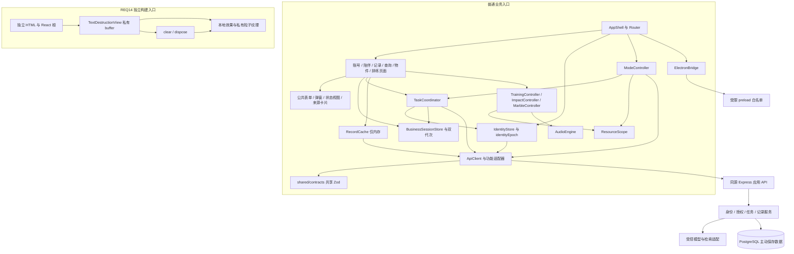
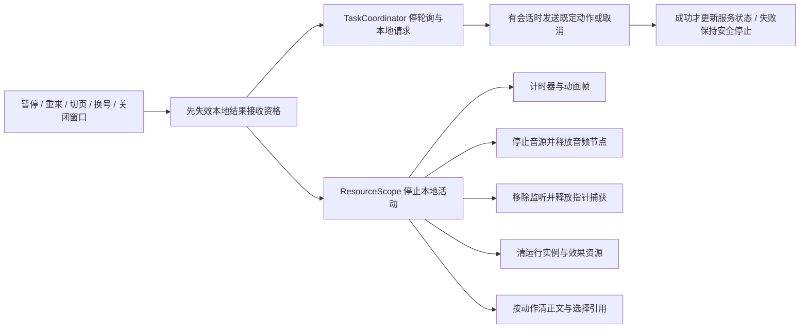
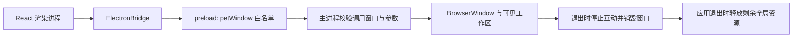

# 前端组件关系图

负责人：程杰（082402202）｜T03｜v1.1｜2026-10-21

状态：设计初稿，待交叉复核。组件名为实现建议；HTTP 和端侧契约沿用09号规范。全文图源直接保存在本 Markdown 中。

## 1. 普通业务与独立销毁入口

实线表示组合或调用依赖。REQ14位于普通应用树之外，没有连接聊天状态、API、持久化或遥测的依赖线。

普通路由离开销毁入口时只执行清空／关闭，不读取或复制其正文。独立页使用自己的输入、效果、资源清理和非正文配置，不复用会记录输入的公共表单包装器。禁止装配日志、错误收集、分析或会话回放 SDK；构建和部署时一并检查。

## 2. 组件职责与数据边界

| 组件 | 持有或接收的数据 | 职责与禁止跨越的边界 |
|---|---|---|
| AppShell／Router | 白名单页面键、实际入口能力、当前路由 | 装配页面、切换前触发停止；不把私密正文放URL或跨入口跳转参数 |
| 普通业务页面 | 当前功能的表单、选中资源和展示状态 | 页面拥有临时输入；通过明确操作才外发或保存 |
| IdentityStore | 认证结果、CSRF、入口、客户端身份代次 | 401／退出／换号先失效并清缓存；不读取安全Cookie原文或储存密码 |
| BusinessSessionStore | sessionId、activityId、模式、双代次、当前消息 | 控制临时会话；不自动读取历史补上下文；END清正文 |
| TaskCoordinator | requestId、代次快照、轮询和Abort句柄 | 停轮询、请求取消、拒绝迟到结果；与服务端撤销配合 |
| RecordCache | 当前账号当前入口的列表／详情内存 | 清除、退出或换入口失效缓存及关联；不写离线缓存 |
| ModeController | 用户选择的目标与 selectedContextIds | 先校验能力和携带范围，再停旧资源并切换；REQ14无携带路径 |
| ApiClient | 严格 DTO、CSRF、允许的错误码 | 同源HTTP、共享Schema；不直连模型或DB，不添加可信 ownerId／entry |
| ResourceScope | 各活动登记的释放函数 | 顺序停止资源；幂等执行；不持久化私密输入 |
| 端侧控制器 | 固定训练进度、画布效果、物理与音频状态 | 本地开始／暂停／继续／重置／退出；碰撞和点击不自动上传 |
| TextDestructionView | 私有buffer、输入DOM与效果缓存 | 正文不进入任何通用业务状态；完成、跳过和所有离开路径清空 |
| ElectronBridge | 白名单方法及有限参数 | 只提供窗口能力；不携带正文、凭据或通用命令 |

通信采用显式参数和控制事件。若使用事件总线或 BroadcastChannel，仅传失效、停止、能力变化等事件，不广播正文。跨模式携带内容由用户选定，保存授权不扩展为 AI／搜索授权。

## 3. 资源生命周期协作

| 生命周期接口 | 触发条件 | 主要动作 |
|---|---|---|
| start／configure | 用户主动开始且能力、参数合法 | 建立本轮资源范围；音频须用户手势解锁 |
| pause | 用户暂停、页面隐藏或面板收起 | 冻结计时、物理及推进，停止在播声音和不必要捕获 |
| resume | 用户主动继续且当前活动有效 | 从有效进度继续；不补计后台时间、不补播旧声音或请求 |
| reset／restart | 用户确认重来 | 释放上一轮运行资源；清球、计时或表达选择；采用服务新代次 |
| stop | 用户退出或失去运行条件 | 停止新效果、计时、音频和任务创建 |
| dispose | 页面卸载、账号切换、窗口销毁 | 幂等释放帧、监听、节点、纹理、捕获与私密引用 |

这些是普通控制器的生命周期约定。REQ14的对外端侧方法仍限定为 `setBuffer/destroy/clear/dispose`，不向其引入普通业务会话。

## 4. Electron 进程与信任边界

白名单仅为 `petWindow.move({x,y})`、`setAlwaysOnTop(boolean)`、`setClickThrough(boolean)`、`close()`、`getCapabilities()`。移动坐标为有限整数并限制在可见工作区；跨屏或断屏提供恢复位置。恢复穿透／退出入口始终可达。

开启 `contextIsolation`、`sandbox`，关闭 `nodeIntegration`，禁止任意导航及通用 `invoke/execute/shell` 或文件读写。渲染进程异常退出时，主进程销毁其浮层；应用退出时另行注销全局快捷键等应用资源，避免只关闭一个窗口就误释放其他窗口仍在用的资源。主进程不能依赖渲染层成功回应才解除浮层。

C03使用合成数据验证窗口能力。正式DESKTOP业务仍须独立可信接入／凭据绑定；修改 `entry` 字段或请求头不构成桌面身份。

## 5. 与后端领域模型的映射

本设计适配既有 `BusinessSession`、`PendingRequest`、`TrainingRun`、`ImpactRun`、`MarbleRun`、`AudioEngine`、`TextDestructionView` 与 `DesktopPet` 等领域概念，不为每个前端控制器新增数据库表。

记录类型统一为 `CONVERSATION/EMOTION/WORRY_OBJECT/REHEARSAL_DRAFT/DEPOSIT/QUERY`。内部 `identityEpoch`、资源登记句柄不进入后端DTO；服务双代次、请求字段和错误保持05号与09号一致。
