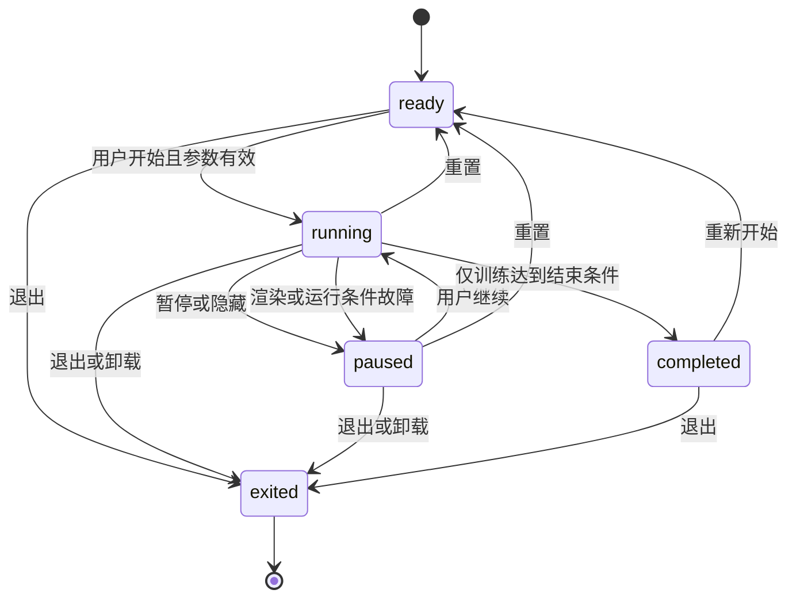
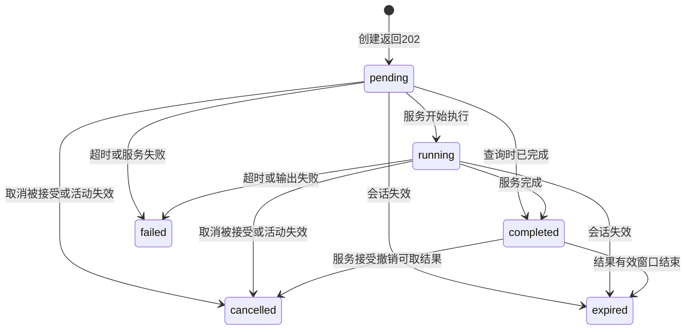
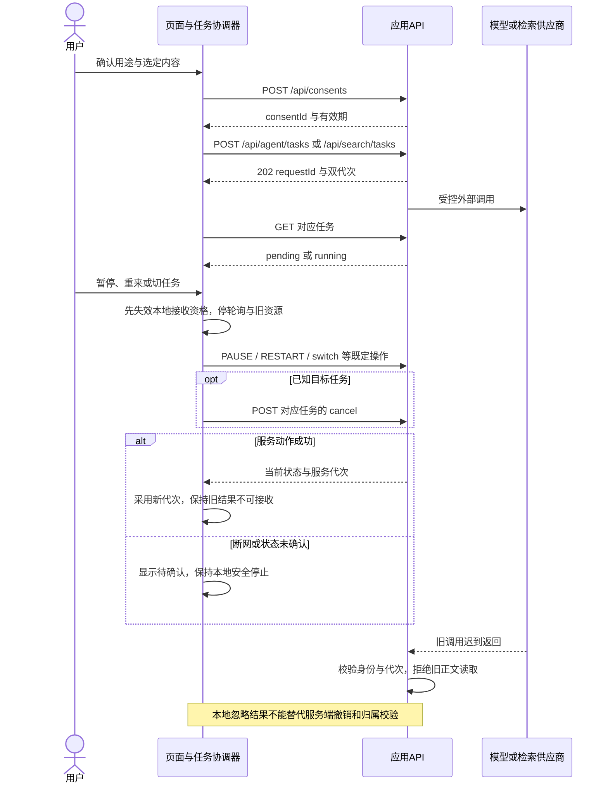
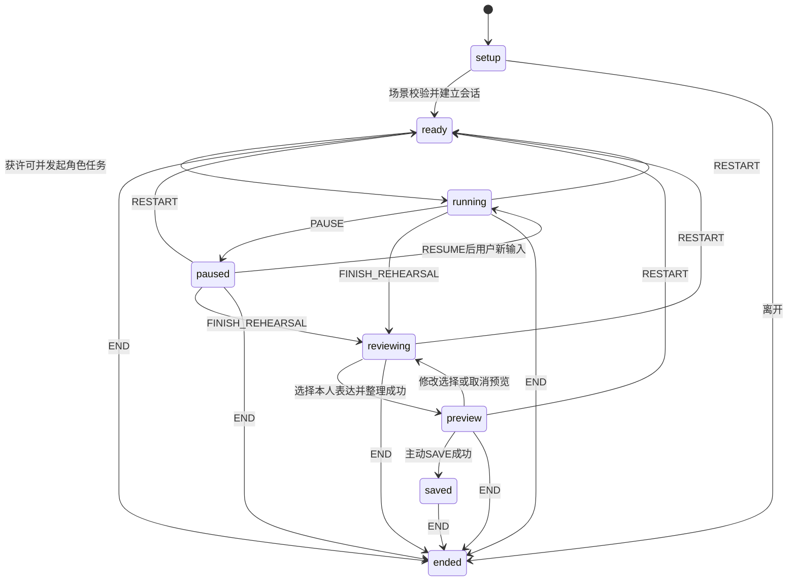
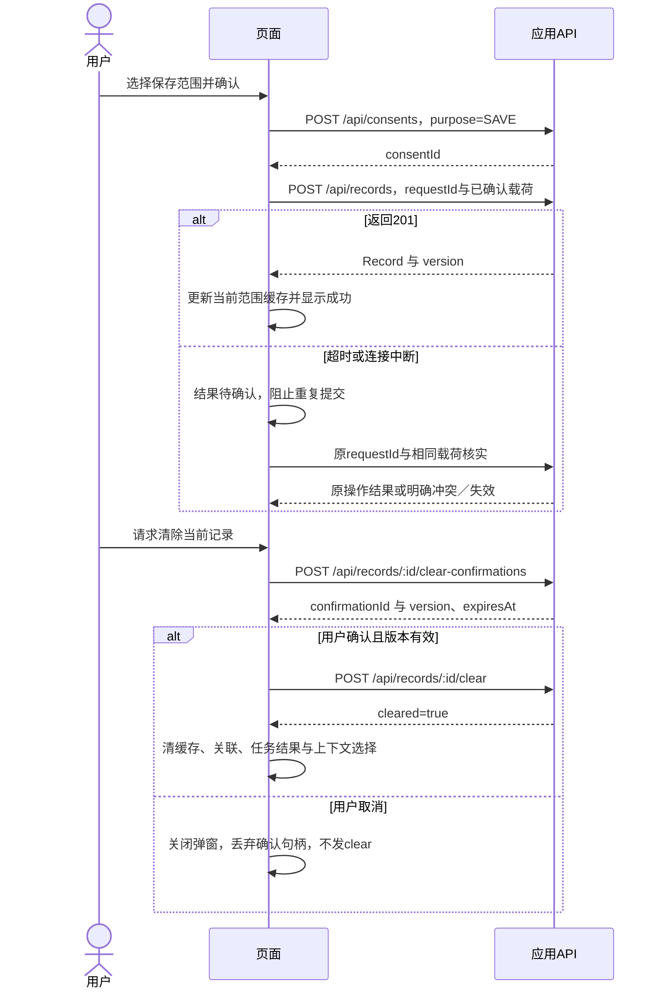
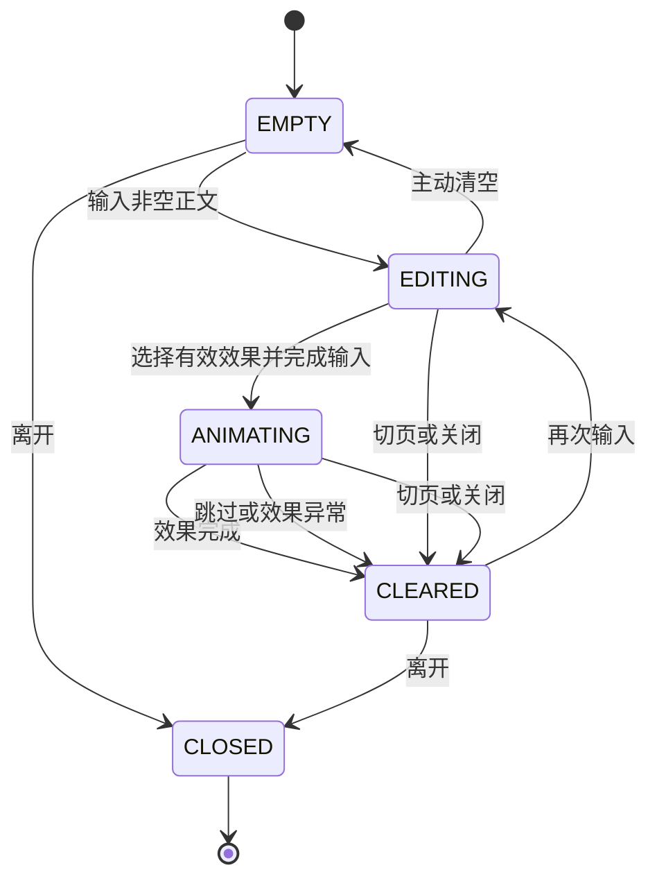

# 前端关键状态与时序图

负责人：程杰（082402202）｜T03｜v1.1｜2026-10-21

状态：设计初稿，运行验证未执行。HTTP动作与任务状态遵循09号；本文另行标明的页面状态只是前端呈现，不扩展服务枚举。每个状态在表中说明进入触发和清理动作。

## 1. 通用页面状态

| 页面状态 | 进入触发条件 | 允许的操作／可见反馈 | 离开或清理动作 |
|---|---|---|---|
| idle | 初次进入，尚未加载或开始 | 说明、输入、开始 | 不启动计时、模型或轮询；用户开始才校验并发起 |
| loading | 当前有效读取或受理请求开始 | 加载提示、取消／安全返回 | 请求完成停加载句柄；离开先失效接收资格并Abort |
| ready | 成功取得当前身份入口的有效数据 | 允许的查看／编辑／启动 | 更新携带当前版本；离开清页面私密引用和活动资源 |
| empty | 成功响应明确返回空列表或 `searchState=EMPTY` | 空状态及主动创建／改写问题 | 不自动造记录或重试模型；离开清临时查询状态 |
| error | 网络、服务、输出或校验失败 | 实际错误、允许保留的编辑、手动重试 | 停加载／轮询；清无效结果；身份失效时同时清输入 |
| blocked | 401、权限失效或安全退出开始 | 正文遮蔽、登录／权限提示 | 失效身份代次和授权，清缓存与旧响应；验证通过才重载 |
| paused | 用户暂停、隐藏页面或失去运行条件 | 已暂停、继续／重来／退出 | 冻结计时和物理，停声音及旧结果；继续只建有效的新运行 |
| ended | END成功、会话过期或活动正式退出 | 结束提示、重新开始 | 清临时正文、选择、许可、计时与轮询；不恢复旧任务 |

退出、暂停请求在网络中尚未确认时，界面使用“本地已停止，服务器状态待确认”提示，不能把服务状态提前显示为已完成。

## 2. 训练、敲击回弹与弹珠机

敲击与弹珠不使用自动 `completed`；它们持续到用户暂停或退出。静音是正交的声音设置，不改变运行状态。

| 状态 | 进入触发条件 | 状态内行为 | 离开／清理动作 |
|---|---|---|---|
| ready | 进入功能或完成重置 | 显示说明和配置；训练零推进、无物理循环 | 开始才创建本轮帧／计时；离开释放配置监听与页面引用 |
| running | 用户开始或继续 | 有效步骤、画布或物理推进；用户手势后可发声 | 暂停清推进句柄和在播音源；重置／退出进一步清运行实例 |
| paused | 暂停、隐藏、收起、运行条件故障 | 保留允许的临时进度；声音和物理不推进 | 继续时重新登记句柄并重设时间基准；不补算后台时间 |
| completed | 仅训练达到时长或有效步骤完成 | 显示完成，可重来或退出 | 进入时即停计时和提示音；重来清进度，退出清全部资源 |
| exited | 返回、切页、窗口关闭或卸载 | 不接收互动输入、不产生新效果 | 幂等释放帧、timer、监听、捕获、音频节点、物理对象与效果缓存 |

| 操作 | 触发与规则 | 清理／保留 |
|---|---|---|
| 暂停／继续 | 仅在状态允许时转换 | 暂停冻结 `elapsedMs` 和模拟；继续不重播旧音符，不复活旧网络请求 |
| 重置／重来 | 用户明确操作；涉及未保存内容先说明 | 训练计时归零；弹珠清球与轨迹；敲击清粒子；布局保留或恢复预置须界面说明 |
| 静音 | 用户切换静音 | 立即停止全部在播音源，后续碰撞不发声；画布可继续 |
| Escape／退出 | 可见退出按钮或键盘操作 | 释放输入捕获、监听、帧与音频；Web不影响产品外区域，原生浮层由主进程兜底关闭 |

弹珠音高来自选定预置音阶，限制声部和触发频率；具体初始待测参数见01号§7。音频不可用时给可见静音反馈，不阻塞退出。

## 3. 外部任务与迟到结果

上图描述任务状态，不代表前端必须观察到每个中间状态。客户端断网只产生页面错误／待确认提示，不自行把任务设为 `failed`。

| 任务状态 | 进入依据 | 轮询／展示 | 清理动作 |
|---|---|---|---|
| pending | 创建返回202或任务GET返回pending | 显示等待；至少1秒间隔、最多1个在途轮询 | 离开时撤销本地接收资格；取消／切换停轮询 |
| running | GET返回running | 显示处理中，允许暂停／取消 | 同上；不把供应商执行中当作可恢复旧回复的理由 |
| completed | GET返回completed且当前身份、活动、双代次、请求均匹配 | 停轮询，展示有效结果；可选主动保存 | 清轮询和Abort引用；仅在有效会话内保留结果；结束清正文 |
| cancelled | 服务确认取消或读取到取消状态 | 不显示该任务正文 | 停轮询，清缓存中的该任务结果和上下文引用 |
| failed | GET返回failed | 展示 `TIMEOUT/PROVIDER_UNAVAILABLE/OUTPUT_INVALID` 对应提示 | 停轮询、清无效结果；用户重试才创建新请求并重新核验许可 |
| expired | GET返回expired或确认会话失效 | 提示重新开始，不恢复旧结果 | 停轮询；清旧任务结果／授权；会话失效时清消息与选择 |

结果展示前匹配本地 `identityEpoch`、可信入口、`sessionId`、`activityId`、`sessionGeneration`、`activityGeneration`、`requestId`。任一不符只丢弃，不渲染、不加入缓存；本地字段不擅自发送给后端。

PAUSE、RESTART、FINISH_REHEARSAL、END、模式切换、撤销和退出都先关闭旧结果展示通道。RESUME不重放旧任务；暂停后用户重新输入才按有效状态创建请求。

## 4. 排练与物件

`setup/preview/saved` 是页面状态，不能作为新增会话 `action` 发送。只有用户明确结束才执行END，不能先END清空消息再尝试整理。

| 状态 | 进入触发条件 | 可执行操作 | 清理动作 |
|---|---|---|---|
| setup | 打开排练设置或新建流程 | 输入scene、counterpart、goal、style | 取消／离开清临时场景；校验失败不创建任务 |
| ready | 场景有效且会话ready，或RESTART成功 | 开始角色模拟 | 重来进入时清旧轮表达、预览与许可；离开END并清正文 |
| running | 有效REHEARSAL_REPLY受理或角色流程推进 | 发言、暂停、重来、结束模拟 | 暂停／重来／结束先屏蔽旧回复、停轮询；不持久化整轮对话 |
| paused | PAUSE被接受；等待期间用本地停止提示 | RESUME、RESTART、FINISH_REHEARSAL、END | 冻结角色推进；继续不复活旧任务；重来清上轮选择 |
| reviewing | FINISH_REHEARSAL成功 | 选择本轮本人消息、整理、重来或END | 进入即失效角色回复及旧许可；不允许继续角色回复；修改选择废弃旧预览 |
| preview | REHEARSAL_SUMMARIZE有效完成 | 审阅／编辑、主动保存、返回选择 | 编辑后重取SAVE许可；取消／重来／结束清预览；不自动纳入AI未认可建议 |
| saved | REHEARSAL_DRAFT保存成功 | 确认已保存后结束 | 仅持久化确认稿；END清临时对话、选择、预览和任务 |
| ended | END成功、会话失效、离开后本地清理完成 | 重新开始 | 清会话私密引用；网络未确认时继续锁定旧内容 |

物件流程同样以用户动作为边界：

| 状态 | 进入触发条件 | 行为与退出清理 |
|---|---|---|
| draft | 用户选择TANGLE／STONE／NOTE | 临时形状与可选描述；离开清草稿 |
| placedLocal | 用户选择先放旁边 | 只显示临时外观，零AI调用；移出清关联，未授权正文不保存 |
| saving／saved | 选择保存范围并获得SAVE，服务返回后确认 | 只存外观时省略description；失败保留当前编辑，成功采用记录版本 |
| organizing | 主动选定一个物件，AI_PROCESS许可有效 | 已保存来源用resourceId／resourceVersion，临时来源用objectDraft；切换／取消停任务并拒绝迟到回复 |

## 5. 主动保存与清除

| 页面状态 | 进入触发条件 | 退出／清理动作 |
|---|---|---|
| editing | 用户新增或编辑 | 取消清未提交修改；当前账号下保存失败可保留 |
| confirming | 用户请求保存范围或清除确认 | 取消不写入；版本／载荷变化使旧许可或确认失效 |
| submitting | 确认后发请求 | 防重复点击；成功停加载并采用新版本；清除成功才移除正文 |
| resultUnknown | 持久写超时／断网 | 保留原requestId与同载荷核实；不改ID盲目重存，不显示成功或未保存的确定结论 |
| conflict | 409、版本或确认过期 | 保持当前实际状态；重读可用资源后由用户重新决定，不自动覆盖 |
| saved／cleared | 服务明确返回成功 | saved刷新范围内缓存；cleared清详情、列表引用、任务和选中上下文 |

SAVE初始5分钟、清除确认初始2分钟有效，均为09号配置。没有批量清除或独立“写入状态查询”端点；结果核实使用既定幂等操作／已有资源读取。原许可过期且无法核实的场景保持待确认，由后端补充既定契约，不能自动新建一次保存。

## 6. 文字销毁状态与清理

| 状态 | 进入触发条件 | 允许操作 | 清理动作 |
|---|---|---|---|
| EMPTY | 初次进入或清空输入 | 私有输入、选择效果、退出 | 无正文，不创建业务会话；离开dispose本地资源 |
| EDITING | 输入非空且不超4000码点 | 改写、SHRED／BURN／BLACK_HOLE、清空／退出 | 主动清空执行clear；切页／关闭执行clear与dispose；空输入不启动动画 |
| ANIMATING | 用户确认有效文本与预置效果 | 跳过或退出；不再外发输入 | 完成、跳过、异常均清buffer、DOM、拆字节点、粒子文本、纹理、轨迹和引用 |
| CLEARED | 同一清理过程已执行 | 再次输入或退出 | 停帧和释放旧效果资源；异常不为了重试保留原文 |
| CLOSED | 路由离开、窗口关闭或卸载 | 无 | 幂等dispose监听、捕获、音频和效果缓存；重新打开为空 |

全部状态都不经过通用聊天Context、API、存储、AI、搜索、日志或遥测。声音或粒子不可用时可直接完成清空，不以效果成功为清理前提。关闭不执行含正文的beacon、网络、崩溃附件或自动草稿恢复。

## 7. 窗口退出、任务切换与断网方案

| 事件／异常 | 触发条件与即时动作 | 服务／恢复处理 | 可观察清理证据 |
|---|---|---|---|
| 普通切页／切任务 | 先校验目标与携带范围；立即屏蔽旧结果、停活动资源 | 既定switch／actions／cancel成功才更新服务状态；失败保持安全停止 | 无旧回复、计时、音频或输入捕获；REQ14只清空不携带 |
| 页面隐藏／桌宠面板收起 | 暂停本地训练和模拟，停声音 | 网络排练按PAUSE处理；返回后用户主动继续 | 后台时间不累计，无角色新回复或新音符 |
| 浏览器关闭／pagehide | 清可见正文、停止本地资源，REQ14同步清私有内容 | 不依赖关闭时HTTP必达；服务通过会话／任务时限兜底 | 重开先验身份；不恢复未保存正文 |
| Electron显式退出／Esc | 停循环与声音、释放捕获和监听，关闭浮层 | 主进程兜底销毁窗口；应用退出注销剩余全局资源 | 其他应用可正常点击；无残留窗口、声音或模拟 |
| 渲染进程异常退出 | 主进程发现崩溃或窗口失效 | 销毁失效浮层；重开仅受控资源与非正文偏好 | 不阻挡桌面、不读取崩溃恢复正文 |
| 断网前已受理外部任务 | 停当前轮询，保持任务标识；用户暂停／切换即失效接收资格 | 重连后仅当前身份和活动仍有效时核实既有任务；不自动创建新任务或重发正文 | 离开活动的迟到结果不可见；不显示空检索冒充失败 |
| 断网期间取消／暂停 | 先本地安全停止 | 提示服务器未确认，重连核对／重试既定控制动作；供应商可能仍运行 | 旧结果始终屏蔽；不宣称已远程停止 |
| 断网退出登录 | 先递增identityEpoch、遮蔽正文、清缓存并停活动 | 服务器退出尚未确认；重连先重试撤销，204后再取匿名上下文 | 不因联网自动展示旧私密内容；不能只清前端就称凭据失效 |
| 401／换账号／改密 | 立即锁私密视图、失效旧任务、清正文及选择 | 重新验证；改密成功所有旧登录会话失效 | A账号正文或迟到回复不进入B账号 |
| 409会话动作冲突 | 保持本地安全暂停，不回滚复活旧任务 | 只用已有响应的实际状态；09号未定义独立GET会话状态，无法核实时由用户新建会话 | 不发明接口，不自动携带正文 |
| 后退／页面缓存恢复 | 内容先遮蔽，重新检查身份及活动有效性 | 通过才重载本人当前入口数据 | 无旧私密正文闪现，缓存失效完整 |

取消网络失败的状态不转换为 `cancelled`。页面只记录本地接收资格已失效、轮询已停、远程状态待确认；只有服务端任务查询返回 `cancelled` 才显示任务已取消。重连后的核实不自动重新受理任务，也不把旧身份缓存或正文带入当前身份。

## 8. 验收用例设计

以下均未执行，不标记运行通过。使用合成正文与测试账号，不使用真实私密数据。

| 用例 | 操作 | 验收观察点 |
|---|---|---|
| ST01 | 未开始、暂停、隐藏、继续、重置、退出训练／弹珠 | 未开始零推进，暂停无计时和音符；退出资源回到基线 |
| ST02 | 任务中暂停、重来、切模式，再模拟迟到结果 | 身份与双代次不符的结果不显示，服务也不提供旧正文 |
| ST03 | 排练结束模拟后选本人表达，尝试跨轮或AI消息ID | reviewing不继续角色；非法ID拒绝；稿件只含认可内容 |
| ST04 | 写入超时后同requestId核实；清除取消、冲突和确认过期 | 无重复记录、不误报成功、取消无清除；冲突不覆盖 |
| ST05 | REQ14完成、跳过、异常、切页、关闭后重开 | 网络、存储、日志、遥测和可访问状态无合成标记；AI／搜索调用为零 |
| ST06 | 断网退出／切任务，重连；A退出换B；后退恢复 | 服务器未确认有明确提示；私密内容不闪现，旧回复不回填 |
| ST07 | Electron关闭、Esc、渲染崩溃、切穿透后退出 | 浮层、输入捕获和声音释放，其他应用可继续操作 |
