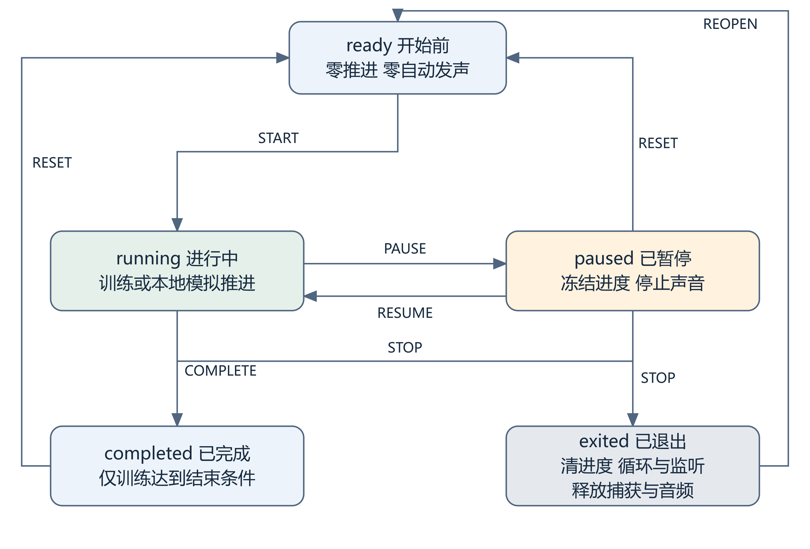
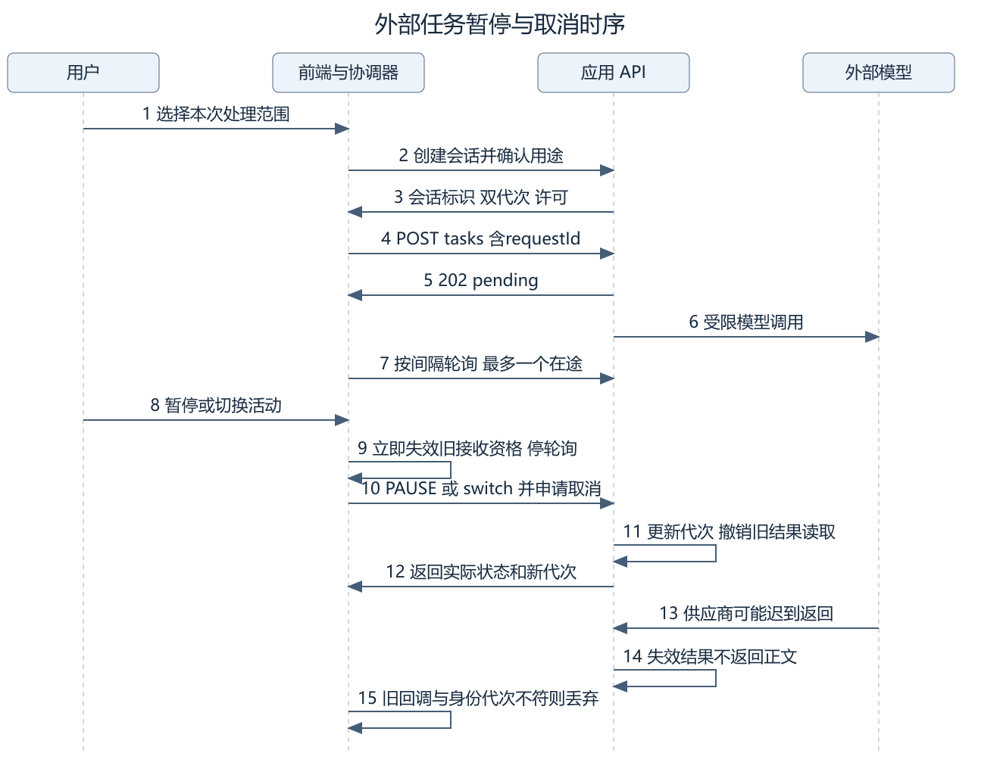
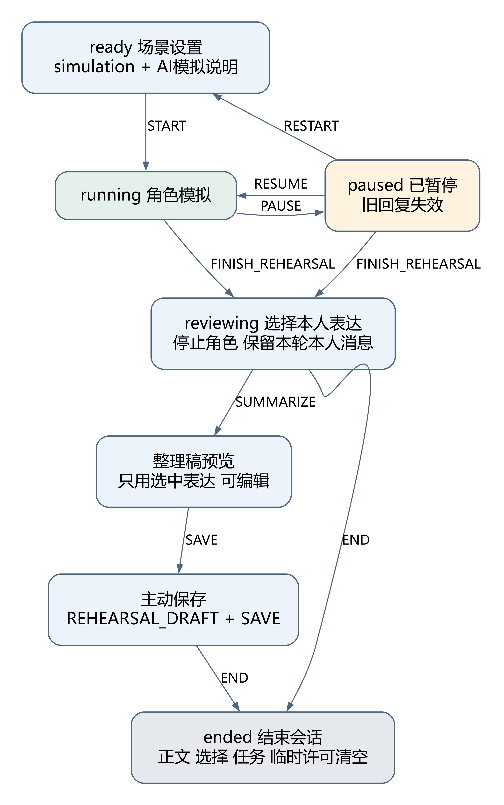
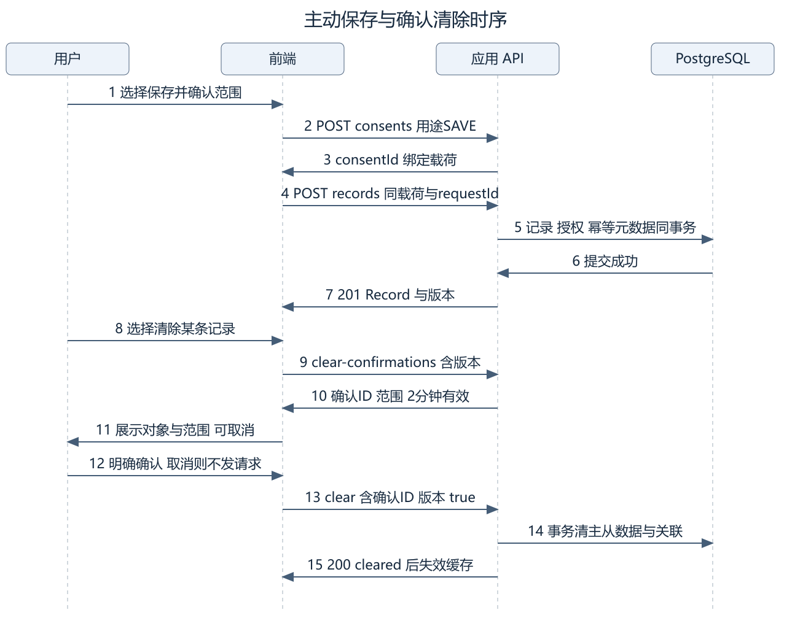
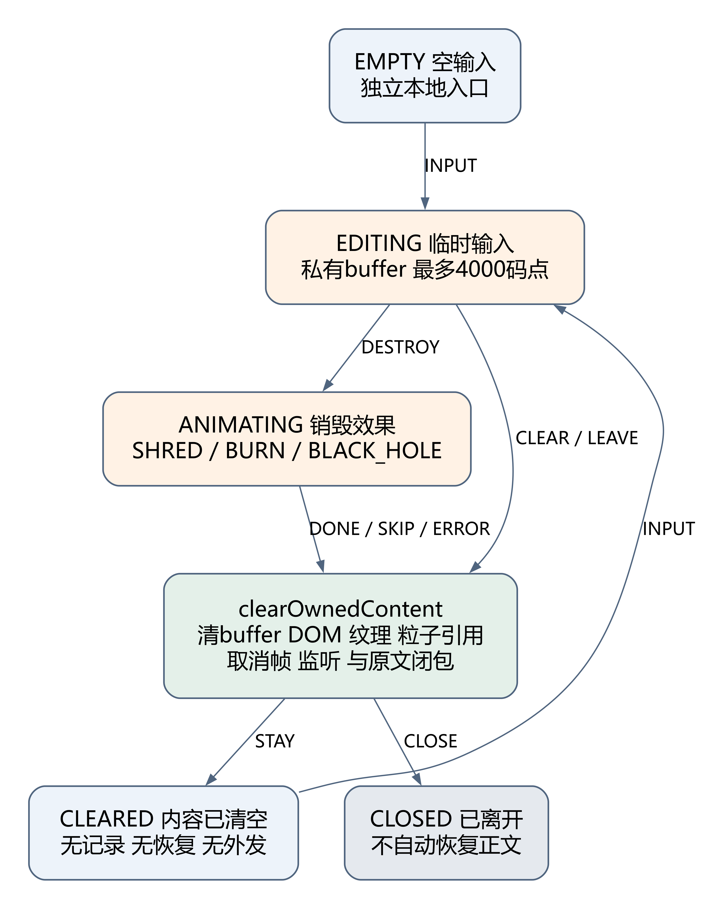

# 前端关键状态与时序设计

版本 v1.0　状态和动作沿用09号接口规范　图源与插图同版

## 1 通用页面状态

| 状态 | 进入条件 | 可见内容与允许操作 | 离开或清理动作 |
|---|---|---|---|
| idle | 尚未加载或开始 | 功能说明、输入和开始按钮 | 校验后加载；不自动推进 |
| loading | 当前有效请求已发出 | 进度提示；取消或安全返回 | 终态停轮询；切换失效本地请求 |
| ready | 数据有效且属于当前范围 | 当前页面数据和有效操作 | 修改或清除以当前 version 提交 |
| empty | 成功响应明确无记录或无来源 | 空状态及主动创建入口 | 不与错误混用 |
| error | 网络、服务或输出失败 | 实际错误、可恢复输入和手动重试 | 不自动循环调用模型 |
| blocked | 未登录、过期或权限不符 | 登录引导或安全提示，隐藏正文 | 失效旧身份任务、授权和缓存 |
| paused | 用户暂停或运行条件丢失 | 已暂停、继续或退出 | 停计时、音频和模拟；继续须用户操作 |
| ended | 用户结束或临时会话失效 | 已结束和重新开始 | 清临时正文、停止异步回填 |

## 2 训练与互动状态

训练采用 ready、running、paused、completed、exited。敲击和弹珠采用同样的开始、暂停、继续及退出规则，但不虚构自动完成条件。训练达到规定时长或用户走完有效步骤后才能进入 completed。

| 触发 | 训练 | 敲击与弹珠 | 清理约束 |
|---|---|---|---|
| 开始 | 从0开始计时或步骤 | 建立画布或模拟循环 | 用户手势后才启用声音 |
| 暂停或隐藏 | elapsedMs 冻结 | 停物理步进和新效果 | 停止在播声音，释放不必要捕获 |
| 继续 | 从保留进度继续 | 恢复本轮有效状态 | 不补计后台时间，不补播声音 |
| 重置 | 回到开始前 | 清球和运行痕迹，保留或重置布局须界面说明 | 清旧动画和节点；首版布局仅临时 |
| 静音 | 进度不变 | 模拟可继续 | 立即停止现有声音，后续不发声 |
| 退出或卸载 | 清本轮进度 | 清运行实例 | 清计时器、帧、监听、捕获和音频 |

## 3 外部任务与迟到结果

任务状态为 pending、running、completed、cancelled、failed、expired。取消是任务状态；TIMEOUT 是 failed 下的 failureReason，不新增同名通用 HTTP 错误码。

发送前捕获客户端 identityEpoch、可信 entry、sessionId、activityId、双代次和 requestId。创建任务返回202后，以每次完成再间隔至少1秒的方式轮询，始终最多一个在途轮询。只有当前有效身份和活动下匹配的 completed 才可展示。

用户点击暂停时，前端立即关掉旧结果展示通道并停轮询，再发送 PAUSE；响应成功后采用服务端新代次。已知任务可并行申请 cancel，但服务端动作和代次校验才是撤销依据。断网时界面保持“暂停请求未确认”，旧结果继续被屏蔽。服务返回仍在计算不表示前端可恢复旧回复。

RESTART、切换模式、FINISH_REHEARSAL、撤销授权和退出同样先失效本地接收资格。RESUME 不重放旧请求。模型供应商未能中止时，服务仍须拒绝旧任务正文读取；前端忽略结果不能替代服务端保护。

## 4 排练状态

| 当前状态与操作 | 服务动作 | 前端行为 |
|---|---|---|
| ready 点击开始 | 创建 REHEARSE 会话，取得许可后生成 | 校验 simulation 的场景、对方、目标和风格 |
| running 点击暂停 | PAUSE | 不再展示角色回复，失效旧请求 |
| paused 点击继续 | RESUME | 不重放原任务；新输入另取许可 |
| running 或 paused 点击重来 | RESTART | 新活动代次，清上轮可选表达和旧许可 |
| running 或 paused 结束模拟 | FINISH_REHEARSAL | 进入 reviewing，停止角色，保留本轮本人消息 |
| reviewing 选表达并整理 | REHEARSAL_SUMMARIZE | 只提交本轮本人 recognizedMessageIds，展示可编辑预览 |
| reviewing 或预览主动保存 | SAVE 许可与 records 创建 | 保存 REHEARSAL_DRAFT，未认可 AI 内容不自动加入 |
| 任一有效活动结束 | END | 清会话正文、选择、任务、临时授权和预览 |

模拟对方的回复不代表现实人物反应。结束模拟与结束会话是两个操作，不能用 END 代替 FINISH_REHEARSAL 后再尝试读取已清空消息。

## 5 主动保存与清除

普通保存过程为编辑、展示保存范围、获取 SAVE 许可、提交同一载荷、以成功返回更新记录视图。许可绑定实际操作与版本；用户改了载荷须重新确认。提交期间防重复点击，使用同 requestId 对同载荷核实结果。服务超时不能直接显示“未保存”。

清除过程先按当前版本获取 clear-confirmations，再让用户核对范围。取消不发 clear；确认才提交 confirmationId、expectedVersion 和 confirmed:true。清除确认初始2分钟有效，版本变化或过期须重新确认。成功后清缓存、关联与上下文选择；409时重新读取并让用户重新决定。首版没有全库一键清除接口，批量清除不能被当作既有能力。

## 6 文字销毁状态

EMPTY 输入后进入 EDITING，点击有效效果进入 ANIMATING，完成后进入 CLEARED，再次输入回到 EDITING。跳过、效果异常、切页和关闭都直接执行 clearOwnedContent；不为动画失败保留原文。

clearOwnedContent 清空由页面持有的 buffer、输入 DOM、拆字节点、纹理、粒子文本、指针轨迹和闭包引用，取消动画帧并释放监听。不存在通用业务会话、HTTP、模型、搜索、持久化、自动恢复或含正文的错误上报路径。这里只约束产品控制的数据通路，不承诺操作系统或输入法的绝对无痕。

## 7 断网退出与会话恢复

身份退出开始即遮蔽私密视图、停止本地活动、递增 identityEpoch，丢弃旧响应并清缓存。服务返回204后确认退出并重新获取匿名上下文。网络故障则保留锁定态，提示服务器撤销未确认；不能只删除前端状态就宣称凭证失效。

业务会话初始无活动30分钟或绝对2小时失效；登录会话初始空闲30分钟或绝对7天过期，由服务端判定。收到401、临时任务 expired 或重启导致不存在时，停止正文读取并提示重新开始，绝不自动恢复重发原文。

09号要求409后核对实际状态，但没有独立 GET 业务会话状态端点。本设计不发明此接口：在未冻结补充契约前，409后保持安全暂停，读取已有响应中的实际状态；无法核实时引导用户新建会话且不自动携带正文。补充的查询方式由李泉毅与程群确认。
