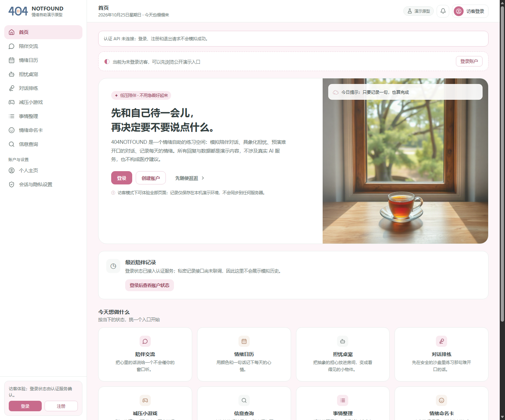
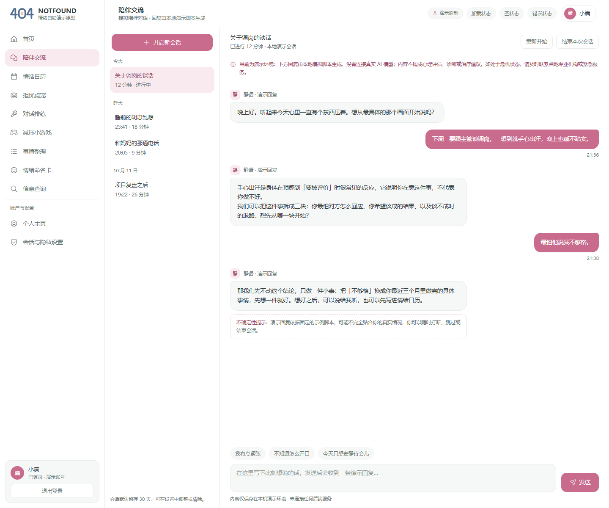
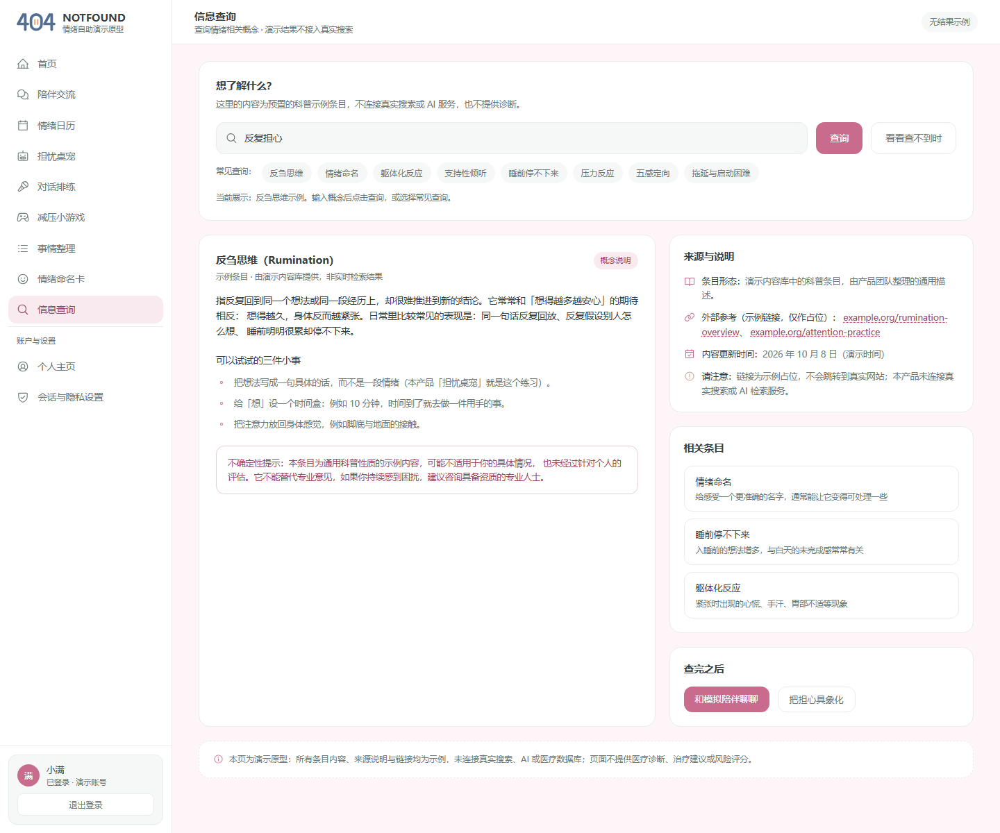
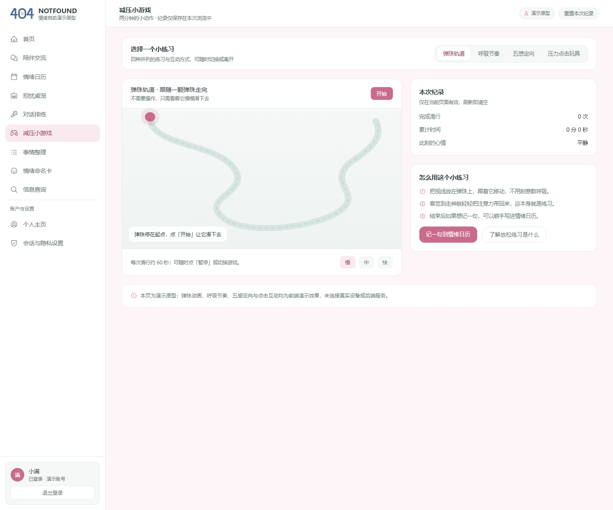

# 程杰 Day 3 交付：Web 运行截图与桌面能力记录

日期：2026-10-25
负责人：程杰（前端工程）
范围依据：Alpha 冲刺 7 天执行计划 Day 3「陪伴、命名卡、训练和查询」

## 1. Web 运行取证

### 1.1 环境与命令

| 字段 | 实际值 |
|---|---|
| 工程 | `prototype/` React/Vite 原型 |
| 提交 | `4696c2a2c49140fb8e21985dd123b48dcac8d2fb` |
| 操作系统 | Windows 10 Home China 25H2，Build 26200 |
| Node / npm | Node.js `v24.16.0` / npm `11.13.0` |
| Vite | `6.4.4` |
| 启动命令 | `npm run dev -- --host 127.0.0.1 --port 4175 --strictPort` |
| 访问地址 | `http://127.0.0.1:4175/` |
| HTTP 结果 | `/`、`/companion.html`、`/info-query.html`、`/games.html` 均为 `200` |
| 截图尺寸 | `1440 × 1200` |
| 截图文件 | `evidence/day3/web-home-20261025.png`（其余页面见下表） |

### 1.2 截图

本次截图覆盖同一个 Vite 服务提供的两个运行层次：`/` 是当前 React/Vite 首页；`companion.html`、`info-query.html` 和 `games.html` 是之前 24 页原型中的静态演示入口。它们共享本地服务和视觉原型，但不因此代表真实 API 或 Electron 已接入。

| 页面 | 截图 |
|---|---|
| React/Vite 首页 `/` |  |
| 陪伴交流 `companion.html` |  |
| 信息查询 `info-query.html` |  |
| 减压小游戏／训练入口 `games.html` |  |

截图核对结果：四个页面均正常渲染，导航和页面主体可见。首页提示“认证 API 未连接”；陪伴页提示回复由本地演示脚本生成；查询页标记示例来源；训练页标记网页内动画与本地记录。没有把登录、模型、检索或桌面能力伪装成服务成功。截图生成后已停止临时 4175 端口服务，未留下本次取证进程。

静态演示页保留原型中的 Tailwind/Iconify 外部脚本引用；本次截图环境加载成功，但尚未完成完全离线资源打包验证，不能把截图解释为离线发布验收。

### 1.3 构建与测试

| 检查 | 结果 | 证据／限制 |
|---|---|---|
| `npm test` | 通过，6/6 | `prototype/src/api/client.test.js`；覆盖 mock 不发请求、同源请求、CSRF、认证字段、身份清理和错误契约 |
| `npm run build` | 通过 | Vite production build，`1575 modules transformed` |
| Electron 源码语法检查 | 通过 | `node --check electron/main.cjs`、`preload.cjs`、`renderer.js`；不代表桌面运行通过 |
| Web 页面启动 | 通过 | React 首页和三个静态演示页均返回 HTTP 200，截图已保存 |
| 真实认证服务 | 未执行 | 当前仓库没有可启动的认证后端，页面保持 `API_NOT_CONNECTED` 边界 |
| 陪伴／查询／训练真实任务与切换取消 | 未完成 | 截图页仍运行本地静态交互；API 适配器有任务端点，但页面尚未接入授权、会话代次、任务轮询、远程取消及迟到响应丢弃。没有后端，不能做真实服务验证 |

## 2. 桌面能力记录

### 2.1 运行前置检查

项目声明的 Electron npm 包为 `45.0.0`。首次下载尝试因 Node `fetch` 失败；本次重试通过 npmmirror 获取同版本 Windows x64 ZIP，并与 Electron 包内 checksums 清单核对：

```text
文件：electron-v45.0.0-win32-x64.zip
大小：158,223,852 bytes
SHA-256：ae53887a23bb640369c93dbd38c408a2af5c0deb86f2fa76c6c244cb444b7f47
校验：与 node_modules/electron/checksums.json 中 Electron 45.0.0 win32-x64 项一致
版本检查：npx --no-install electron --version -> v45.0.0
```

首次启动随后被 Windows AppContainer ACL 拦截，错误为 `install_dir_access.cc:52`，要求 `ALL APPLICATION PACKAGES` 对 Electron 安装目录有读取/执行权限。已将只读/执行 ACE 递归应用到本项目 `prototype/node_modules/electron/`，没有改系统安全策略。重试 `npm run electron:dev` 后主进程与 renderer 启动正常。

运行日志证据：`[electron] app ready`、`[electron] createPetWindow`、`window created true { x: 663, y: 369, width: 381, height: 281 }`、`did-finish-load true`、`ready-to-show true`。窗口标题为“404NOTFOUND 桌宠样机”，renderer URL 为本地 `renderer.html`。样机目前保持运行。此次运行未单独保存桌面截图，窗口的透明外观、与其他窗口叠放效果及输入操作仍须现场交互复核。

因此本日没有窗口运行截图，不能把透明、置顶、拖动、隐藏、退出或点击穿透写成桌面实测通过。源码检查结果与桌面运行结果分开记录。

### 2.2 E01～E09 能力记录

| 编号 | 能力与检查动作 | 源码检查 | 桌面运行 | 当前处理／降级 |
|---|---|---|---|---|
| E01 | 透明无边框窗口叠放普通应用 | `frame:false`、`transparent:true`；窗口运行且可见 | 窗口可见已观察；透明区域与普通应用叠放未单测 | 未单测前不宣称透明/叠放通过；继续使用 Web 原型 |
| E02 | 置顶开关与其他窗口切换 | 创建后调用 `setAlwaysOnTop(true, 'floating')` | 置顶配置运行；与其他窗口切换效果未单测 | 未宣称覆盖系统保护界面；失败时关闭置顶并保留退出入口 |
| E03 | 拖动窗口、按钮区域不误拖 | 标题栏 `-webkit-app-region: drag`，按钮区 `no-drag` | 未执行 | 保持普通 Web 入口；运行后记录位置是否仍在可见工作区 |
| E04 | 点击穿透与恢复交互 | 仅主进程调用 `setIgnoreMouseEvents`；`Alt+Shift+P` 恢复 | 未执行 | 未开启桌面浮层；无法确认时降级 Web 画布 |
| E05 | 100%／125%／150% 缩放命中 | 样机窗口固定 380×280 | 当前 Windows 日志识别到单屏 scale=1.5；未做控件命中测试 | 仅记录当前 150% 环境，不推断其他缩放支持；补测尺寸、命中和偏移 |
| E06 | 跨屏拖动、断副屏、重新打开 | 未发现跨屏恢复实现 | 当前只检测到 1 个显示器；跨屏流程未执行 | 主屏 Web 入口可用；桌面窗口后续增加找回主屏验证 |
| E07 | Escape、显式退出、关窗、渲染崩溃清理 | 显式关闭、`before-quit`、快捷键注销和 `render-process-gone` 清理已写入；未发现 Escape 专用处理 | 未执行 | 不宣称 Escape 可用；未开放原生桌面业务，补测后确认无残留窗口、帧、音频或捕获 |
| E08 | 非白名单 IPC、导航、权限请求 | preload 只暴露 `setClickThrough/hide/close/onClickThroughChanged`；主进程拒绝导航、窗口打开和权限请求 | 未执行 | 保持不可加载远程页面；安装二进制后用异常参数复测拒绝路径 |
| E09 | 伪造 `entry=DESKTOP` 访问业务数据 | 样机不读取 Cookie、不加载业务 API；可信入口仍由服务端决定 | 未执行 | 保持 `SIMULATED/UNAVAILABLE`，不以客户端字段开启桌面业务 |

### 2.3 源码边界核对

- `contextIsolation: true`、`nodeIntegration: false`、`sandbox: true` 已写入窗口配置。
- renderer 只加载本地 `renderer.html`；CSP 的 `connect-src` 为 `'none'`，不访问远程页面。
- preload 不暴露 `require`、文件系统或通用 IPC；窗口控制由主进程校验发送方后执行。
- 点击穿透、本地隐藏和退出是独立的主进程动作；本地窗口关闭不表示业务会话或服务端任务已取消。
- Electron 的源码和 Node 语法可检查，不能替代 Windows 桌面行为实测。

## 3. Day 3 结论与后续动作

本日已交付可复核的 React/Vite Web 运行截图、测试/构建结果、Electron 下载校验、窗口成功启动日志和 E01～E09 桌面能力记录。Web 原型能运行，但真实认证、陪伴、查询、训练服务尚未联调；Electron 窗口已运行，透明效果、置顶实际效果、拖动、点击穿透、退出交互、DPI 命中和多屏行为仍未完成人工实测。

Day 3 原定的陪伴／查询任务接入及请求切换、取消、旧响应失效尚未完成；本日证据只证明页面可启动和静态交互可见，不构成该任务闭环验收。继续开发时需先接入正确的会话／授权／任务流程，再用后端服务验证本地Abort与远程取消状态的区别。

下一步由后端提供可启动服务并冻结 CSRF 与任务契约后，使用合成账号执行陪伴、查询和训练的受理、轮询、切换、取消及迟到响应用例；获得 Electron 二进制后，在 Windows 单屏／双屏和 100%／125%／150% DPI 环境逐项复测 E01～E09。前端本地 Abort 只表示停止接收，不写成服务端已取消；只有取消接口明确返回 `cancelled` 或任务 GET 返回该状态时才更新远程状态。

## 4. 证据索引

| 证据 | 路径 |
|---|---|
| Web 首页截图 | [`evidence/day3/web-home-20261025.png`](evidence/day3/web-home-20261025.png) |
| 陪伴交流截图 | [`evidence/day3/web-companion-20261025.png`](evidence/day3/web-companion-20261025.png) |
| 信息查询截图 | [`evidence/day3/web-search-20261025.png`](evidence/day3/web-search-20261025.png) |
| 训练入口截图 | [`evidence/day3/web-training-20261025.png`](evidence/day3/web-training-20261025.png) |

截图均为 `1440 × 1200` PNG；SHA-256 分别为：`web-home` `4A9F07A90746F8D636EFF5927879BB1CEEB28508AE3BAA36225F7DF3C47D76F0`、`web-companion` `4AD0B19CF947E983DB3A2CAEE545D3224DA1842A35489948AD2DB9722DE8430C`、`web-search` `7DE85A3E35DAE0821E77F024500601F2CCC11F78D4ECEB1504C0C871478BCF7F`、`web-training` `65CE4C04448E57AB70DE2019328E12BBF3D45100454111D21367CEFCC19038F0`。
| Electron 主进程 | [`prototype/electron/main.cjs`](../../prototype/electron/main.cjs) |
| Electron preload | [`prototype/electron/preload.cjs`](../../prototype/electron/preload.cjs) |
| Electron renderer | [`prototype/electron/renderer.html`](../../prototype/electron/renderer.html)、[`prototype/electron/renderer.js`](../../prototype/electron/renderer.js) |
| 前端 API 适配器 | [`prototype/src/api/client.js`](../../prototype/src/api/client.js) |
| 认证与 Electron 联调记录 | [`07_第二天认证联调记录与Electron样机_20261024.md`](07_第二天认证联调记录与Electron样机_20261024.md) |
